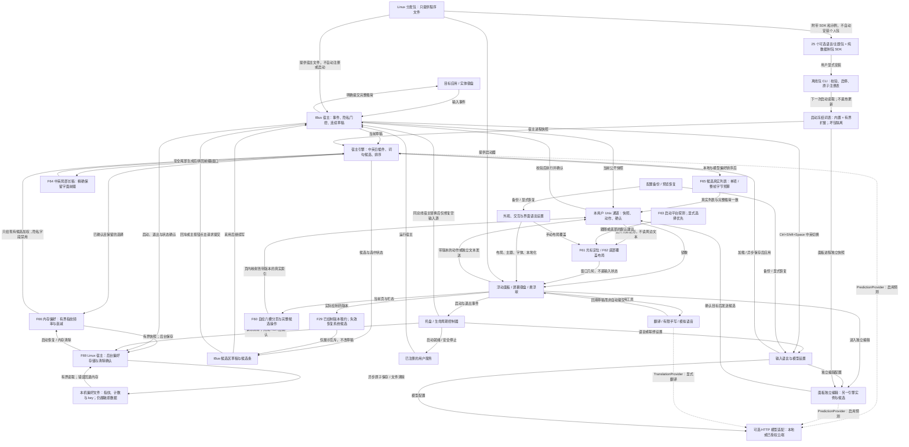
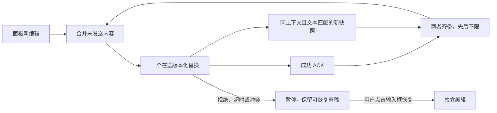

# Suzaku 功能网络与成熟度稀疏张量

**当前0.9.5/build45源码准备**：纳入厨房与床品两批，相对`d2b0a1a`/0.9.4源码增14英文词形、
28中日Word读音、30组语境和60作者句，EN6193/867/1698（55层）、ZH3410/861/1720、JA622/349/697。
纯数据增量不改运行/模型逻辑、旧rank/flags/作者源、25包SDK和配额；短根池仍可正常变化。
新版独立full实际工具0：275唯一组含Doc-tests/2623过0失败32原ignore0filter；83Python/250链接/升版保真过。
新版精确隔离UI19门另实际工具0通过，不加full总数；strict全target/allfeature Clippy-Dwarnings实际工具0/1分03秒。
准确提交CI/accepted四包仍待验，不代表已发布或个人安装更新。
旧同数2623/52.51秒/419不充当新版通过，临时toolchain别名setup零test中止记录不算产品失败或测试通过。
Ubuntu24.04 amd64/glibc2.39 Alpha prerelease非latest只在验收后发布，不改个人安装或恢复取消自动化。
133旧证据/49实现/79cells/评分语义路由不变，仅新增准备摘要；[0.9.5范围](releases/0.9.5.md)与下方历史记录分开。

**当前未提交床品增量**：在含kitchen的实际956文件脏快照后新增6内置英文词形、8中文/3日语Word读音、
12组语境、24作者句；EN6193/867/1698（55层）、ZH3410/861/1720、JA622/349/697。
有限床品取放、换洗与睡前整理表达，不是医疗/睡眠功效建议、闹钟控制或设备动作。旧rank/flags/作者源、
模型协议、运行逻辑、25包SDK、配额和0.9.4/44保持，不恢复发布自动化或提交安装。
`E-daily-bedding`只新增F16–F19四引用及EN2/ZH2/JA1五测试索引，132旧证据/49实现/79cells/评分语义和路由保留。
真实before与本批验收统一见[开发记录](../DEVELOPMENT.md#daily-bedding-and-bedtime-preparation--2026-10-23)，不借用厨房2604或旧UI/实模结果。
独立完整all-features实际工具0：275组含Doc-tests/2623过0失败32原ignore0filter，新19只计一次；
fixed419全tuple/字节同、83Python/250链接及保真通过；邻域82池每catalog有40变化，不泛称所有短根稳定。
严格全target/allfeature Clippy-Dwarnings实际exit0/52.51秒，格式/摘要终局通过；32原ignore保留，不新增UI/原生/实模/安装/性能声明。

**当前未提交厨房词库增量**：在干净`d2b0a1a`/0.9.4/44后新增8内置英文词形、12中文和5日语Word读音、
18组语境、36作者句；当前EN6187/863/1690（54层）、ZH3402/857/1712、JA619/345/689。
有限备菜协作、餐具取放与收尾表达，不是食谱、健康建议或设备动作。模型、运行逻辑、25包SDK、预算和版本不改，
也不恢复取消的发布跟进。`E-daily-kitchen`只复用F16–F19四关联及EN2/ZH2/JA1五测试索引；
131旧证据、评分、轴、cells、实现语义与运行路由保留。真实before及当前验收见
[本批开发记录](../DEVELOPMENT.md#daily-kitchen-preparation-tableware-and-clearing-up--2026-10-23)，不借用下述历史通过数。
独立完整all-features实际工具0：271组含Doc-tests/2604过0失败32原ignore0filter，新19只计一次；
不加focused46/419回放/子进程。固定419池原tuple和字节全同不代表所有短根稳定；旧九包`fur`作者候选变化如实保留。
严格全target/allfeature Clippy-Dwarnings实际exit0/50.42秒；32忽略身份不变，不新增UI/原生/实模/安装/性能声明。

**当前源码候选0.9.4/build44**：收录0.9.3后穿衣、房间、文具、阅读、植物五批，累计新增28英文词形、
82中日Word读音、90组语境、180条作者续句，以及有界日语句位/短父词保留、单源和合并目录层数边界修正。
新版本地独立完整2585过/零失败/32原ignore/267组、隔离UI19/19、严格Clippy51.90秒已过；
准确提交CI/accepted四资产仍待独立验收；[发布准备](releases/0.9.4.md)不等于已发布或安装。
原131条证据、评分、轴、实现和路由保留；下方批次的0.9.3/43与未提交状态属于各自历史快照。

## 0. 当前能力索引：架构 × 功能 × 实现 × 成熟度

2026-10-03 建立、2026-10-20 更新当前模块边界与能力索引：原来的网络图继续表示运行路由，
但不再承担“全仓库能力清单”的职责。
保留 **F01–F59**，把原来藏在段落中的分页、定位、布局、长稿、偏好等能力拆成
**F60–F68**，再以 **F69** 索引偏好文件与宿主接线。当前数据包含
**10 个架构域、69 个功能、49 个实现切片、79 条有效关联**；
每条关联有四个评分槽位，展开为 **316 条 COO 记录**。这不是 316 个独立功能。

可查询的数据源是 [functional-tensor.json](functional-tensor.json)，
[校验/切片工具](../scripts/functional-tensor.py)只读运行，不需要构建、模型或桌面权限。

### 当前未提交增量：阳台植物与日常交流

`E-daily-plants`基于含reading的实际946文件脏快照，追加8内置英文词形、12中文/5日语Word读音、
18组语境和36作者句；EN6179/857/1678（53层）、ZH3390/851/1700、JA614/339/677。
只是有限植物相关输入，不是科学种植指导、传感、自动控水或实际消息/文件操作；旧英文首现rank、
读音flags/作者数据顺序、25包SDK、模型协议、配额和运行图不变，不等于短根候选池恒定。
另有仅默认12项的日语spare末槽父词保留修复，保护旧可选基础Word；小/大limit保持原行为。
四tests-first目标含日语独立九包，真实before与本轮验收统一见
[开发记录](../DEVELOPMENT.md#daily-plants-and-balcony-dialogue--2026-10-20)，不借旧2561/50.58s或UI/实模/时延结果。
独立修后完整工具0：267唯一组含Doc-tests、2585过/零失败/32原有忽略/零筛除；新22集成+2cfg已含，
不加focused54/子进程/前失败轮。严格Clippy51.34秒、格式/83Python/250链接/摘要与保真通过，非新原生/UI/实模/安装验收。
只新增同一plants证据、F16–F20五引用与EN2/ZH2/JA2/mix1七索引；130旧证据/成熟度/结构保持。
仍0.9.3/43，未提交/安装，也不在已发布0.9.3资产中；以下历史记录保留各自范围。

### 当前未提交增量：阅读、书页与书签

`E-daily-reading`基于含stationery的实际941文件脏快照，追加4英文词形、12中文/4日语Word读音、
18组语境和36三语作者句；EN6171/851/1666（52层）、ZH3378/845/1688、JA609/333/665。
只提供有限阅读表达，不获取书籍、保存书签、追踪进度或操作文件；原英文首现rank/读音flags/作者数据顺序、
25包SDK、模型协议、配额和运行图不变，短根候选竞争不等于所有池恒定。
四新fixture的真实before记录与新oracle复核、最终验收统一见
[开发记录](../DEVELOPMENT.md#daily-reading-pages-and-bookmarks--2026-10-20)，不借旧2542/Clippy或UI/时延结论。
固定source独立完整2561过/零失败/32原有显式忽略，262组含Doc-tests、零筛除；19新项已含，不重加定向38/旧golden8。
严格全target/allfeature Clippy-Dwarnings50.58秒工具0，格式/83Python/250链接/摘要与保真检查通过；非新UI/原生/实模/时延验收。
只新增同一reading证据、F16–F19四引用和EN两条/ZH三条/JA一条测试索引（含共享回放helper）；129旧证据和成熟度保持。
仍0.9.3/43，未提交/安装，也不在已发布0.9.3资产内。以下保留先前批次的原始范围。

### 当前未提交增量：纸笔、桌面文具与书写

`E-daily-stationery`在含room数据的真实936文件脏快照上，新增8英文词形、12中文/4日语Word读音、
18组语境和36三语作者句；EN6167/845/1654（51层）、ZH3366/839/1676、JA605/327/653。
三语有限文具/书写表达不识别手写或操作笔记/文件；旧rank/flags/作者顺序、25包SDK、模型协议及配额不改。
五新fixture先冻结，真实before EN1/5、ZH2/4、JA2/4、compat4/4、packs0/2；旧包controls先检查。
英文beside仅来自optional包的错误builtin假设已留原证据，仅改同义next to并重冻/重跑相同before。
首after23过1失败为新英采用oracle误定out后空格，仅修following字段后英6项独立过、同before仍1/5；
不是生产修复，不拼作单命令24全过。419旧池实际全等，邻接31/58一致、27扩充，不预称所有旧低位Word/score保留。
`zhe ji`/`xian na`的旧Word及其拼接双句被原take4的新整词分支替换，含旧首页句；作者源数据未删除，
但不能泛称所有旧作者候选/首页项留存，也不修改算法或旧固定断言来掩盖变化。
本批专项和更广验收独立记录，不借用下方room2518、历史UI或性能结果。
固定最终五目标后的独立完整all-features工具exit0：**2542过/零失败/32原有显式忽略，258组含Doc-tests、
零筛除**；24新项已含，不把初23/1和英6、父调子进程相加。严格全target/allfeature Clippy-Dwarnings
49.91秒工具exit0、格式exit0，83Python/250源码审计链接/当前摘要校验通过，非新实机/实模/时延/安装验收。
只新增同一stationery证据、F16–F19四引用和三个语言实现的九个测试索引；128旧证据/评分/运行路由原样。
版本仍0.9.3/43，未提交/安装、不在已发布资产内；详见[本轮记录](../DEVELOPMENT.md#daily-stationery-and-writing--2026-10-20)。
下述room和更早段落保留其当时快照范围。

### 当前未提交增量：室内光线、通风与舒适度

`E-daily-room-comfort`基于含上一批dressing的真实脏快照，新增8英文词形、12中文/5日语Word读音、
18组语境和36作者句；总量EN6159/839/1642（50层）、ZH3354/833/1664、JA601/321/641。
原词表/读音flags/作者顺序及25包SDK、16cap、模型协议和6/12/256配额保持。只提供有限输入表达，
不探测或控制室内灯光、窗户、风扇和空调，不是通风建议。
五份新测试先冻结，真实before EN1/5、ZH2/4、JA2/4、compat4/4、packs0/2；
首次after23过1失败，`kankise`的換気扇第二作者index8。冻结断言和原失败保留；
独立末拨音证明修前新3集成0/3、3混排单测1/2；首完整2509过2失败/32忽略、252组保留。
广准入破坏旧乗車券第二页，且新50英文层暴露把单来源64误作合并上限的包事务失败，均不改旧断言。
最终要求stem自身双作者语境保旧ticket分页；合并仅用64+16×8=192有界校验，原单来源/包/单位/安装配额不扩。
撤回整理券positivefixture和顺序逆投影，改四项stem边界与四项pack预算；最终范围定向93过。
原始池418/419同且data-only419/419同；邻接21/38同，17实际扩充，非所有旧Word仍可达或分数不变。
最终独立完整all-features **2518过/零失败/32原有显式忽略，253顶层组含Doc-tests/零筛除**，
38新项已包含，不重计focused93/红绿/撤回positive/子进程；旧双失败、fulln7/releasetail8/两四golden过。
50inverse/872原字节/6docs/8freeze已审计；独立严格全target/allfeature Clippy-Dwarnings49.21秒通过，
格式/diff、83Python守卫、250源码审计链接和最终摘要均通过，不构成新原生/UI/实模/安装/时延验收。
复用F16–F20和实际受影响lexicon/packs既有关联，不改评分、旧127证据、门禁或运行图路由。
版本仍0.9.3/43，本批与dressing均未提交/安装，也不在已发布0.9.3四资产中。
详见[本轮记录](../DEVELOPMENT.md#daily-room-comfort-and-terminal-nasal-completion--2026-10-20)；
不能借下方旧2480、2456/UI19或性能时间宣称本轮已通过或实装。

### 前一未提交增量：穿衣、松紧与小配件

在`6edfa3e`准确源码之后，`E-daily-dressing`追加12中文/4日语Word读音、18组三语语境、
36作者句；英文新层不增加词形，原6,151首现rank不变。最新总量
EN6151/833/1630（49层）、ZH3342/827/1652、JA596/315/629。
五份新专项24/24通过；首轮私有包的日语同文Word分类预期错误已保留并仅修正为实际原文类型，
三语言fixture和兼容对照冻结字节不改。419固定原始池相同；另24邻接池21相同，
拉链/纽扣/`kutsu`扩充保留旧选项，不能说所有旧前缀池不变。
独立完整复跑2480过/零失败/32原有显式忽略，245唯一顶层组、零筛除；新24含在总数内。
首轮2479过/1失败只漏维护私有包总数3331→3343，原失败保留，旧边界/候选断言不改；
完整词尾n7、release-tail8与两套旧四golden原样通过，不借用旧2456/UI19作本轮实机验收。
严格Clippy46.05秒、83Python守卫、格式/源码摘要/250审计链接及精确保真检查通过。
复用F16–F19既有词库关联，不增运行路由、不改成熟度评分、模型协议、25包/SDK或配额。
完整范围和失败记录见[开发记录](../DEVELOPMENT.md#daily-dressing-fit-and-accessories--2026-10-20)。
仍0.9.3/43，未提交/安装；不替换0.9.3已锁定验收SHA，不构成UI/原生/实模/性能或发布验收。

**0.9.3/build43已发布基线**纳入下述五批词库、查询索引和两次日语句位修复。
最终本地全量2456过/零失败/32原有显式忽略，240唯一结果组、零筛除；另隔离UI19/19及严格Clippy过。
保留英文泛语境冲突与目录新增tuple漏同步的两次失败；新作者措辞改为if，旧断言/哈希/配额不变。
旧“未提交/未发布”记录保留当时状态；该版及四个Linux包/校验资产已在
[0.9.3 Linux Alpha预发布](https://github.com/chiharu-kiryu/Suzaku-map/releases/tag/v0.9.3)交付，
个人安装不变。[0.9.3准备说明](releases/0.9.3.md)中的本地记录不替代远端验收。

### 当前：基础洗护、纸品与日语长元音补全

`E-daily-hygiene` 追加8英文词形、8中文/6日语Word读音、36三语作者句；当前
EN6151/827/1618（48层）、ZH3330/821/1640、JA592/309/617。
原47英文层和6143首现rank、全部旧读音顺序/flags、25包/SDK和模型协议不变。
新增词库测试真实after19过1失败，发现`senganryo`第二作者在index8；不改冻结断言。
独立窄修只对唯一整词缺末长元音、严格同根延长、真实旧转换及实际本地Word/双作者句
复用首页两句/原文配额；不放宽旧root/progress规则，不改分数、Word序或模型偏好竞争。
新26已包含在本轮扩大回归**1872过/零失败/5原有显式忽略**，188唯一组：库605加187集成1267，
全零筛除；含完整词尾n7、release-tail8、旧清洁10及两套四golden，子进程/首轮不重复计数。
555文件before快照中的三raw追加、36维护路径、两实现叶子和catalog新增投影均可逆；
507其它文件原字节，旧评分/证据/路由均保持。详见[开发记录](../DEVELOPMENT.md)。
仅有限输入表达，非全仓/原生/UI/实模/安装/新性能验收；未提交，仍0.9.2/42。

### 前一轮：日语转换进度与首页双句

`E-japanese-progress-slots` 修复前一轮的实际失败：`汚れ ga` 的转换首项 `汚れが`
被计入句子配额，四个 Word 竞争后第二作者句掉到 index6。仅在完整 seed 转换可核实、
真实 Word 语境的前两条 distinct 作者句均严格延伸整个进度、且两条实际 Local/Sentence
已在池中时，让转换锚点不抵扣作者句席位。保留首项100分/类型/来源及四Word原相对序和分数。
模型句和偏好仍竞争，不硬钉本地双句；六项容量先为原文留位，防止最终救援替换第二续句。
小于六项不新增配额，0–12限制保持；不跨行、删除未知前文或扩大256窗，不改中英文旧策略。
先冻结新增5集成与3单测：修复前旧清洁9过1失败、新集成1过4失败、新单测1过2失败；
修复后首轮26过（3单测+4集成目标23），旧断言、两份四golden/语料/全部旧测试保持。
私有九包、罗马音/大小写/假名、0–12容量、逐项提交撤回、模型佐证和偏好均有新回归。
两源码可严格逆回本轮554文件快照，546其它保护文件含223旧Rust测试及全部资源/SDK/版本保持。
本轮扩大重跑 **1846过、零失败、5原有显式忽略**，183唯一组（库602+182集成目标1244），
全部无筛除；旧清洁10/10、完整日语词尾n7/7和release-tail8/8过。新8已包含，不重复加首26/子进程。
严格Clippy（47.44s）、83静态守卫、250源码链接、格式和保持审计过；非全仓、原生/UI、实模或安装验收。
复用F19/F20，不改全部旧评分/路由/25包和16上限；仍0.9.2/42，未提交推送、发布或重装。
下述性能百分比和1837/1/5失败属于前一轮历史，不代表本次规则修复已重测时延。

### 前一轮：固定词库的候选计算索引

`E-catalog-index-performance` 在四批未提交词库之后，仅把英文搭配匹配改为末段分桶、
中文作者续句按语境首字符筛选后恢复原顺序、日语 Word 书写前缀改为一次建立的精确索引。
索引来自启动时不可变的 active 词库，不保存输入文本，不改变匹配条件、同分顺序、转换、权重或候选配额。
三份 JSON、25 包/SDK、222 份旧 Rust 测试及模型/UI/版本文件保持原字节；
三语实现只替换枚举入口，旧规则与单测可严格逆回本轮实际 dirty-before 快照。
419 组完整候选（EN130/ZH107/JA91/九包JA91）优化前后原始 JSONL 逐字节相同，
新冻结四项回放先真实链接保存的 before release 库通过，不刷新旧四个 golden 或增加历史投影例外。
正式构建、同 CPU、五轮 AB/BA 交替的 warm Engine.seed 回放：
英文均值 29.648→23.720μs（约−20%，五轮改善范围4.86–39.49%，波动较大），
中文178.975→31.308μs（约−83%），日语121.715→86.772μs（约−29%），
九包日语176.886→105.967μs（约−40%）。增加固定目录索引内存与一次初始化成本，
不保证任意草稿/自定义包或最坏输入都提速，也不代表 UI、IBus、模型推理或冷启动。
扩大范围：**1837过、1失败、5原有显式忽略**，182唯一组（完整库599+181集成目标1238），
全部零筛除；完整日语词尾n七项、release-tail八项通过。唯一失败是 `汚れ ga` 的第二作者句
被之前call词库挤到index6；独立链接真实before库也复现相同九项候选，仍未修复，不称全绿。
严格Clippy（51.31s）、83静态守卫、250源码链接、格式和精确保持审计通过。
不重计focused89/before4/子进程，不作全仓、原生/UI、实模或安装验收。
复用F16–F19，69功能/49实现/79关联/316COO及全部旧评分、证据保持。
仍0.9.2/42，未提交推送、发布、安装或操作个人输入服务；不进入已发布4108bc0四资产。

### 前一批：日用品余量与补货词库

`E-daily-restock` 在未提交 route+call+storage 上追加 **24 条中日 Word 读音、36 条三语作者句**。
工作区 EN **6143/821/1606（47层）**、ZH **3322/815/1628**、JA **586/303/605**。
补余量、补充装、备用、清单和先用开封物等有限表达，不测库存或自动购买；英文基础日用品词形仍有缺口。
五新测试先冻结，实际before三语1过5缺口、1过5缺口、2过4缺口；兼容3过、九包1旧过1缺口。
首after本批23项原样通过，连同前storage23/性能4/catalog4/resources15，共69项/13组。
24采样旧完整向量原样相同；另从新库导出419原始热路向量，与真实storage-before逐行全字段相同，
尚未经过历史投影。历史性能语料、四goldens及全部旧投影不改，不追加例外。
单独的短根边界另记：yobi新增予備会使yobidash的贪心主项变予備だsh，旧呼び出し仍首页index2、
精确可提交但score91→90.5；完整yobidashi旧池保持。不把这种变化说成所有旧pool不变。
ティッシュ用既有thisshu规则，Katakana本身为canonical文字时仍可续写，其他四词不伪造Katakana别名。
本轮定向 **1027过、零失败、2原有自选模型诊断忽略**，66唯一组（库588+65集成目标439）。
主64集成无筛除，另builtin_n三项通过/四项非builtin明确筛除，不等于全仓/完整九包n/release-tail/原生/实模/安装。
严格Clippy（1m19s）、83独立Python守卫、250源码审计链接及格式/digest通过。
复用F16–F19全部评分，索引顺序、25包SDK、16cap、算法及模型协议不改。
版本仍0.9.2/42；四批未提交数据不进入已发布4108bc0安装包，也未修改个人输入法。

### 前一批：收纳与腾空间词库

`E-daily-storage` 在未提交 route+call 上追加 **24 条中日 Word 读音、36 条三语作者句**。
工作区 EN **6143/815/1594（46层）**、ZH **3304/809/1616**、JA **580/297/593**。
覆盖腾空间、箱子装不下、常用物放手边、分开放、标签和放回原位，仅是输入表达。
五份测试先冻结：实际 before 三语1过5缺口、1过5缺口、2过4缺口，兼容3过、九包1旧过1缺口。
补词后18项语言和2项九包不改通过。保留首轮一项兼容和两项性能指纹失败：
24完整采样23组原样，`shou na` 新增袋/箱，旧句位置分数各降1但旧选仍全部可达；
另419热路417组原样，`nihongo w` 两模式增加末位分けて置きます，九包模式替换旧末位ウェブページ。
首页不改，不承诺旧低位词全可达；全部新tuple硬断言后精确逆回旧hash与四golden，
原corpus、call/route投影和旧行为断言保留。本轮定向 **1004过、零失败、2原有自选模型诊断忽略**，
61唯一组（库588+60集成目标416），主59集成无筛除，另builtin_n三项通过/四项非builtin明确筛除。
严格Clippy（2m00s）、83独立Python守卫、250源码审计链接、格式及digest通过；Python3.10的AST
序列化误报保留，系统3.14原标准25/25过。非全仓/完整九包n/release-tail/原生/实模或安装验收。
复用F16–F19全部评分不改；6143英文词形顺序、25包SDK、16包限制、模型协议及算法保持。
版本仍0.9.2/42，但本批未提交，未进入已发布的4108bc0 Linux Alpha四资产，也未改变个人安装。

### 前一批：通话恢复词库

`E-daily-call` 在未提交的途中联络批次上追加 **24 条中日 Word 读音、36 条三语作者句**。
工作区 EN **6143/809/1582（45层）**、ZH **3286/803/1604**、JA **574/291/581**。
复用 F16–F19，架构、评分、25 包/SDK、16 包上限及模型协议不变；只提供画面卡住、声画不同步、
换耳机、重新加入等有限输入表达，不控制通话/设备/权限。版本仍0.9.2/42，不进入锁定4108bc0产物。
补词前三语1过5缺口、1过5缺口、2过4缺口，兼容3过，九包1旧过1新缺口。
首轮三语及兼容21项原样通过，24组旧完整采样向量全等；新包错误空格预期已留档，
只改为日语既有规范作者句并增加精确raw空格提交保护，非产品规范化修复。
更广419性能向量中415原样相同，两短前缀×两模式共4组尾选正常改变，可能挤出原低位候选；
首页文字/序保持。先断言全部新元数据再精确逆回，原corpus/四golden/旧route投影保持。
修正后完整重跑本轮定向命令：**981过、零失败、2自选实模诊断忽略、56唯一组**，库588加55集成目标393。
主54集成无筛除，词尾n另builtin_三项通过/四项其他明确筛除；本批23项与父子进程不重复加。
严格检查见本轮开发记录，不借上轮1440/旧全仓2313或UI19，不作本轮全仓/完整九包n/原生/实模/安装验收。

### 前一批：0.9.2 之后的途中联络词库

`E-daily-route` 在锁定的 `4108bc0` 之后追加 **36 条中日 Word 读音、44 条三语作者句**，
该批次 EN **6143/803/1570（44层）**、ZH **3268/797/1592**、JA **568/285/569**。
复用 F16–F19，不新增功能节点或提高评分；25 包/SDK、6143 索引顺序、16 包上限、模型接口和算法不变。
五份新测试先冻结：补词前语言各1过5缺口、1过5缺口、2过4缺口，九日语包1旧过1新缺口，兼容3过。
补词后新 **23 项原样通过**，25 组旧完整向量全等。修正下述历史对照后完整重跑本轮定向范围：
**1440过、零失败、3原有显式忽略、119唯一组**，库588/118集成目标852；不重复加23项或子进程。
主117集成无筛除，词尾n另只跑builtin_三项/四项明确筛除；非全仓、完整九包n、release-tail、
原生桌面/真实模型或安装验收。严格Clippy及静态守卫以本轮开发记录为准。
旧“快到了／走错路了／会合时间”等早已有覆盖；此次是有限的途中进度、错出口与绕行表达，
不提供 GPS、真实导航或自动发信。完整旧资源可逐字逆回，14 数量维护及2历史投影路径保留原断言。
扩大回归的旧性能样本仅 builtin/九包 `nihongo wo be` 新增“日本語を別ルート”，两旧句依现有公式各降0.5，
第二句和原文后移一格；没有丢项，首页文字/顺序不变，其余417/419向量不变。先断言完整新十项再严格逆回
这一词/两分，仍比较原四golden；不刷新指纹或泛称旧池全不变，首轮两项失败保留。
本批未提交/未发布，不进入原0.9.2验收提交/安装资产，不动个人输入服务；以下版本收口记录是历史证据。

### 历史：0.9.2 源码候选收口

三批日常词库与下述英/日热路径工作纳入 **0.9.2 / build 42**，相对 0.9.1 新增
100 条中日 Word 读音与 122 条三语作者句，英文 6143 索引与顺序不变。
版本同步不改变架构路由或成熟度评分；25 包与 SDK 不改。下列“不提交/未发布/仍0.9.1”
均保留对应开发阶段的历史状态。新版本完整本地结果另记开发记录，不能借定向结果、
旧 CI 或已发布 0.9.1 产物代替本次准确提交的远端八门禁与包验收。实际安装不变。
2026-10-18 本版本完整本地收口：**2313过、零失败、32显式忽略、213唯一结果组、零筛除**；
完整日语词尾n七项及release-tail八项均过。另行私有UI **19/19**、严格Clippy **43.48秒**、
格式及数据/发布守卫通过。子进程不重复计数，不借此前1417或0.9.1的2237，
也不将私有UI当作用户实体键盘、实模、完整平台或已发布包验收；评分与所有旧证据不变。

### 历史：已测量的候选热路径优化

`E-input-hotpath-performance` 在三批词库之后，仅优化英文作者句构造和日语精确 Word 成员判断，
复用F16/F17/F19；不改变转换、排序、权重、候选预算、模型协议或成熟度。
英文第六个唯一句子后停止构造，词尾/规范前缀同次复用，原语境枚举仍在；日语只对启动时不可变
active词库的Word文字/读音/片假名建立精确集合，不用集合遍历生成候选、不缓存用户输入。
中文单次decode offset memo试验仅约2%均值/1%p95收益且增临时内存，已精确撤回至本轮旧字节。
最终正式构建五次交替回放摘要中位：英文均值32.780→21.710μs（−33.77%），日语223.810→102.815μs
（−54.06%），九包日语326.877→138.413μs（−57.66%）。中文控制151.248→156.844μs，p95约+4.84%，
如实保留这次略慢观测，不将源码相同当成性能相等证明或中文加速。该计时只覆盖warm合成草稿的本地候选计算。
419组实际旧完整候选（EN130/ZH107/JA91/九包JA91）JSONL逐字节相同；冻结4项测试先真实链接保存的
优化前release库通过。保留5项新确定性oracle/构造次数/类型边界单测，旧词库和201份旧Rust测试不改。
最终114个唯一结果组 **1417过、零失败、3原有忽略**：113集成目标829项及完整库588项（59.72秒）。
主112集成无过滤，词尾n另只跑builtin_三项，四项其它情况明确筛除，不称完整九包n或release_japanese_tail复验。
忽略为库中两项自选实模诊断及购物英包一个由父调用的子进程入口；新4对照与5单测已包含，
不重复加优化前4项、试验88项或子进程。严格Clippy43.51秒、格式/旧字节保持及数据文档守卫通过；
精确范围见[开发记录](../DEVELOPMENT.md)，不借此前1408项代替本轮结果。
不作GUI、IBus/native、实模、冷启动、实体键盘或安装发布验收声明；版本/build仍0.9.1/41，
69功能/49实现/79关联及所有评分保持，不提交推送或操作个人输入法。

### 此前：售后沟通词库

最新 `E-daily-aftercare` 基于下述两批未提交词库，追加 **28 条中日 Word 读音、34 条三语作者句**：
EN **6143/795/1554（43层）**，ZH **3244/789/1576**，JA **556/279/557**。
补齐独立“包装”和 `henkin` →“返金”整词；已有退货、退款、换货和收据不是本轮首次支持。
主题是包装、凭证、缺件、照片和寄回材料，只提供有限输入表达，不查询商家政策或执行交易。
五份新测试先冻结；真实补词前三语分别1过5缺口、1过5缺口、2过4缺口，九JA包1旧控制过1新缺口，
独立兼容3过。追加后 **23项原样通过**；18个旧完整向量全等，旧退换作者、主词和原文提交仍可达。
首轮18目标 **97过、零失败**，包含前两批测试，不重复累计。最终113唯一结果组
**1408过、零失败、3原有显式忽略**：112集成目标825项及完整库583项（58.18秒）。
主命令111集成无过滤，另跑词尾n的builtin_三项，四项其他情况明确筛除，不作完整九包n矩阵或
release_japanese_tail本轮通过声明。忽略为库中两项自选实模诊断及购物英包一项子进程专用入口；
后者由父测试实际调用，不重复加子进程或首次97项。严格Clippy42.67秒、格式、旧字节保持与
数据/文档守卫通过；精确范围见[开发记录](../DEVELOPMENT.md)，不借旧1348/1729/2237。
本轮三资源可逆恢复含前两批的真实dirty快照；旧9测试和新5冻结、25包/SDK、英文6143索引顺序保持。
只维护当前数量及新一层历史字节投影；转换、权重、模型协议、6格/12项/4句/256字和16包限额不变。
复用F16–F19，69功能/79关联及成熟度评分不变。版本/build仍0.9.1/41；不提交推送、发布、安装，
不接触个人输入服务，也不把engine/私有store测试当作真实键盘、模型或平台原生验收。

### 此前：预约到店词库

当前为已发布 **0.9.1** 的 `da7dc6d0f2a265c37b365e994b58cf9183182a84` 之后的未提交消息沟通与预约到店扩充，
版本/build 仍 **0.9.1/41**。最新 `E-daily-appointments` 继续复用 F16–F19，不新增节点或提高成熟度。
在真实消息工作区基线上再加中文24、日语12条 Word 读音和三语44条作者句；当前 EN **6143/789/1542**、
ZH **3226/783/1564**、JA **546/274/547**。英文6143索引顺序、25包/SDK、16限额和所有算法/协议/数量上限不变。
`qu hao` 的旧“去好”主项由显式整词“取号”补齐；“预约／营业时间／排队等候”和部分长串Sentence拼接本来已有，
不冒称首次支持这些文字，也不把固定句子当作实时服务或预约能力。
五份测试先冻结：语言补词前分别1过5缺口、1过5缺口、2过4缺口，九JA包1旧控制过1新缺口，独立兼容3过；
追加后新23项不改通过。17真实旧完整向量全等，旧预约作者对句首页及维修对句两页可选；新九包候选只保证12槽内可达。
首次13目标74过，含原消息四目标，不额外累计进最终范围。最终103唯一结果组 **1348过/零失败/2原诊断忽略**：
102集成目标765项及完整库583项。词尾n单独只跑builtin_三项，四项其他情况明确筛除，不作当前九包矩阵通过声明。
严格Clippy48.45秒、格式与精确旧字节保持及数据/文档守卫通过；不复用上一轮1729或0.9.1全量数字，
也不把engine/私有store测试当作真实键盘、模型、本轮安装或远端交付验收。
原始快照含未提交消息词库，剥本批后交给未改历史hash链；新五测试及旧消息四测试都保留冻结字节，旧断言只维护当前计数。
版本、个人配置、输入服务、发布资产不改；具体数据与结果见[开发记录](../DEVELOPMENT.md)。

### 此前：消息沟通词库

`E-daily-messaging` 增加中文24、日语12条 Word 读音和三语44条作者句；该批 EN **6143/781/1526**、
ZH **3202/775/1548**、JA **534/268/535**。英文索引顺序、25包/SDK、16包限额及模型协议不变。
三份语言专项先冻结，补词前 EN/ZH 各1过5缺口、JA 2过4缺口，追加后18项原样通过。
39组旧完整向量有一处预期富集：`renraku` 新增“連絡漏れ”于第7位，旧首屏文本/顺序保留；
旧混排下标公式使四条句子权重各减0.5。新兼容测试逐项精确校验这个增量及权重变化后逆回原hash，
不刷新旧金值、不删有用词掩盖差异；其余38组完整向量不变，原冻结与两次差异失败留档。
三语旧资源原字节、所有旧行为断言及历史hash保留；算法、6格/12项/4句/256字上限不改。
本轮定向结果见[开发记录](../DEVELOPMENT.md)，不借下列旧全量结果充作当前全仓、实装或物理键盘验收。
0.9.1 的准确 CI `38757706232` 八门禁及四资产已单独验收并发布 Linux Alpha prerelease；自动跟进已暂停。
本轮不修改已发布资产，不提交推送、升级个人安装或操作输入法服务。
最终按目标去重的相关 Rust 验收为 **1,729 通过、零剩余失败、5 原有显式忽略**，共156结果组：
155集成目标1,146项及完整库583项。154目标首轮保留旧私有包计数失败，同步数量后只复跑该目标，
另验15项资源检查；未重复累计子进程或专项重跑，不称整条首轮命令全绿。
严格 Clippy（41.75秒）、格式、逆字节保持、双解释器张量/词库分区/分发/文档链接守卫通过；
非全仓、真实键盘/模型或本轮远端交付验收，全部评分不变。
此前纳入日用词库、基础读音及续句来源修复；下文未提交/未发布时态和分轮结果保留当时的历史范围。
新版本全量结果另见[开发记录](../DEVELOPMENT.md#091-source-candidate--2026-10-15)，不以历史定向结果或父提交 CI 代替。
版本全量首轮发现学习包 `きょうかし` 的第二条“教科書”续句掉至后页；保留失败与所有旧断言。
补充有界日语来源判断：原首个补全为唯一整读音 Word，且纠正而非延长原贪心首词，
只有自己的两条作者句已在池中时共享额外句位。旧 `kyouyu`、`ほぞんさ` 后页与模型权重竞争不变；
不扩大搜索、4句/6格/12项或256字窗口。五组相关41项过不替代随后整轮验收，不提高评分。
0.9.1 最终本地整轮：198 个结果组、2,237 过/零失败/32 显式忽略，严格 Clippy 与19项私有UI门禁过；
原首轮失败保留、定向重复不累计，远端原生/包与安装验收仍独立，日常安装不动。
此前 `E-chinese-compound-sources` 继续修 F18 复合分支的作者来源，不新增内置词库。
私有“那”包让 `na guo lai` 的已显示旧 Word 丢两句；新增私有 finished_count 记录真实完成边界，
仅在主项为词典 Word 时，补回旧五来源窗外、严格扩展先前真实已完成 Sentence 的可见 Prefix Word。
句子类型的 Prefix 不能当已完成证据；不借主词或子串，不增加路径，原混排后稳定追加去重。
旧搜索/顺序/beam/12槽/模型协议保持，来源可用性有界增加。该例原 5 词/6 句/原文均可选，
新增同音后不承诺旧分数/所有页位不变；也不保证满池新“那…”分支都显示。
六项最终冻结：修复前 4 过/2 来源缺口，修复后原样 6 过，三项元数据/边界单测通过。
初次新测试比较类型错误及长全拼 `na ben shu gei ni` 的满池裁剪失败保留；后者未解决，
最终缩小直接复合承诺，另测显式选“那／那本书”后继续写，不把两工作流混作同一修复。
旧 13/30 全向量、资源和旧 fixture 不改；内置“那／里”、实装、实体输入/实模、远端验收均未新增。
最终 63 个结果组、1,052 通过/零失败/2 原有诊断忽略：61 组集成 468 项、完整库 583 项，
再单独执行复核后新增的 1 项复合边界测试（21 输入，原文提交与不误借句子，不外推所有转换候选）。
严格 Clippy、格式、字节保持、数据/文档守卫通过，专项重复不再累计，不作全仓或交付声明。
此前 `E-chinese-prefix-sources` 修正 F18 裸完整单读音、多同音词下的续句来源缺失。
只补原四个 Prefix 中确实已显示、但掉到旧五来源窗口后的 Word 整词语境，末尾稳定追加去重；
不取第五额外词或任意后续路径，不改 decoder/normalizer/mixer、权重、最终数量或模型协议。
`ta/hao/you` 恢复“太好了／好久不见／优先级”已有对句，旧主词/词序/分数保持，句子首屏有意变化。
七项冻结测试修复前 3 过 4 缺口、修复后原样 7 过，13 组新对照和此前 30 组旧全向量受保护；
三项来源边界单测通过，初次新断言混淆 raw mixed 与引擎去重输出的失败与纠正另有记录。
隔离词包模拟“那”验证旧闹钟对句不丢；内置“那”复合输入及“里”分段仍待后续，未新增内置数据。
三语数量、25 包/SDK、旧 fixture、版本/安装不变；仅源码引擎验收，不提高评分或借用历史实装/CI结果。
本轮相关 60 组集成 462 项与完整库 580 项通过，合计 1,042 过/零败/2 原有诊断忽略；
首次严格检查只指出新测试复杂类型，保留记录，仅提取声明别名，不改断言或生产实现。
声明整理后同七项再过，严格 Clippy、格式、字节保持及数据/文档校验通过，不重复计数。
此前 `E-chinese-reference-chars` 仅为 F18 追加 `zhe→这 / ben→本`，
该这/本批次基线为 3,178 读音 / 767 语境 / 1,532 作者句；无新语境或模板句，不改算法、预算或协议。
组合“这本书／我拿这本书／这本书给你”，保持已有整词、30 组真实旧向量及闹钟/本地模型续句。
原里/这方案八过一败：`lian` 被拆成里安；那有旧续句来源风险，均暂缓。
全局分段保护会影响其他旧歧义，未合入；保留失败证据、原算法和旧快照，不冒称已修复。
最终这/本新九项先冻结，补词前两过七缺口，追加后九项原样通过；原始投影/配额保持。
该这/本批次最终 60 个结果分组、1,032 项通过、零失败、两项原有自选诊断忽略：
59 组相关集成 455 项及完整库 577 项，严格 Clippy 和数据/文档守卫通过；早期失败方案不计验收。
范围见开发记录，不提高评分，也不外推实装、物理键盘/实模或远端验收。
此前 `E-chinese-arrival-chars` 仅为 F18 追加 `dao→到 / jia→家`，
该到/家批次基线为 3,176 读音 / 767 语境 / 1,532 作者句；无新语境或模板句，不改算法、预算或协议。
组合“找到／我找到书了／拿到书／我的家”，而“到家／回家”等整词和“找到了”等既有组合
仅为兼容控制；没有独立读音的“里／这里”仍不承诺自由拼接。十六组真实旧全向量受保护。
九项新测试先冻结：补词前两项兼容通过/七项缺口失败，追加后九项原样通过。
精确剥离两行恢复原始资源 SHA，旧断言/投影/配额保留，仅维护四旧字测试的当前总数。
该到/家批次 59 个结果分组、1,023 项通过、零失败、两项原有自选模型诊断忽略：
58 组相关集成 446 项及完整库单元 577 项，严格 Clippy 和数据/文档守卫通过；不借用旧结果，也不声称全仓验收。
范围见开发记录，不提升评分，不冒充实装、物理键盘/实模或远端验收。
此前 `E-chinese-result-chars` 仅为 F18 追加 `guo→过 / wan→完 / hui→回 / zhao→找`，
该结果字批次基线为 3,174 读音 / 767 语境 / 1,532 作者句；不增加语境、模板句或更改算法。
已知字词可拼接“用完／我回去／我找书／我用过”；`guo` 和混合输入保留原“国”分支优先，
完整词/同音、十二组旧全向量与宽泛候选受保护，25 包/SDK 和旧行为断言保留。
新测试误判中间空格为整词的失败、恢复旧数据采样纠正与重新冻结/补词前红测均记录，
最终九项专项通过；不是依靠修改产品算法或旧断言过测。范围见开发记录，不提高评分。
该结果字批次 58 个结果分组、1,014 项通过、零失败、两项原有自选模型诊断忽略：
57 组相关集成 437 项及完整库单元 577 项，严格 Clippy 和数据/文档守卫通过；不代替全仓、实装或提交验收。
此前 `E-chinese-action-chars` 仅为 F18 追加 `na→拿 / fang→放 / dai→带 / yong→用`，
不加语境或模板句；已知读音可组合“我拿书／我放书／我带书／我用书”及采用续写。
完整同音词、短前缀和先前分页快照受保护；保留旧“我防水”和宽泛候选，既有混排实现不变。
专项预期先冻结，补词前两项兼容通过/七项缺口失败，追加后九项不改通过。
精确剥离新增窗恢复上一批原始 SHA，25 包/SDK 和所有旧行为断言保留，仅维护当前总数。
该动作批次 57 个结果分组、1,005 项通过、零失败、两项原有自选模型诊断忽略：
56 组相关集成 428 项及完整库单元 577 项，严格 Clippy 与数据/文档守卫通过。
范围见开发记录，不借用旧批次计数，不提高成熟度，也不代替全仓、实装或远端验收。
此前 `E-chinese-giving-chars` 为 F18 增加 `gei→给`、`shu→书`，不加语境或模板句。
支持已知读音的“给我书／我给你书”和采用后续写，保留“输入法／数据／结束”等整词、
更短前缀与旧 `hai/jie/huan` 快照；暂缓会使“还个”挤占“换个说法”的 `ge→个`。
专项预期的额外候选来源误标已按真实旧数据/源码纠正并重新红测；保留原失败记录，
新测试重冻结后九项通过，具体范围见开发记录，不外推全仓、实键盘/实模或远端验收。
扩大回归发现“还没睡”第二续句被新拼接首项挤出首页；修正只按原解码来源保护紧邻、仅末字不同完整词的
作者句建议位置，并由离线、模型合并和偏好重排复用，不改权重/容量或旧多歧义词分页。
该条件分页修正同时关联 F20，不新增节点或提升成熟度评分。
给书批次最终 56 个结果分组、996 项通过、零失败、两项原有自选模型诊断忽略：
55 组受影响集成 419 项及完整库单元 577 项，严格 Clippy 和数据/文档守卫通过；
134-target 中断诊断不计通过范围，也不代替全仓、原生界面、实键盘/实模或远端验收。
此前 `E-chinese-lending-chars` 仅为 F18 增加 `jie→借`、`huan→还`，不加语境或模板句。
保留 `hai` 别名、完整复合词/同音顺序及更短前缀的真实候选快照；裸完整读音的新单字优先
是有意的数据效果，沿用原算法和预算。不是完整单字库或声调消歧，不增加功能节点或评分。
该基础读音批次 55 个结果分组、484 项定向回归通过、零失败/忽略，严格 Clippy 与
数据/文档守卫通过；具体范围见开发记录，不代表全仓、实键盘/实模或远端 CI 验收。
此前 `E-daily-borrowing` 在物品寻找批次之后再补 36 条中日读音与 44 条三语句子，
保留所有旧数据字节、算法、模型协议和容量；只同步当前总数与增量测试，不增加架构节点或评分。
该借还批次 65 个结果分组、524 项定向回归通过、零失败/忽略，严格 Clippy 与数据/文档守卫通过；
不复用上一轮通过数，不声称全仓、原生桌面或远端提交验收。
`E-daily-belongings` 新增 36 条中日读音、44 条三语句子及对应输入回归，
保留旧资源原始字节、25 包/SDK、算法与容量；仍是模型不可用时的有限日用 fallback。
物品寻找批次定向回归 136 个结果分组、1,055 项通过、零失败、三项原有子进程入口忽略，
严格 Clippy 与数据/文档守卫通过；不提升评分，也不代替全仓、原生桌面或提交 CI 验收。
文件/照片分享扩充 `E-daily-sharing` 已纳入该父提交，补三语词句与输入回归，并在作者查询/去重后
稳定移后额外中文长词以保护旧短词首屏；解码器、外层公式和容量不变。
原提交 CI `38385254322` 的原生 core 会话触及 120 秒限制、聚合门禁拒绝验收，失败记录保留。
同在父提交中的 `E-native-core-sessions` 将完整原生门禁拆成生命周期、完整输入链、恢复、HTTP 回退四个
私有会话，各保留原 120 秒和全部断言；本机普通/行内两种完整门禁通过，不代替新提交远端验收。
自动发布仍暂停，未把当前修复和新增词库混入旧提交的安装包。
下述架构整理和此前词库批次已经编入该 0.9.0 源码基线：
架构整理只调整离线包内部职责、模型适配器目录归属与说明；其后的日常数码及日语来访、
办事、天气、出门准备及清洁扩充另见 `E-daily-devices`、`E-japanese-errands`、
`E-japanese-weather`、`E-japanese-cleaning` 与
[词库记录](../data/lexicons/README.md)。天气扩充同时修正未完成日语音节的后页空位排序，
保留原主候选与句子/原文；模型协议、候选容量和功能评分不变。
清洁扩充另修正同一读音分支内末尾音节补完短词时的句子优先级，不跨越无关分支或同音词，
保留词候选顺序与长词续句可达性。
版本号和源指纹不代表已经通过精确提交的 CI 或交付了安装包；
原 `d4196c7` 的词库会话超时、最终汇合拒绝及后续六分区本地验证仍是各自独立的历史证据。
数据中的源文件摘要覆盖列出的实现和测试文件，不声称覆盖仓库全部文件。
下文的旧基线、测试总数、安装和发布说明均保留其原来的历史范围。

### 四个轴如何读

`T[a, f, i, m] = 0..4 | null`：架构 `a`、功能 `f`、具体实现 `i`、成熟度维度 `m`。
JSON 使用按 `(a,f,i)` 分组的坐标格式，`m=[I,T,V,O]`；`--coo` 展开成四维坐标。
实现携带平台/语言范围、源码路径和测试入口，关联携带证据与能力边界。
同一功能可以横跨宿主、IPC 和面板；不能拿共享算法的一格替代另一平台的原生验收。

| 维度 | 0 → 4 的评分依据 | 本轮怎么使用 |
| --- | --- | --- |
| I 实现闭环 | 未实现 → 接口/模拟 → 部分真实实现 → 声明范围内闭环 → 完整契约独立验收 | Linux 核心多为 3；有限手写/日文/翻译为 2；Linux ASR、Windows TSF 为 1 |
| T 自动化回归 | 确认无覆盖 → 编译/单元入口 → 定向集成入口 → 有专项历史执行记录 → 精确快照完整重验 | 测试文件存在最多支持入口级分数；3 必须挂运行记录，不从总测试数推断所有链都通过 |
| V 真实环境验收 | 关键失败 → 部分验证 → 有限矩阵通过 → 完整支持矩阵 → 长期/重复验收 | 当前 dirty 快照未重新真人/设备验收，全部为 `null`；旧 GNOME 安装记录仍保留，未自动继承 |
| O 交付准备度 | 无交付路径 → 说明存在 → 维护/打包/验收流程 → 精确版本已交付 → 升级回退重复验收 | Linux 多为 2，跨平台实验为 1；不是当前工作区已装机、已发包或远端 CI 已绿 |

这是**有依据的人工序数评估，不是概率或百分比**。不取平均、不用 I/T 高分抵消 V/O 缺口。
不存在的坐标表示未枚举/不适用关联，不能补 0；存在坐标中的 `null` 表示未确认，
也不能当作失败 0 分。`parents` 只表示功能拆分关系，不是调用顺序或完整运行依赖图。
评级的证据类型、适用范围和日期都在 JSON 中；没有证据时应降级或保留未知。

### 当前 Rust 模块与职责

这是单个 Rust crate 的模块边界，不是已经拆成独立库或插件进程的承诺。
入口见 [lib.rs](../src/lib.rs)；早期 Signal/Control 等设计笔记见
[概念地图](../src/00-Map.md)，它们不与源码目录一一对应。

| 模块 | 当前拥有的责任 | 依赖与边界 |
| --- | --- | --- |
| [ime](../src/ime.rs) | 组合状态、候选混排、选择、采用/提交上下文、预测 worker 与偏好接线 | 组合语言插件、预测协议和频率缓存；不以一次候选生成代替系统提交 |
| [languages](../src/languages/mod.rs) | EN/ZH/JA 解码、词句补全、局部长稿策略 | 使用共享引擎类型和冻结词库；保留旧模型路径、旧联想接口与翻译任务接口，不再拥有 HTTP 模型适配器实现 |
| [lexicon](../src/lexicon.rs) / [packs](../src/lexicon/packs.rs) | 有序词库数据契约、可选包管理与启动快照 | 解码规则仍在 languages；不加载执行代码，不在按键热路径读取词包文件 |
| [prediction](../src/prediction/mod.rs) | 版本化输入预测请求/响应、取消与预算契约 | `PredictionProvider` 返回完整草稿替换，不是提交命令；内部 prompt/policy 仍有语言策略依赖 |
| [model](../src/model.rs) | 本地/云部署配置、发现、HTTP 封装及具体提供器 | 核心直接使用预测协议类型，旧接口/英文工厂隔离在私有 legacy；仍经 prompt/policy 依赖语言策略，翻译接口仍属 languages |
| [languages/translation](../src/languages/translation.rs) | 显式翻译请求、独立 worker 与结果校验 | 使用 `TranslationProvider`，不是输入预测协议；HTTP 提供器可实现两种接口 |
| [ime_host](../src/ime_host.rs) | 宿主会话、共享 FFI 状态、设置/provider 装配、Linux 偏好生命周期 | Linux 启动入口先读包快照与偏好，再运行 IBus；其他宿主不因此获得相同持久化验收 |
| [platform](../src/platform/mod.rs) / [Linux 桥](../src/linux/ibus_engine_bridge.c) | 系统输入、用途/隐私分流、IPC、窗口、语音与生命周期适配 | 目标平台决定桥接实现；不是全部可独立替换的纯接口层 |
| [panel](../src/bin/panel.rs) / [GPU 场景](../src/ime/gpu/mod.rs) / [panel_support](../src/panel_support.rs) | 原生镜像、独立编辑、交互、工具、呈现与设置协调 | 面板独立引擎和原生宿主引擎是不同状态所有者；界面文字由 [ui](../src/ui.rs) 本地化 |
| [preferences](../src/preferences.rs) / [data](../src/data.rs) | 频率缓存、持久化格式/worker，以及配置备份恢复和安全文件原语 | 偏好文件、个人包和配置备份是不同数据集合；不能将 data 视为无业务依赖的通用底层库 |

模型适配器的规范入口是 `suzaku_map::model`，实现位于 `src/model.rs` 与 `src/model/`。
原 `languages::model` 通过公开转导出保留兼容，`languages::llm` 与 `languages::llama`
也仍保留；不是并行运行第二套适配器。输入预测协议仍由 `prediction` 拥有，翻译任务接口
仍由 `languages::translation` 拥有，`model/translation.rs` 只是其 HTTP 实现。
旧 `LlmCompletionProvider` 实现和两个英文插件工厂集中于私有
[model/legacy.rs](../src/model/legacy.rs)，工厂继续公开转导出；兼容测试仍使用旧接口。
模型核心、发现与传输直接使用 `PredictionError` / `PredictionCancellation`；翻译适配
将共享传输的 `PredictionError` 映射为翻译错误。原 `LlmProviderError` / `LlmCancellation`
是这两个协议类型的别名，
这次分层不新增模型能力，也不改变请求格式、错误检查顺序、发现/取消预算或候选策略。
旧桥仍有旧联想接口/英文依赖，prompt/policy 仍有实际语言策略，不能据此宣称完全解耦。

离线包公开入口继续是 `suzaku_map::lexicon::packs`。本轮仅把原有实现分到四个私有模块，
公开类型、常量、方法和调用路径保持兼容；`recommended()` 与有序推荐清单仍留在入口，
不是新建一套包 API 或新的注册表格式。

| 私有模块 | 所有权 | 不承担 |
| --- | --- | --- |
| [format](../src/lexicon/packs/format.rs) | Manifest、OfflinePack、声明统计、格式/语言字段校验与单包预算 | 文件/环境读取、候选生成、个人注册表修改 |
| [catalog](../src/lexicon/packs/catalog.rs) | 内置与启用扩展的合并、冲突/预算检查、逐包错误报告 | 安装事务、进程全局冻结时机 |
| [store](../src/lexicon/packs/store.rs) | 有界文件读取（含 `OfflinePack::read`）、注册表读写、锁、显式安装/启停/替换/移除、原子持久化 | 自动下载、自动淘汰或更改运行中的快照 |
| [runtime](../src/lexicon/packs/runtime.rs) | 进程内 OnceLock 快照及启动初始化入口 | 热更新、跨进程共享可变词表 |

当前可选目录为 **25 包（EN 8 / ZH 8 / JA 9）**；最多安装 **16 包**，禁用仍占名额。
浏览目录不安装或启用；明确安装一个新包时按原规则启用。宿主和面板在各自启动时读取，
需要分别正常重启才加载变更。现有 GTK/native 包专项仍是历史十四包，不因目录增长而扩展验收。

### 草稿、候选与提交的所有权

- **原文（Literal）**是可选的完整输入载荷，不是错误或模型输出；语言转换、候选混排与预算共同决定列表，不能由 UI 标签重建提交文本。
- **本地候选**先同步生成；“fallback”指模型不可用时仍可使用，不是等网络失败后才读取词库。模型结果只能经请求关联、取消、文本保护和排序校验后补充候选。
- **原生草稿**由 IBus 宿主维护，面板只镜像并发送带上下文/版本的动作；**独立草稿**由面板自己的引擎和采用历史维护。显示租约仅协调候选呈现，不转移草稿所有权。
- **采用不等于提交**：数字选词和 Space 继续编辑，明确 Enter/候选点击才请求提交。宿主或目标平台输出桥发送完整载荷，不能把按钮点击、排队发送或模型返回视为目标应用已经保存正文。
- **预测与翻译分开**：输入预测走 `PredictionProvider`；显式翻译走 `TranslationProvider`，先回填工具/草稿。共享 HTTP 部署配置不意味着共享任务协议或自动提交权限。
- **偏好持久化**由 Linux 宿主协调内存缓存与后台文件 worker；托盘/CLI 请求清除，确认完成才报告成功。含 key 的指纹文件仍敏感，不是个人词库、匿名数据或配置备份内容。

### 构建边界与后续整理

[Cargo features](../Cargo.toml) 当前为 `default = []`、`linux-ibus → gpu`；
[build.rs](../build.rs) 还按平台编译原生桥。空默认 feature 不代表已经支持独立 headless 构建：
多个 platform/voice/呈现模块仍直接或间接依赖 GPU 类型、winit 与平台库。
当前验证入口继续按 [贡献说明](../CONTRIBUTING.md) 使用 `--all-features`。
模型适配器目录归属与私有旧桥已整理，历史路径继续兼容；旧桥、翻译接口及
prompt/policy 的语言依赖未消除，仍不是独立 crate 或无语言依赖的纯协议层。
引擎中的呈现帮助代码、feature 拆分及独立 crate 仍是后续候选工作，
不属于本轮模块整理；本轮不改平台 ABI、设置格式、候选顺序或持久化所有权。

### 架构切片

| 架构 | 主要责任 | 重点功能 |
| --- | --- | --- |
| A01 Linux 原生输入与宿主 | 事件、用途分流、草稿生命周期、精确提交、控制确认、偏好持久化接线 | F08–F15、F42、F69 |
| A02 引擎、状态与候选策略 | 组合状态、词句混排、预算、偏好及文件契约、快捷键 | F20–F21、F27、F65–F66、F68–F69 |
| A03 语言与离线词库 | EN/ZH/JA、长稿窗口、资源契约、扩展包和 SDK | F15–F19、F57–F59、F64、F67 |
| A04 模型与异步任务 | 配置/授权、发现、取消、生成校验、翻译与回退 | F22–F28、F34 |
| A05 IPC 与伴随一致性 | 快照/动作/ACK、目标与版本、显示租约 | F14、F29–F30、F65 |
| A06 面板交互与工具 | 独立编辑、手写、模拟语音、工具回填 | F31–F35 |
| A07 呈现、窗口与本地化 | 窗口、主题、字体、设置、分页、定位、底部模式 | F05、F13、F36–F41、F60–F62 |
| A08 配置、数据与持久化 | 异步保存、路径、白名单备份/恢复和锁 | F42–F49 |
| A09 生命周期、运维与交付 | 单实例、激活/释放、安全退出、诊断、Linux 包/CI | F01–F04、F06–F07、F50–F53 |
| A10 跨平台适配 | IMK、TSF 预留、Android IME、自动布局策略 | F54–F56、F63 |

架构和功能不是一对一：例如 **F13 精确提交**同时关联 A01 宿主和 A07 候选卡操作；
**F29** 同时关联公开快照同步与显示租约；**F65** 同时关联真实列表裁剪和 IPC 载荷一致性。
这些交汇点适合作为后续审计入口；编号拆分本身不代表发现了新缺陷。

### 下一轮优先补的证据

1. **当前快照实际交付与使用**：精确构建/重装后，再验中英输入、分页、长候选单击、底部/自动布局、重启与退出；旧安装记录不替代。
2. **位置与触控兼容**：多屏/DPI/桌面工作区、原生 Wayland、物理触屏；底部布局是覆盖窗口，不是系统保留键盘区域。语义等待的收缩/回弹触发已修；后续 X11 移窗/缩放旧坐标单独红测及同事件坐标补丁见开发记录，不替代这些设备/会话验收。
3. **模型能力质量**：默认期限内的本机 LLaMA 成功率、独立中英语料和译文语义。离线回退成功与生成质量分开。
4. **已知实验能力**：真实 Linux ASR、日文形态分析、Windows TSF、Android 真机与 macOS IMK 原生验收；不能由 UI 或共享库测试“带过”。

### 查询与维护

```bash
python3 scripts/functional-tensor.py --check
python3 scripts/functional-tensor.py --slice F60
python3 scripts/functional-tensor.py --slice A05
python3 scripts/functional-tensor.py --slice chinese
python3 scripts/functional-tensor.py --coo
python3 scripts/test-functional-tensor.py
```

`--check` 拒绝重复坐标、悬空引用、非法分数、缺失证据、路径逃逸和源码摘要漂移；
它**不运行产品测试，也不能自动证明人工评分合理**。
当前 schema v1 不提供精确快照的真人/交付验收凭据，因此禁止 I4/T4/V>0/O≥3；
将来升级评分须同时扩展该类证据结构和校验，不能仅改分数。
源码变化后先复核受影响的关联、限制和证据，再用 `--digest` 获取摘要并更新
`snapshot.source_sha256`，不要为了让校验变绿盲刷摘要。
摘要按去重排序的路径，串联 `UTF8(path) + NUL + SHA256(file).hexdigest()` 后再做 SHA256；
固定长度的文件摘要避免裸文件内容拼接歧义。当前推荐的 25 个离线包也列在实现清单内；
目录数量不替代组合、原生或安装验收。
新增功能先复用已有 F 编号或在尾部追加，不重排旧编号；修改跨平台实现时单独评估其切片。
历史测试失败不因后续通过而删除。网络图是路由投影，JSON 是评分与证据索引，两者不是相互替代品。

## 历史快照与回归记录

2026-10-07 沿 **F16/F17/F18/F19/F67** 补澄清、确认与说明接续：英文 16 组搭配/
32 句复用现有索引词形，中文 48 条读音/16 组语境/32 句，日语 24 条读音/
12 组语境/24 句。固定新测试先复现缺口，锁定旧 19 层英文权重与所有搭配/句子、
中文 2,544 条读音/555 组语境、日语 178 条读音/90 组语境的完整内容顺序。
保留原数据、全部早期保护和模型无关数据接口，候选容量及 6,144 内置索引预算不变。
全量回归捕获新词挤走 `zheg` 旧“这个”的首屏问题，仅更换这条新增表达为
“如何理解这句话”，保留旧首屏断言、排序和解码上限。
家庭包另修量词“留一套”，并补同音罗马音大小写/假名检查；推荐目录仍为十四包。
新六例和一条真实后页选择进入完整 GTK 词库入口（104＋3＋1＝108）；
专项 `clarification` 仅六例加三个旧接续控制和一条翻页（10 组），不冒充完整门禁。
修正后的快照完成 1,335 项常规 Rust 回归（29 项显式/专项入口不计作默认执行）、
严格 Clippy、108 组完整隔离 GTK 流程，另完成十四包共存的 14 组专项流程。
执行范围/红绿日志见[开发记录](../DEVELOPMENT.md)，
不自动重装、不提升评分或外推实模质量、个人桌面与物理设备验收。

2026-10-07 沿 **F57/F58/F59** 增加中英日三个可选 `family` / `home` 家庭生活包：
英文 60 个显式词形/32 句，中文 36 条读音/32 句，日文 24 条读音/24 句；
推荐目录由十一变十四，原十一包文件、目录顺序及全部内置数据不变。
用独立新进程固定词句、拼写、长稿、采用/撤回、空格续写、同音旧排序和合成模型故障，
并验证独立启停及原有包共存。发包清单静态校验不等于当前安装包已生成；原生与 GTK
执行的精确范围和保留日志见[开发记录](../DEVELOPMENT.md)。不自动安装、不热更新，
不绑定模型、不增加预算或成熟度评分，也不外推实模质量、个人桌面或实体键盘验收。

快照日期：2026-10-03。范围：**0.8.1 源码，包含默认 Suzaku 自绘候选与显示租约回退、日常表达补缺、数字生活/居家/办事词库及离线包/SDK，保留 N58/N59、数据分层、偏好缓存、设置 I/O、中英快捷键及既有输入链路**，以 Linux / IBus 为核心。
本轮自绘呈现、日用词库和主题包扩充收录于 [0.8.1 说明](releases/0.8.1.md)；下列各轮“未发布”保留为开发时记录，安装包发布仍须同提交 CI 与容器安装验收通过。
二进制 Release 须等同提交 CI 与安装验收通过后附包，源码版本不等于个人安装已更新。
审计基线提交：`a0c8dbf20fec8cf974cffddaf8026f902387ac04`（`0.5.5`）。

2026-10-07 沿 **F17/F18/F64** 减少中英候选热路径的重复整库扫描：英文补句首字母
稳定分桶、中文词分类采用冻结词库集合；全预设线性对照保留内容、排序与重复项。
原生门禁新增可选阶段计时，精确上下文模型探针改用显式回复闸门；不减少场景、断言
或负向观察，不增加截止时间。执行结果与 IBus 警告的独立调查见[开发记录](../DEVELOPMENT.md)。
这不是个人安装、远端 CI、模型质量或已修复上游诊断的证据，成熟度评分不变。

同日沿 **F04/F53** 修复探测结束的清理顺序：最终释放输入上下文才会排出取消订阅，
现在于同一连接取得有界应答后再关闭；失败保留原错误，否则报告清理失败。
12 项确定性顺序/错误子例旧代码失败、修复后通过；有界诊断及完整原生执行见
[开发记录](../DEVELOPMENT.md) 与 `E-daemon-probe`。这不是所有上游 sender 风险已解决的声明。

同日沿 **F09/F12/F66** 修复采用后取消 Compose 丢撤回、英文结束双引号丢待确认偏好：
只开始组合、取消及被拒绝的控制字符结果不算正文编辑；真实字符编辑仍撤销旧记录。结束双引号
统一处理，撇号/缩写/词元保护保留。GTK3 补上七条真实按键导航边界与正对照，按键
观察移到输入法过滤前，事件只转交一次；夹具失败、红测及最终执行见
[开发记录](../DEVELOPMENT.md) 与 `E-compose-quote-boundaries`，评分不变。

同日沿 **F12/F30** 统一屏幕退格/空格与宿主输入语义：原来将 `hello` 猜删为
`hell` 的面板退格改由宿主决定取消组合、恢复拼写还是删一个 Unicode 字符；
屏幕空格尊重主动选择。语义动作在同连接返回完整权威草稿后才继续处理后续输入，
旧协议无此能力时拒绝、不退回猜测替换、不重放不确定请求。协议、异步面板与实际
IBus 各自的验证范围见[开发记录](../DEVELOPMENT.md)。
真实底部连点又发现语义等待清空候选造成收缩/回弹和旧鼠标坐标命中错误键；
改为等待期间保留只读候选占位，双 hit 路径禁用、确认后再更新。该窄修复不宣称
所有 X11 移窗后的坐标缓存问题已解决。

后续 **F36/F37/F61/F62** 独立复现了通用 X11 问题：真实移窗后，固定 root
指针位置的当前控件是 `w`，旧构建仍按缓存 local 坐标输入 `z`。修复固定
`winit` 0.30.13，并在其 XI2 按钮回调前传递同一事件的 local 坐标，不以迟到的
`QueryPointer` 快照替代排队点击；重复同点和不同点快速排队各有实际窗口用例。
按钮位置与真正移动事件分开，实际排队拖动验证松开不再多移动一次。
应用只允许已呈现布局命中，尺寸/DPI变化取消普通点击；已呈现、当前意义/矩形不变
的键盘可在草稿使缓存失效后连续输入，候选索引不走这条回退。
相同候选刷新后，仅对已按下的补全保留完整 edit/种子/语言/矩形/截断一致的释放
许可，不授权新候选按压，也不保留整张旧场景。
隔离夹具还要求内容适配尺寸已稳定、面板已观察最新光标后才点候选/设置；
这是测试就绪条件，不放宽产品点击保护、不重试失败输入。
无窗口管理器的设置返回只恢复输入焦点，不额外抬高编辑器；静止点击还核验 root
指针实际接收窗口，避免把被遮挡面板的坐标误当成已命中。三布局双传输完整流程
共 222 条通过，仍不等同于真实桌面合成器的全局置顶验收。
具体红灯、初验失败和最终验证范围以 [开发记录](../DEVELOPMENT.md) 为准；
不因此提高评分，也不宣称物理触屏、原生 Wayland、Windows 或当前安装已验收。
沿 **F13/F64** 将累计正文的撤销历史改为 UTF-8 字节位置，消除平方级全文副本，
保留原有拼接与逐次撤销；正文仍线性保留，不宣称全程序内存上限或历史 OOM 原因。
未安装、发布或提高成熟度评分。

2026-10-07 沿 **F16/F17/F18/F19/F67** 追加休闲、兴趣和周末安排的离线兜底：
英文 16 组搭配/32 句、五个新索引词形，中文 48 条读音/16 组语境/32 句，
日语 24 条读音/12 组语境/24 句。追加前独立期望确认缺口并固定全部已有词序指纹。
不改模型协议、语言算法、候选容量或英文索引预算；旧句和全部推荐包仍需兼容。
新场景进入默认完整 GTK 词库门禁（52＋49＝101），另有九流程专项诊断；确切
执行及失败记录见 [开发记录](../DEVELOPMENT.md)：完整 101 流程和 1,297 项核心回归
均通过，本轮没有把九流程专项当完整验收，也没有单独运行该专项。
本地数据仍是有限 fallback，不是任意日语活用或实模预测质量；未安装或提高评分。

2026-10-07 沿 **F16/F17/F18/F19/F67** 继续补充日常进度与接续沟通：
英文 `daily_followup` 与中文各新增 24 组语境、48 句，中文新增 64 条读音，
英文仅新增 `having/stuck` 两个索引；日语消息协作新增 32 条读音、16 组语境、32 句。
保留全部旧词条、顺序与权重指纹，不改模型协议、解码排序或候选容量。
新日语测试对两个歧义前缀的过强首屏前提由实际候选日志纠正：完整读音仍要求词句
首屏，宽前缀保留旧词优先，并严格验证后页候选的选择、采用恢复与一次提交/撤回。
新增独立固定期望、类型化提供器故障和隔离 GTK 入口；完整门禁/专项的确切执行
范围见 [开发记录](../DEVELOPMENT.md)，不以专项冒充全门禁或个人装机，不提高评分。

2026-10-07 沿 **F11/F12/F31** 保持输入连续性：逐项导航撞到边界不再隐式选中、取消
预测或清掉采用撤回；独立编辑器的起点/空稿退格不重建候选或丢弃翻译。核心、IBus
与面板均有修复前红灯和对应回归，具体执行见[开发记录](../DEVELOPMENT.md)。
真实移动、明确选中和实际删除行为不变；未提高成熟度评分或更新个人安装。

2026-10-07 沿 **F64/F65** 检查 0.8.3 原生门禁超时：IBus 超预算、没有英中局部窗口的
草稿先返回原有 Literal，避免算完日语整稿转换再丢弃。模型夹具的显式回复闸门不再叠加
无关固定等待；所有截止时间、断言和负向观察保留。具体红灯、分语言耗时和最终验证见
[开发记录](../DEVELOPMENT.md)。原 CI 失败保留，未继承真人验收或提高成熟度评分。

2026-10-06 沿 **F17/F26/F27/F28** 补齐预测输入保护与英文上下文边界：

- 所有新旧后端在 worker 共用逐项草稿保护，不让无效预测删除英文前文或挤掉有效候选；
  不以本地词库覆盖面封死独立模型能力，保留合法中日同音转换及用户已输入的 JSON。
- 英文句子额外水平空白仍能提取完整词候选；路径/标识符内开包装符不伪造自然语言
  上下文。规则覆盖短/长稿、自己的提交上下文和精确显式提交。
- 独立红灯、兼容性失败与修复范围见 [开发记录](../DEVELOPMENT.md)；不扩大模型预算、
  不触碰个人安装、不声称完整原生或真实模型质量通过，成熟度分数保持不变。

2026-10-04 抽出 **F22/F26/F27/F28** 的模型无关输入预测协议：

- 引擎、worker、Linux 宿主与面板使用版本化 `PredictionProvider`；定义完整草稿替换、
  词/句类型、请求关联和预算，后端名称、端点、密钥与 UI 注解留在协议外。
- 旧 LLM 接口显式桥接；聊天任务提示/解析与 HTTP 外层封装分离。保留本地发现、授权、
  单 worker/取消、焦点上下文与离线回退；默认小模型网络格式和提示不变。
- 具体契约见 [模型协议](model-providers.md)，执行结果见 [开发记录](../DEVELOPMENT.md)。
  不把结构性解耦计为实模预测质量提升、流式支持或完整原生验收，不提高成熟度分数。

2026-10-04 回到 **F18/F67** 的中文连续输入边界：

- 修复半截拼音末尾加水平空白后词／句候选同时消失，涵盖已采用汉字后续写和长稿。
- 只调整读音匹配视图，保留原文、汉字间距、音节内部边界、引号、竖直行界和原预算；
  词库及中英日数据不变。新增独立红测、错误提供器／推荐包案例和原生 Space 输入路径。
- 执行范围见 [Chinese partial-reading spacing 开发记录](../DEVELOPMENT.md)，不提高成熟度。
  先前偶发 IBus daemon 崩溃按用户要求暂缓，保留失败记录，不声称修复或完整门禁通过。

2026-10-04 继续检查 **F19/F67** 的日语连续输入边界：

- 未完成读音后的水平空白不再关闭辅音补全；`nihong ` 等仍可选词句，
  原始空格不丢失、不提交，七类竖直边界仍保留且不跨行拼词。
- `同じ` 采用后接 `kanji` 不再错误拆成 `同時間じ`；主转换和末词补全
  共用最长已知表记／读音边界，保留更长读音和同长旧同音优先级。
- 新固定回归先得到四失败一通过；追加错误提供器、全推荐包和私有 IBus 按键路径。
  本轮词库数据、候选容量和模型协议不变，不宣称完整形态分析或个人安装验收。
  确切执行结果见 [Japanese reading boundaries 开发记录](../DEVELOPMENT.md)，评分不变。
  全量 Rust 1,181 项通过，日语专项两种预编辑模式通过；完整默认 IBus 门禁在托盘激活阶段
  再次出现无效 sender／GIO vtable 断言，专用 daemon SIGABRT，未到达日语用例。
  本轮完整原生门禁判失败，不因专项通过而改为成功；日志及新 Apport 报告本地保留，
  该崩溃的具体原因仍待调查，不宣称修复或据此升级成熟度。

2026-10-04 沿 **F08/F19/F67** 补上日语比较与选择表达：

- 独立日语词库追加偏好、比较、条件和替代方案，不绑定模型，不覆盖中英未提交成果。
  新增 48 条读音、24 组语境、48 句，总量 122 / 62 / 123。
  固定回归覆盖 `KONOMI → 好み`、`jouke → 条件` 等词句选择，以及采用后接助词的续句。
  原 74 条读音与 38 组语境增加全文指纹保护，旧同音优先级和原始快照保留。
- 新增独立引擎预期，并在模型失败、全部推荐包和私有 IBus 中检查新词句。
  原生回归抓到平假名首键未进入草稿的问题，入口仅增加日语平假名字母；
  同时检查中英、非读音字符、应用组合键、硬隐私用途及失焦透传边界。
  扩词还暴露 **F20** 排序退化：`準備gadeki` 的旧续句被挤到第二页。
  仅降低日语次级基础 Sentence 转换权重，保留主转换、词候选、原文和配额，
  并增加首屏续句与精确提交的独立回归。
  未扩展 GTK、完整形态分析、任意片假名反查或日语长稿窗口；评分不变。
  新增数量与确切红绿记录见 [Japanese choices 开发记录](../DEVELOPMENT.md)。

2026-10-04 在 0.8.2 后继续泛化 **F16/F17/F18/F67** 的日常选择表达：

- `daily_choices` 补比较、偏好、条件和替代方案；中英各追加 24 组语境、48 句，
  中文追加 65 条读音，英文只新增 `depends/hurry/simpler` 三项索引。
  总计 EN 6,127 项索引 / 521 组搭配 / 1,006 句；ZH 2,432 条读音 / 515 组语境 / 1,028 句。
- 保留全部旧层次序、权重和内容，并增加 0.8.2 全量历史指纹。独立预期先复现缺口，
  再验词句首屏、变体拼写、半截词、采用续写、长前缀、原文可选和精确提交/撤回。
  模型失败和 11 包共存门禁加入新词句；原生门禁增加 8 条词/句采用流程及 Reset 确认屏障。
- 连续输入绿测暴露独立“这个”缺失（旧库只有“这个词／这个意思”）；追加基础读音，
  保留“我更喜欢”接 `zhe ge` 的整句预期，并独立检查不同已采用前缀后的转换。
- 不改语言算法、模型接口、候选容量或索引预算；日文和推荐包数据不变。
  执行结果与红测记录见 [Daily choices 开发记录](../DEVELOPMENT.md)。新增数据不等于
  开放式生成能力，不代表个人装机、GTK/实体键盘或真实模型验收，不提高成熟度评分。
- 最终 1,168 项非忽略 Rust 回归、严格 Clippy、21 项张量检查、所有推荐包共存及
  默认/行内两种完整私有 IBus 门禁通过；各含 96 条中英词句采用流程。失败记录保留，
  27 项 opt-in 与常规 Rust 数量分开；本轮未重跑 GTK。张量快照基线更新到 0.8.2
  的 `a019b7c`，旧历史证据和评分不变，不宣称旧 IBus 依赖崩溃已修复。

2026-10-04 继续打磨 **F19/F67** 日语连续句子候选：

- `予定ga`、`nihongo wo`、`JYUNBI GADEKI` 不再因超过 exact trigger 而丢失词库续句；
  对整个已转换草稿做前缀匹配，保留长语境优先和旧 exact trigger 顺序，不截掉未知首尾。
- 换行不再被读音转换吞掉；水平分隔仍遵守已有日语转换契约，原文精确选择始终保留。
- 全包回归进一步发现并修复 `shuudennha` 重复 `ん` 的衔接问题；保留 `nna/nnya` 等读音规则。
- 新增独立进展/负例/换行回归，以及全部推荐包启用时的日语铁路句子进展。
  默认与行内私有 IBus 日语专项、4 条 GTK 日语流程通过；完整套件/个人装机不在本轮验收内。
  精确运行记录见 [Japanese sentence progress](../DEVELOPMENT.md)；功能评分不变。

2026-10-04 开始渐进增强 **F19/F67** 日语基础输入：

- 追加 48 条日常读音和 24 组双分支续句；总计 74 条读音、38 组语境、75 条续句记录。
  旧 26 条读音同音顺序、14 组语境逐项保留，与日语铁路包共存，中英词库不变。
- 修复 `nn` 结束边界的重复“ん”，支持弯撇号 `n’` 和 `jya/jyu/jyo`，只对 ASCII
  做大小写归一化。`watashihakanji` 保留“私は漢字／私は感じ”；采用“ニホンゴ”后
  接 `wobenky` 可补为“ニホンゴを勉強”，不跨越任意未知片段寻找候选。
- 独立固定预期与模型故障回退、推荐包共存、日语原生按键和 GTK 场景均有新增入口；
  确切运行结果及红测记录见 [Gradual Japanese 开发记录](../DEVELOPMENT.md)。
  单假名宽前缀不保证全部匹配在首屏；原文可在后页选择，不为新词重排旧词。
  仍没有完整形态分析、任意片假名反查或日语长稿窗口扩展，不增加成熟度评分。
- 最终通过 1,147 项非忽略 Rust 回归、Clippy、21 项张量检查、默认完整私有 IBus、
  行内模式日语专项，以及 4 条隔离 GTK 日语输入流程。完整 GTK 门禁已加入日语，
  当前入口共 89 条流程，但本轮没有重跑全部 89 条；不把专项通过记成全门禁通过。

2026-10-04 继续扩充 **F16/F17/F18/F67** 的本地兜底词库：

- `daily_objects` 覆盖找物、摆放、借还、数量与尺寸，中英各新增 24 组语境、48 句，
  中文新增 64 条读音；英文复用旧词，仅增加 7 个索引词形，保持 6,144 上限。
  当前为英文 6,124 项索引 / 497 组搭配 / 958 句；中文 2,367 条读音 / 491 组语境 / 980 句。
- 保留全部旧数据和旧指纹，新增对前 15 层英文词权重、473 组搭配、910 句，以及前
  2,303 条中文读音、467 组语境的锁定。新独立中英回归覆盖首屏词句、部分拼写、空格、
  长前缀、原文与候选精确提交/撤回；模型失败测试仍是合成提供器错误，不代表真实模型质量。
- 全部推荐包兼容检查抓到新语境与烹饪包的碰撞；改用 `could you pass me the`，不改
  已有包。增加“新内置杯子/盐 + 原包量匙/滤盆”同时可选的回归，防止只验一侧。
  这轮不改模型/解码实现、不安装或发布，也不增加成熟度评分；执行记录见
  [开发记录](../DEVELOPMENT.md)的 Everyday objects 段落。
- 最终通过 1,138 项非忽略 Rust 回归、Clippy、默认及行内预编辑完整私有 IBus 门禁
  （各含 88 条词句采用流程），以及完整隔离 GTK 词库门禁的 85 条流程。
  GTK 首次运行暴露打字夹具只接受小写，补齐真实 Shift 事件后保留大写场景重验通过；
  不是输入引擎故障，不以改小写或削减断言跳过。21 项张量与 14 项编辑器观察器测试通过。
  首次失败日志均保留；XTest、类型化模型失败和源码测试不等于真人装机或模型质量验收。

2026-10-04 回到输入体验，沿 **F16/F17/F64、F66、F60/F68** 打磨混写与翻页：
英语模式在 `—，。！？；：、` 后无需额外空格即可获得词/句候选，短稿、长稿、
已提交语境和模型半词判断保持一致；URL、路径和标识符不被截成伪自然语言后缀。
选词后接破折号保留待确认偏好；新增扫描仅处理当前窗口所在词元及尾部，不重复
遍历已经完成的输入历史，350 组等价性对照保留保护语义。三种 IBus 翻页入口
与面板一致跳相邻页首；首末页继续向外翻不改变选择、撤回和在途预测。
回归包含中英翻页、4 组原生混写选词/撤回/空格/精确提交、模型与长稿边界。
最终 1,126 项常规 Rust、严格 Clippy、两种预编辑模式完整私有 IBus、23 项
原生夹具诊断与 21 项张量校验测试通过；27 项 opt-in 不计入常规通过数。
执行结果及红测/夹具修正见 [开发记录](../DEVELOPMENT.md) 和 `E-prose-paging`；
源码指纹已更新，不提高成熟度评分，不代表个人装机、实体键盘或真实模型质量验收。
旧依赖崩溃调查暂放，不因本轮输入体验通过而宣称修复。

2026-10-04 沿 **F04/F53** 找回原 N45 的系统崩溃报告，时间、daemon/父进程 PID
及私有 socket 与旧失败完全匹配：已确认是 **ibus-daemon SIGABRT**，不是单客户端
断连、OOM kill 或外层超时。精确 GIO 调试符号及转储内诊断文本确认：sender 名称
校验失败 → NULL invocation 入队 → `call_in_idle_cb` 断言 → 守护进程退出。
具体 sender 内容与失效来源仍不可恢复；IBus 连接析构和后台读取名称的竞态是待证
假设，不能据此宣称已修复或升级一定解决。无 Suzaku 的 600 次连接/38,400 条合法
请求对照及未改动的完整行内门禁通过，均未复现旧崩溃；临时同 bus 重复 N45 的
两次尝试在第二轮因面板事件缺失退出，daemon 仍存活，不能当作同一故障。
证据 `E-daemon-abort` 与 [开发记录](../DEVELOPMENT.md) 保留这些边界；只更新调查
记录，不改生产依赖、安装或成熟度评分，原始转储未进入仓库。

2026-10-03 沿 **F04/F53** 继续调查上一轮 N45 私有 IBus 偶发断连：确认测试丢弃
守护进程 stderr、清理异常覆盖首错，以及未跟踪延迟回调的诊断/隔离缺口。保留日志并
在清理前记录本地连接和自有子进程状态；显式传播 GLib 回调异常，稳定期结束后重查
所有切换 ACK，退出时取消自有定时源。23 项纯 Python、6 项真实 GLib/C、21 项矩阵
校验及默认/行内两种完整私有 IBus 门禁通过，均未复现旧断连；350 ms 稳定检查和
外层超时保持不变，源码指纹同步更新。
详见 [开发记录](../DEVELOPMENT.md) 与 `E-recovery-fixture`。未证明旧断连根因，
未改生产宿主、安装或提升成熟度评分；保留旧失败，不以复跑通过替代根因修复。

2026-10-03 后续沿 **F64/F17/F18** 修正长稿窗口的边界少看一字符：前置分隔符应
属于冻结前文，不占用 256 码点尾部额度。中文恰好 256 码点的合法拼音不再丢转换；
英文完整词首恰落窗口起点时不再丢句子语境。仍保留最后 Han/CJK 分隔前文，不扩展
成任意长篇转换；257 码点、URL/标识符保护、模型整稿和 8,192 字节载荷上限不变。
38 项定向引擎/预测回归及 1,116 项完整常规回归通过（27 项显式门禁另行处理）；
默认/行内两种私有 IBus 完整门禁最终通过，各包含新增 14 组边界流程。行内首轮在
最后 N45 阶段私有连接断开，独立恢复门禁及原样完整复跑通过，但断连原因未确认。
严格 Clippy、格式和 21 项矩阵校验测试通过，源码指纹已更新。
中英文红测、本地端点沙箱拒绝和该次失败均保留在
[开发记录](../DEVELOPMENT.md)，证据为 `E-window-boundary`，未提高成熟度评分，
不等同于本次实际装机、物理键盘或模型质量验收。

2026-10-03 稀疏矩阵后续审计沿 **F60/F36/F40、F66/F16** 修复两处输入边界：
滚轮/捏合的零值与非有限增量不再经 `signum` 变成分页/缩放动作，也不污染设置滚动；
英文已采用词后续变为 `hello.com` / `hello:world` 时撤销待学习选择，保留正常句界、
精确提交和确认后撤销。1,110 项常规 Rust 回归通过，27 项显式门禁单独处理；
私有 Xvfb 的生产事件分发通过 70 个无效与 28 个有效事件，两种完整私有 IBus
预编辑模式均通过，含 10 组英文词元/标点续写。真实 GTK/IBus/XTest 候选流程在
默认/同步传输下各通过 26 组，共 52 组；严格 Clippy 与 21 项矩阵校验测试通过。
设置测试从误用主窗口改为真实独立
设置窗口，保留滚动范围前置条件和正反向对照；红测、沙箱端点拒绝、测试编译/夹具
修正都保留在 [开发记录](../DEVELOPMENT.md)。证据为 `E-pointer-preference`，
未提升整个布局评分，不代表物理触控、个人安装或发行包验收；未改词库和模型能力。

2026-10-03 未发布边界修复继续沿 F16–F18/F20/F29/F57–F59：中文开括号、引号和
破折号前不再残留声调数字，数字字面规则不变；英文离线包语境统一匹配大小写与直/弯
撇号，整词缩写不再拆开，等价语境保留最早条目。注册表先保留逐条原始 JSON 再严格
解码，拒绝重复字段并隔离坏记录，拒绝损坏数据的写回。短草稿的长包候选也受既有
8,192 字节单项与 65,536 字节帧预算约束，在实际候选列表处理而非只截断显示镜像；
模型结果先完成偏好排序再做最终字节裁剪。没有扩大预算、改词库数据或更新个人安装。
实链路随后确认原生编号候选卡误用了独立编辑器的“首击滚动预览”分支；原生卡片
即使文字被省略也应一次点击提交完整候选，独立面板的预览行为保持不变。
复现与回归入口为 [中文边界](../tests/input_edge_audit_chinese.rs)、
[英文边界](../tests/input_edge_audit_english.rs)、[注册表边界](../tests/input_edge_audit_packs.rs)、
[候选载荷与提交索引](../tests/input_edge_audit_budget.rs)。
本轮 1,104 项常规 Rust 回归通过、27 项显式门禁仍独立；最后的点击修复再次通过
228 项面板回归、扩展后的原生动作专项及严格 Clippy。私有 GTK/IBus 的跟随、底部、
自动布局在默认与同步两种传输下分别通过 26/33/36 组，共 190 组，含真实长候选
采用、撤回、单击精确提交。首轮失败、几何观察修正及独立点击红测保留于开发记录；
不放宽期限，不把隔离 X11 结果等同于个人 GNOME/Wayland 或物理触摸验收。

基线上叠加的 Compose/死键处理、英文补全改进、首轮链路修复和 Clippy 清理已纳入 0.5.6；
第二至第七轮的 N05–N18 修复纳入 0.5.7，见 [0.5.7 说明](releases/0.5.7.md)。
第八至十轮 N19–N23 纳入 0.5.8，见 [0.5.8 说明](releases/0.5.8.md)。
第十一至十四轮 N24–N28 纳入 0.5.9，见 [0.5.9 说明](releases/0.5.9.md)。
第十五至十七轮 N29–N32 纳入 0.6.0，见 [0.6.0 说明](releases/0.6.0.md)。
第十八至二十一轮 N33–N37 纳入 0.6.1，见 [0.6.1 说明](releases/0.6.1.md)。
第二十二至二十五轮的长草稿回归、实际应用检查及 N38–N40 修复纳入 0.6.2，见
[0.6.2 说明](releases/0.6.2.md)。第二十六至二十八轮的 N41/N42 修复、系统弹窗及
输入生命周期回归纳入 0.6.3，见 [0.6.3 说明](releases/0.6.3.md)。
0.6.4 为构建占用和测试临时目录清理的维护补丁，未改变以下输入链路或新增功能审计编号，
见 [0.6.4 说明](releases/0.6.4.md)。第二十九至三十一轮的重启回归及 N43–N45 修复
纳入 0.6.5，见 [0.6.5 说明](releases/0.6.5.md)。第三十二至三十六轮的键盘/跨应用测试、
模型请求与翻译保护、N46/N47 修复纳入 0.6.6，见 [0.6.6 说明](releases/0.6.6.md)。
第三十七至三十九轮 N48/N49、跨窗口松键测试和快捷键设置纳入 0.6.7，见
[0.6.7 说明](releases/0.6.7.md)。第四十至四十四轮保存校验及 N50–N53 修复纳入
0.6.8，见 [0.6.8 说明](releases/0.6.8.md)；人机工程学修复、第四十五轮长句本地续写及
2026-09-27 中英词库扩充纳入 0.6.9，见 [0.6.9 说明](releases/0.6.9.md)。
第四十六、四十七轮 N54/N55 及弹窗夹具修复纳入 0.7.0，见 [0.7.0 说明](releases/0.7.0.md)。
0.7.1 收录私有激活诊断、重复验证入口及 0.7.0 安装/CI 跟进，不改变生产输入链路或
新增功能缺陷编号；原远端释放失败根因尚未确认，见 [0.7.1 说明](releases/0.7.1.md)。
0.7.1 发布检查另保留两次语言切换空响应与一次跟踪超时；OOM 后限内存串行复验默认/行内
IBus 及 10 轮激活通过，未放宽断言，也不把后续通过作为历史失败根因已确认的证据。
第四十八轮确认 N56 慢配置刷盘阻塞输入线程，后台准备后由主线程确认应用；修复与保留
草稿的中英快捷键纳入 [0.7.2](releases/0.7.2.md)，受控复现不能证明上述历史空响应的根因，
见 [设置 I/O 审计](bug-audit-settings-io-2026-09-27.md)。
0.7.2 之后的[日常写作词库](ibus-candidates.md#中英日常写作词库)现纳入 0.7.3；
复用 F16–F18，两轮扩充后英文索引 5,251 项、中文拼音词条 1,143 条，不新增输入路由或缺陷编号。
随后按要求完成[本机用户级实装](ibus-candidates.md#本机实装词库验收)：安装版隔离应用 141 组、
真实 GNOME 桌面 5 组及托盘退出/重开联动通过，保留原配置和 Rime。未更新分发包或其他安装版。
再后续的[词库分层](../data/lexicons/README.md)将中英日词句迁入统一 JSON 资源，
通过[数据接口][lexicon]供语言实现使用；此重构尚未重新安装，不能用上一次实装结果代替。
随后增加[内存偏好频率缓存](ibus-candidates.md#偏好频率缓存)：确认选择后学习，
 按语言/拼写分区并衰减，词库与模型保持独立；托盘可清除，不写输入历史或备份。
0.7.3 之后的第四十九轮修复 N57：异步模型合并在偏好加权前裁掉常用句子；
改为先在有界池内加权再执行最终裁剪，见[偏好与模型审计](bug-audit-preference-model-2026-09-27.md)。
该修复与随后三轮独立兜底词库扩充现纳入 [0.7.4](releases/0.7.4.md)；发布源码不更新个人安装。
第四轮补充解释澄清、学习写作和进度跟进，复用 F16–F18/F20/F26–F28；
英文索引达到 6,004 项、中文读音 1,805 条，词/句候选及选词后连续输入保持解耦。
未新增输入路由或缺陷编号；详情见[词库说明](../data/lexicons/README.md)。
第五十轮 N58 随后修复中文逐词采用时的句子上下文丢失，沿同一局部窗口保留已匹配的
句子进度与合法后续拼音；另补入 `再`，当前中文读音 1,806 条。仍未重新安装，
见[连续输入审计](bug-audit-sentence-progress-2026-09-27.md)。
第五十一轮 N59 修复英文本地候选跨行匹配，以及数字/符号/域名和截断 token 被误认成
普通词的问题；词库、模型预算和输入路由不变，见[英文上下文审计](bug-audit-english-context-2026-09-28.md)。
上述第四轮词库与 N58/N59 现纳入 [0.7.5](releases/0.7.5.md)；源码版本不更新个人安装，
历史测试记录和本次版本验收分开保留。
第五轮未发布词库追加登录验证、文件收发、音视频通话、显示设置和离线使用，复用
F16–F18/F20/F26–F28；总量为 6,041 项英文索引、1,931 条中文读音及中英 654/672 条短句。
只是独立资源扩充，不新增路由、模型耦合或缺陷编号，不改变预算和个人安装；
见[数字生活词库](ibus-candidates.md#数字生活兜底词库未发布2026-10-02)。
本轮 978 项 Rust、严格 Clippy、两种完整私有 IBus 和 46 组源码 GTK 输入流程通过；
27 项显式启用测试由普通测试跳过。未放宽期限、更新版本或个人安装。
第六轮未发布 `home` 层继续沿 F16–F18/F20/F26–F28 补充找物、家务和维修表达；
总量为 6,074 项英文索引、1,984 条中文读音及中英 686/704 条短句。
旧九层英文、前 1,931 条中文读音、旧语境和日文保持不变；没有新增路由或模型分支。
本轮环境为 Ubuntu 26.04，局部解包开发依赖后完成定向回归，不扩大既有发行包基线；
见[居家生活词库](ibus-candidates.md#居家生活兜底词库未发布2026-10-02)。
本轮另修正新版 IBus 改写共享 Compose 测试夹具的问题：启动器只传递私有副本，
并拒绝共享/链接路径。979 项 Rust、严格 Clippy、两种完整私有 IBus 和 6 组定向 GTK
通过；首轮完整 GTK 在 240 秒超时（44/50），当时 Python IBus 对象告警待排查。
系统 GLib/xkbcommon 开发库安装后的续查修正 Python 信号载荷生命周期与单次
无障碍观察的重复查询；完整 GTK 已在 194.7 秒通过 50/50，两种完整私有 IBus
无上述对象告警，新增四项生命周期回归。不延长期限，不修改个人安装或发行平台基线；
首轮失败、私有门户提示与任务目录 IBus 头文件依赖仍如实保留。
第七轮未发布 `errands` 层继续沿 F16–F18/F20/F26–F28 扩充寄取快递、图书借还、
打印复印和排队等办事表达；总量为 6,102 项英文索引、2,043 条中文读音及中英
718/736 条短句。旧十层英文、前 1,984 条中文读音、353 组汉字语境和日文均保留，
没有新增模型耦合、算法分支或扩大索引/候选预算；见
[日常办事词库](ibus-candidates.md#日常办事兜底词库未发布2026-10-02)。
本轮完整 Rust 980 项通过、27 项显式启用测试跳过，严格 Clippy、两种完整 IBus
（各含 28 组真实 HTTP 503/超时）及全部 54 组真实 GTK 工作流通过；期限、安装和
Ubuntu 24.04 发行基线不变。
第二十二轮补充长草稿限长回归，未确认新缺陷。
第二十三轮补充实际 GTK 应用检查并修复 N38 同步客户端预编辑残留。
第二十四轮补充 Chrome/Qt 输入检查，记录当轮未解决的客户端切框确认与数字用途缺失限制。
第二十五轮以候选区草稿与空草稿数字直通修复 N39/N40；默认预览位置变化。
第二十六轮补测系统 GTK3 候选弹窗，修复 N41 长草稿预览超出屏幕，已纳入 0.6.3。
第二十七轮补测实际应用的输入法切换、隐私边界及进程重连；未确认新缺陷。
第二十八轮以 N42 显示层兼容处理解决 Suzaku 候选序号点击，已纳入 0.6.3。
第二十九轮补测私有 IBus 守护进程断开、重启及实际应用恢复；未确认新缺陷，测试纳入 0.6.5。
第三十轮在隔离的真实 systemd 中确认并修复 N43：长时间总线不可用会耗尽服务启动配额；纳入 0.6.5。
随后按用户授权更新本机用户级安装并补验托盘/服务链路，保留配置及原输入源。
首次补验发现宿主自动恢复后活动输入源可能仍为空，密码诊断探针存在 GNOME 恢复时序问题；
这两项的本机失败记录见 [安装补验][service-recovery-audit]。第三十一轮以 N44/N45
补上同总线宿主替换后的有限恢复及密码探针清理；隔离回归及明确授权的 GNOME 本机
安装实测均通过，修复纳入 0.6.5，
见 [恢复审计][engine-recovery-audit]。
第三十二轮补测真实 GTK 中的物理键位、大小写锁定、非美式布局、AltGr/小键盘及
组合键取消；26 组通过，未确认新产品缺陷，测试纳入 0.6.6，见 [键盘布局审计][keyboard-layout-audit]。
第三十三轮新增 Firefox 23 组、VS Code/Electron 14 组及真实本机模型输入保护 6 组；
输入链通过，但本机 CPU LLaMA 候选超时、部分译文语义偏差仍未通过效果验收，
见 [浏览器与实模审计][browser-model-audit]。没有用安全回退通过代替模型效果通过。
第三十四轮精简候选请求、过滤模型回显的请求字段，并加强翻译任务提示与问句标点检查。
本机三语探针及真实模型候选采用取得正向结果；默认短预算及多语言语义仍有限制，
见 [模型时延与输出保护][model-latency-audit]。这些改进纳入 0.6.6，未更新本机安装。
第三十五轮修复 N46 旧本地候选请求占住单工作线程：输入变化后协作取消已连接读写与清单
请求，保留总期限、完整响应验证与旧结果隔离，见 [本地请求取消][model-cancellation-audit]。
不表示单次 CPU 推理已满足默认期限，也不保证云端/第三方提供器在途调用立即结束。
第三十六轮按当前优先级集中打磨中英输入，修复 N47 已知中文词条被合法音节分隔打断；
补齐与英文配套的固定质量回归，日文继续保持兼容，见 [中英核心输入][bilingual-core-audit]。
第三十七轮修复 N48 中文转换误改字面边界：已有汉字周围的空白、引号、换行及非拼音大小写
不再被全稿标准化改写，带空白的词句候选仍可续写，见 [中文原文边界][chinese-literal-audit]。
修复纳入 0.6.7，未更新本机安装；不改变原生 Enter/Tab 路由或回填协议的控制字符限制。
第三十八轮修复 N49：物理选词键长按不再连续采用新列表候选，保持立即撤回；松键后可
快速再次采用，导航与字面编辑仍可连发，见 [快捷键长按审计][shortcut-repeat-audit]。
第三十九轮补测中英选词键在两个真实窗口之间松开和重新使用；键盘门增至 44 组，
未确认新产品缺陷；一次历史测试保存异常仍未复现，见 [快捷键切窗跟进][shortcut-focus-audit]。
下表保留「开发」标记以区分相对 0.5.5 的变化；源码版本不表示已有可下载安装包。
各轮审计报告中的未提交/待发布表述记录当时状态，发布归属以本页和版本说明为准。
以下第四十至四十四轮的本地验证记录均已纳入 0.6.8；不追改历史失败为成功。
随后按明确授权完成 0.6.8 用户级安装及[首轮人机工程学实测](ergonomics-audit-2026-09-25.md)：
安装程序的 101 组隔离应用检查、真实 GNOME 上 9 组英文操作及拖动/悬浮球/退出重开通过；
记录设置键盘导航、窄缩放控件和调试标题三项发现；随后按用户要求修复并更新本机安装。
补上焦点导航/确认/自动滚动，放大缩放按钮并修复实测发现的恢复 100% 无响应，
移除标题中的正文和调试串；后续修复 GNOME/X11 默认窗口中悬浮球点击被系统拖动吞掉。
这些修复纳入 0.6.9，不把自动测试等同于真人舒适度验收。
2026-09-27 按授权完成 [0.7.0 用户级重装与实测](install-audit-0.7.0-2026-09-27.md)：
安装版隔离应用 124 组通过，真实 GNOME 中英操作通过 13 组后因焦点离开安全中止，
剩余两组不记为通过。实际托盘退出/重开及服务联动通过，个人配置、Rime 和桌面状态保留；
首次远端 CI 的原生释放失败记录保留；随后同提交的 Linux 任务重跑全部通过，但根因未确认，
另补诊断与重复验证入口，见 [CI 激活跟进](ci-activation-followup-2026-09-27.md)。
这不是本机正在运行的安装版清单，也不是逐函数调用图、网络端口扫描或完成率统计。

0.8.0 新增离线包链路 F57–F59：按语言/主题编写纯数据包，经 CLI/SDK 校验和
原子安装后，在宿主/面板启动时冻结加载；没有设置面板管理或热更新，不依赖模型。
内置数据保留，包冲突/损坏不会覆盖旧词表。见[包生命周期与 SDK](linux-packaging-data.md#离线词库包与制包-sdk)。

2026-10-03 开发更新沿 F05/F29 将 Suzaku 自绘伴随窗口作为默认候选呈现：只有当前
公开草稿已实际绘制、面板可用且不抢焦点时，才申请短期显示租约，隐藏重复的系统候选条
和辅助草稿；没有面板或租约失效时仍使用 IBus 显示。租约不是选词/提交动作，不变更草稿、
选择、版本或模型状态，详细边界见第 3.2 节。源码接通不等于个人安装或真实 GNOME 验收。
同轮只在中文数据末尾补齐 `qiang/lihai/henqiang/henlihai` → “强/厉害/很强/很厉害”，
增加两组四条预设续句；原 2,043 条读音指纹保持，现有拼音算法和模型接口不变。
随后沿 F16–F18/F20/F26–F28 补日常评价、感受、回应、约见与休息表达：英文追加
`daily_chat` 的 24 组搭配/48 句，中文追加 64 读音/24 语境/48 句。该轮内置数据为
6,108 项英文索引和 2,111 条中文读音；旧十一层英文权重及前 2,047 条中文读音锁定，
不改候选页容量、拼音消歧或模型协议。全部具体期望由独立日常词库回归验证，
模型异常仍保留本地候选，隔离编辑器新增 `daily` 专项，不代表个人安装已更新。
日用需求层随后沿相同链路追加点餐口味、天气出门、临时安排：中文再补 64 读音，
中英各 24 语境/48 句。该轮总量为 6,111 项英文索引、2,175 条中文读音；前十二层英文
权重和 2,111 条中文读音保持原样。`daily` 编辑器专项累积为十二组词句加两组旧续写，
不新增输入路由、实时天气/菜单服务或个人位置读取。
0.8.1 后的未发布日常沟通层再补听懂/确认、礼貌请求、消息回应与协调：中文 64 读音，
中英各 24 语境/48 句，总计 6,113 项英文索引和 2,239 条中文读音。仍走相同数据与候选
链路，旧十三层英文及前 2,175 条中文读音另加指纹锁定。该轮真实 GTK 默认门禁为
37＋35＝72 组；`daily` 专项为十八条词句与两条旧续写，不代表个人安装已更新。
随后扩展测试入口：加入“帮我看看 → 有没有 → 漏掉什么”的真实拼音多次采用、
撤回、空格续写及精确保存，当时默认 `all` 为 38＋35＝73 组，`daily/home/packs` 分别为
21/7/11 组；原生模型失败门禁增加日常沟通例子，两种完整 IBus 模式各要求 32 组真实
HTTP 503/超时回退。`SUZAKU_NATIVE_QA_BIN_DIR` 可指定安装目录的宿主、探针和数据工具，
但激活/恢复用的面板测试程序仍从对应源码构建；安装面板另由 `SUZAKU_APP_QA_BIN_DIR`
选择并走真实应用门禁。这些是当前覆盖要求，不改写上述历史结果，也不代表本轮已通过
或真实 GNOME/Wayland 桌面已验收。
随后修补原生显示分支的覆盖缺口：宿主六槽分页 → native frame → 六卡布局 →
数字/按钮/滚轮 → 版本绑定选择/提交，以及 IBus 绝对光标 → 独立几何更新 →
面板屏幕边界定位。新 `candidates` 应用门禁与系统 `popup` 门禁分开；后者通过并不
证明原生面板能看到/点到后页。详见[原生候选分页与光标定位](linux-packaging-data.md#原生候选分页与光标定位2026-10-03)。
上述安装版门禁的后续实测结果与边界记录于
[日常沟通开发版重装与扩大验收](linux-packaging-data.md)。

未发布的 `daily_social` 层继续沿 F16–F18/F20/F26–F28 补近况关心、倾听、邀约和婉拒：
中文再加 64 条读音，中英各 24 语境/48 句，当前为英文 6,117 索引/910 句、中文
2,303 读音/932 句。旧 14 层英文、2,239 条中文读音及全部原语境/句子新增指纹锁定。
独立回归见 [英文社交](../tests/daily_social_english.rs)和[中文社交](../tests/daily_social_chinese.rs)；
GTK 新增六组，当前 `all` 覆盖要求为 41＋38＝79 组，`daily` 为 24＋3＝27 组。
原生真实 HTTP 失败门禁、`home/packs` 覆盖数不变；不新增路由、模型耦合或安装更新。

共枚举 **9 个功能域、59 条链路（F01–F59）**。每条记录入口、处理路径、结果、
失败边界及源码依据。一个链路可能跨多个模块，一个模块也可能服务多个链路。

后续实测：[第一轮链路审计与修复（2026-09-13）][audit] 的 4 个问题（N01–N04）
已纳入 0.5.6 并加入回归；未改动本机安装。「接通」仍不代表未覆盖场景也已通过验收。

第二轮：[工具回填审计（2026-09-13）][tools-audit] 检查 F32–F35，确认 N05 自动语音回填
跨输入上下文、N06 独立编辑器插入词边界错误，**已纳入 0.5.7**。
语音采集绑定原目标，换框/断连后保留转写供手动采用；工具回填统一按光标两侧补分隔。

第三轮：[设置确认与持久化审计（2026-09-13）][settings-audit] 检查 F42/F44，确认
N07 首次状态覆盖新选择、N08 旧宿主覆盖待重载配置（含授权）、N09 外观保存失败无提示，
**已纳入 0.5.7**。启动点击独立追踪；条件保存与写锁拒绝旧配置覆盖；
外观保存失败保留预览，显示未保存和重试入口。专项回归已加入 Linux CI。

第四轮：[备份、恢复与运行锁审计（2026-09-13）][data-audit] 检查 F45–F49，确认
N10 文件软链接配置与不同运行目录组合下的运行锁漏检，**已纳入 0.5.7**。
生命周期内保留链接各层及读取目标的锁，原子保存替换链接后也不提前释放；写锁同步覆盖别名。
五种路径的真实宿主回归及备份/恢复失败保护通过，已加入 Linux CI。

第五轮：[Linux 分发与注册审计（2026-09-13）][packaging-audit] 检查 F50–F53 和 F07。
干净 Ubuntu 容器的安装、升级、中文面板启动、卸载与合成数据保留通过；另确认 N11 首次
注册失败重试遗漏自启、N12 `diag` 隐式安装、N13 外部桌面命令缺少超时、N14 新报告打包遗漏，
**已纳入 0.5.7**。首次自启使用持久的未完成标记；诊断只读；桌面命令和恢复
重试有时限；补齐报告并校验包内链接。原失败诊断已转为现有 Linux CI 覆盖的回归。

第六轮：[模型配置与异步结果审计（2026-09-13）][model-audit] 检查 F22–F28 与 F34/F35/F44。
确认 N15 面板未重载就采纳新目标、N16 compatible 未完成回复进入候选，**已纳入 0.5.7**。
候选绑定已确认配置，翻译遇目标/授权冲突先拒绝；文本与类型统一校验完成状态。
816 项常规测试、12 组私有窗口、3 组设置、原生 IBus 与严格 Clippy 通过。

第七轮：[候选采用与回退审计（2026-09-13）][completion-audit] 检查 F11–F13、F31/F36。
确认 N17 独立面板快速连续选词/回退被槽位去重吞掉、N18 词候选耗尽后回退入口消失，
**已纳入 0.5.7**。保留重复释放、旧编辑载荷和异步候选变化保护；有历史但没有
下一个词时保留紧凑回退行，不改变 IBus 一步补全撤销或实际提交规则。
818 项常规测试、12 组私有窗口、原生 IBus 与两套严格 Clippy 通过。

第八轮：[启动、退出与失败重试审计（2026-09-13）][lifecycle-audit] 检查 F02/F03/F04/F06。
确认 N19 停止服务后的恢复失败被退出重试跳过、N20 排队启动在 inactive 状态下丢失清理
责任，**已纳入 0.5.8**。恢复目标保留到读回确认，尊重用户手动切换；
已接管单元的启动取消必须明确完成，不能仅凭未运行状态跳过。
823 项常规测试、12 组私有窗口、原生 IBus 与两套严格 Clippy 通过；故障时序由合成
后端验证，不据此宣称真实 GNOME/systemd 会话的故障场景已全部验收。

第九轮：[单实例启动与候选面板唤出审计（2026-09-13）][wakeup-audit] 检查 F01/F05/F29。
确认 N21 单实例保护失败后继续多开、N22 合并快照遗漏新上下文的唤出，**已纳入 0.5.8**。
启动错误不再绕过运行锁；自动唤出根据当前上下文判断，不依赖观察到
中间空状态，同时保留手动隐藏、隐私与焦点保护。两项新增隔离回归已接入 Linux UI CI。
823 项常规测试、13 组私有窗口和 1 组程序入口测试、原生 IBus 与两套严格 Clippy 通过。

第十轮：[工具采用手势与输入目标审计（2026-09-23）][tool-gesture-audit] 检查 F29/F30/F32/F33。
确认 N23 按下语音插入/手写候选后切换目标，松开旧手势会向新目标回填，**已纳入 0.5.8**。
目标变化取消旧按压，保留来源供重新点击；同框刷新和本地编辑不受影响。
新增 64 组鼠标/触摸组合回归，接入工具专项及 Linux UI CI；823 项常规测试、14 组私有
窗口和 1 组程序入口测试、原生 IBus 与两套严格 Clippy 通过。合成快照与动作队列验证
不代表真实应用已被写入或全面桌面验收。

第十一轮：[翻译请求与取消边界审计（2026-09-23）][translation-audit] 检查 F34/F35 与 F29。
确认 N24 旧的 Translate 按压在换框/改原文后向模型发送新草稿，**已纳入 0.5.9**。
请求发出前也取消失效手势；本地修改和取消操作不会保留旧按压；纯元数据刷新及重新点击
仍可正常翻译。34 组鼠标/触摸组合先复现再通过，HTTP 仅使用测试拥有的回环模拟服务。
823 项常规测试、15 组私有面板和 1 组程序入口测试、原生 IBus 与两套严格 Clippy 通过。

第十二轮：[工具回填后的连续输入审计（2026-09-23）][insertion-followup-audit] 检查 F35 → F30，
并覆盖 F32/F33 的共用回填路径。确认 N25 回填成功确认先于新快照时，屏幕键盘沿旧原文和
旧版本继续发送，**已纳入 0.5.9**。后续编辑从已确认文本继续，等匹配的新快照
才发送；没有后续编辑时以最新快照为准，不重放已确认文本或覆盖实体键盘修改。
三种来源的 6 组确认顺序/续写检查及 30 组共用边界回归通过；823 项常规测试、
15 组私有面板和 1 组程序入口测试、原生 IBus 与两套严格 Clippy 通过。

第十三轮：[原生候选操作与连续输入审计（2026-09-23）][native-actions-audit] 检查
F13/F29/F30 与 F05。确认 N26 非工具候选操作成功后仍复用旧草稿/版本、N27 中间空快照
把仍有待发送草稿的面板收起，**均已纳入 0.5.9**。所有原生动作共用确认与
新快照保护；自动显隐考虑同一公开输入目标的待发送草稿，仍尊重手动隐藏和隐私边界。
新增 86 组操作/顺序、迟到确认和窗口显隐场景全部通过；823 项常规测试、16 组私有
面板和 1 组程序入口测试、原生 IBus 与两套严格 Clippy 通过。合成窗口测试不代表
真实 GNOME/Wayland 桌面或已安装版本验收。

第十四轮：[原文候选选择与状态发布审计（2026-09-23）][literal-selection-audit] 检查
F11/F12/F13 → F29。确认 N28 数字选回原文时内部选择已生效，但候选栏和伴随快照仍显示
旧选中项，**已纳入 0.5.9**。文字未变也发布新的选择与版本，不重建候选或
解除锁定；保留原文续写、逐字符删除和一步补全撤回，三语 12 组专项回归已通过。
823 项常规测试、16 组私有面板和 1 组程序入口测试、完整私有 IBus 链与两套严格
Clippy 通过；未修改本机安装版本或个人会话。

第十五轮：[同值设置与输入状态审计（2026-09-23）][noop-controls-audit] 检查
F15/F42/F44 → F09/F11/F12/F27。确认 N29 重选当前语言清掉草稿/撤回/重音组合、
N30 重复设置相同联想值重建候选并解除选择锁定，**均已纳入 0.6.0**。
只在真正切换语言时清稿，同值窄设置不重建引擎；保留条件保存、失败保护与显式重载。
新增 41 组同值、保存失败及模型候选场景已通过，不操作个人桌面会话或真实模型。
823 项常规测试、16 组私有面板和 1 组程序入口测试、3 组设置专项、完整私有 IBus 链
与两套严格 Clippy 通过；未构建分发包或修改本机安装版本。

第十六轮：[输入引擎销毁与候选收尾审计（2026-09-23）][engine-destruction-audit] 检查
F14 → F26/F28/F29。确认 N31 未先失焦的活动引擎销毁后，既有订阅仍显示旧草稿和候选，
**已纳入 0.6.0**。销毁当前对象时结束字段会话、取消预测并发布无焦点空帧；
旧对象迟到销毁不影响新字段。三语 30 组状态检查和 4 组受控模型时序检查已通过，
不操作个人桌面输入法或真实模型。
823 项常规测试、16 组私有面板和 1 组程序入口测试、3 组设置专项、完整私有 IBus 链
与两套严格 Clippy 通过；未修改安装版本。

第十七轮：[原生连续提交与模型上下文审计（2026-09-23）][commit-context-audit] 检查
F13 → F26/F28。确认 N32 原生宿主沿用编辑器的英文自动分隔，模型上下文比实际候选
提交多出空格，**已纳入 0.6.0**。宿主按候选载荷原样累积，独立编辑器的
分隔/撤销不变；20 组原生模型请求检查及 2 项 Rust 回归通过。模型仍只接收当前字段
最近 160 字符，不采集应用周边文本。
825 项常规测试、16 组私有面板和 1 组程序入口测试、3 组设置专项、完整私有 IBus 链
与两套严格 Clippy 通过；未构建分发包或修改安装版本。

第十八轮：[输入类型边界与独立面板发送审计（2026-09-23）][content-type-audit] 检查
F08/F14 → F29/F30/F31。确认 N33 隐私/直通模式变化未更新输入目标标识、N34 独立面板
字面发送未拦截 PRIVATE 标记，**已纳入 0.6.1**。真实模式边界使旧请求失效，
普通提示更新和旧对象事件不打断当前字段；PRIVATE 保留原生本地输入，但禁止面板注入。
117 组新增原生场景、825 项常规测试、16 组私有面板和 1 组程序入口、3 组设置专项、
完整私有 IBus 链与两套严格 Clippy 通过；未修改本机安装或个人会话。

第十九轮：[语言切换与延迟发送审计（2026-09-23）][language-target-audit] 检查
F15/F44 → F14/F29/F30/F31。确认 N35 语言切换成功后未更换输入目标，旧发送仍可成功并
清掉新草稿，**已纳入 0.6.1**。实际语言切换推进目标标识，切走再切回也不
恢复旧绑定；同语别名、同语重载与失败操作仍保留当前目标。96 组原生及 20 组面板新增
场景、825 项常规测试、完整私有 IBus 链、16 组面板和 1 组入口、3 组设置专项与两套
严格 Clippy 通过；未修改本机安装或个人会话。

第二十轮：[取消输入与在途操作审计（2026-09-23）][cancel-target-audit] 检查
F14 → F29/F30/F31。确认 N36 整段 Esc/当前对象 Reset 后旧发送仍能上屏并清掉新草稿，
**已纳入 0.6.1**。整段取消更换目标标识；仅取消 Compose、普通删字和
面板确认后的连续输入不受影响，同框已提交的联想历史保留。新增 71 组原生/模型、
20 组面板场景通过；825 项常规测试、完整私有 IBus 链、16 组面板和 1 组入口、
3 组设置专项与两套严格 Clippy 通过；未修改本机安装或个人会话。

第二十一轮：[外部提交与连续输入审计（2026-09-23）][commit-target-audit] 检查
F13/F14 → F29/F30/F31。确认 N37 外部提交成功后旧发送仍能追加上屏、清掉下一段草稿，
**已纳入 0.6.1**。实体回车、原生候选条点击和独立字面发送成功后更换目标；
伴随面板带版本提交仍保留确认后的续写，普通编辑和失败操作不换目标。新增 104 组
原生/模型及 12 组面板场景、825 项常规测试、完整私有 IBus 链、16 组面板和 1 组入口、
3 组设置专项与两套严格 Clippy 通过；未修改本机安装或个人会话。

第二十二轮：[长草稿与联想限长审计（2026-09-23）][draft-limits-audit] 检查
F09/F10/F13 → F20/F26/F28 → F29/F30，**未确认新的产品缺陷**。新增 72 组原生
字节边界、8 组在途/已就绪模型边界和 1 项含 30 组组合的宿主单测，验证 Unicode、
Compose、镜像隐藏/恢复、完整提交和联想恢复。超过镜像预算仍会隐藏面板正文，
并非解除长度限制；详见报告，不操作个人桌面会话或真实模型。

第二十三轮：[GTK 实际应用与预编辑清理审计（2026-09-23）][gtk-apps-audit] 检查
F10–F14/F29。确认 N38 同步 IBus 客户端不处理 hide-only 事件，结束输入后可能
残留旧预编辑；改发空文本不可见更新。新增 12 组同步协议回归和 8 组真实 GTK
应用工作流；未声明隐私用途的旧式隐藏文本框仍是外部应用限制，不能算作隐私通过。

第二十四轮：[浏览器与 Qt 英文输入审计（2026-09-23）][cross-apps-audit] 检查
F08/F10–F14/F29。Chrome 与 Qt 5/6 的普通补全、选区/光标插入、取消、密码按键和
恢复路径通过；客户端可能自行确认切框前的草稿，且本机三类客户端的数字用途未传达，
`12.5` 会误触候选选择。两项限制在当轮未解决，后续默认模式修复见第二十五轮；
当时显式 Escape/Alt 数字仅为已验证的临时方式，
不改变数字优先选择规则，也不把这些应用列为全面兼容。

第二十五轮：[跨应用草稿与数字兼容修复（2026-09-23）][cross-app-fixes-audit] 修复
N39 客户端切框自行确认行内草稿、N40 未标记用途的数字输入误触候选槽位。默认草稿
保留在候选区/伴随面板，Enter/点击才提交；空草稿数字直接交还应用，有草稿时数字仍
选词。Chrome/Qt 五种配置 115 组严格回归覆盖正文不变、选区取消、数字与普通候选恢复。
用途未知的字段并未因此被识别为私密；高级行内模式仍有客户端自行确认风险。
115 组跨应用、8 组 GTK、默认/行内两套完整原生 IBus、826 项常规测试、16 组面板与
1 组入口检查、两套严格 Clippy 均通过；未重新打包、安装或运行远端 CI。

第二十六轮：[原生候选弹窗审计（2026-09-23）][native-popup-audit] 检查 F10–F14/F29。
实际鼠标文字点击、翻页、滚轮、取消与边缘定位补充 29 组严格回归。确认并修复 N41：
160 码点的草稿仍可能把不换行的系统候选窗撑到 2795 像素宽；预览新增 48 显示列预算，
完整草稿与提交、模型上下文不变，**已纳入 0.6.3**。测试中的 800×600 弹窗完整可见。
系统 IBus 1.5.29 左侧序号栏另有无效索引问题，当轮严格附加复现失败，不计为验收通过，
也未修改系统组件。默认门禁只覆盖候选文字区，不宣称 GNOME Shell/Wayland 或任意 DPI 适配。
后续 Suzaku 显示层兼容处理见第二十八轮。

第二十七轮：[实际输入生命周期审计（2026-09-23）][app-lifecycle-audit] 检查 F03/F08/F14/F29。
新增 21 组真实 GTK 应用流程：三语切换、密码框、系统候选面板重启、伴随面板重启和
宿主退出后显式重启/激活；覆盖草稿、已采用候选与未完成 Compose 三种状态。
通过实际候选窗、合成文档正文及版本令牌检查取消、恢复和拒绝旧请求，**未确认新缺陷**。
系统面板按夹具默认配置重选 US 时清稿，伴随面板重启则保留宿主草稿，两者不能混同。
这不是桌面 systemd 自动恢复、原生 Wayland 或草稿持久化验收。

第二十八轮：[序号点击兼容修复（2026-09-23）][ordinal-click-audit] 处理 F11/F13。
旧版系统面板的实际序号点击再次复现无效索引 16；N42 将可见上标移入候选正文点击区，
独立标签置空，保留页内编号与完整提交，不猜测或钳制错误索引。新增 17 组真实字形点击，
使弹窗门禁从 29 组扩展为 46 组；原生协议另外验证 6 组非法索引拒绝。
**已纳入 0.6.3**。无需修改系统 IBus，不能据此宣称上游组件或其他输入法的同类问题也已修复。

第二十九轮：[私有 IBus 重启审计（2026-09-24）][bus-restart-audit] 检查 F03/F08/F14/F29。
新增 13 组检查：无总线启动、三语三种输入状态的守护进程退出，以及英文强制退出。
实际应用与伴随面板保持运行；断连不提交旧草稿，普通输入直通，显式重启/激活后候选
恢复，旧宿主请求被拒绝，实体 Enter 或候选序号点击只提交新正文。**未确认新产品缺陷**；
测试、CI 配置与报告已纳入 0.6.5。不是个人桌面 systemd 自动恢复、原生 Wayland 或草稿持久化验收。

第三十轮：[服务自动恢复审计（2026-09-24）][service-recovery-audit] 检查 F02/F03/F06/F52。
真实用户级 systemd 加载注册命令生成的服务文件，复现 N43：旧配置启动五次后停在失败
状态，IBus 恢复也不再重试。生成器改为不因启动次数耗尽重试、每 2 秒再试；主动停止与
禁用自启偏好不变。普通注册回归和独立容器覆盖长时间启动/运行中断连、恢复后新输入、
停止与取消待执行重试。**N43 已纳入 0.6.5**；隔离阶段没有改动个人桌面或本机安装，
后续明确授权的安装检查见报告。服务重试本身不选择输入法或恢复旧草稿，不等同于 GNOME 登录/注销验收。

第三十一轮：[输入源与密码探针恢复审计（2026-09-24）][engine-recovery-audit] 检查
F02/F03/F06/F08。N44 在受管面板观察到同总线宿主替换后，仅恢复确切为空的全局
输入源，尊重较新手动选择和有效桌面回退；退出停止观察，总线断开清空历史。
N45 先清理探针自身的密码用途，再有界恢复并读回原输入源。**N44/N45 已纳入 0.6.5**；
升版前已按用户授权更新本机安装，GNOME 46/X11 的三次宿主恢复、两次密码探针和托盘
退出/重开通过，未重启桌面 IBus，不覆盖登录/注销或原生 Wayland。

第三十二轮：[物理键盘与布局审计（2026-09-24）][keyboard-layout-audit] 检查 F08–F13。
XTest 发送实际键码，经 XKB/GTK 解析后进入 IBus，校验草稿、保存正文、锁定指示器及
键盘映射。26 组覆盖 Caps/左右 Shift/NumLock、选词与小键盘直输、五种布局配置、
AltGr、重音/Compose、Ctrl 删词和输入中途的状态切换。**未确认新产品缺陷**，不新增
N 编号；测试与 CI 配置纳入 0.6.6，不代表个人键盘硬件灯、任意重映射或原生 Wayland 验收。

第三十三轮：[Firefox/Electron 与本机模型审计（2026-09-24）][browser-model-audit] 检查
F08/F10–F14/F22–F28/F34。Firefox 的文本/富文本/密码/数字框 23 组、真实 VS Code
编辑器/输入框 14 组通过；新增的观察扩展只切焦点和读正文，不注入文字。另以透明本机
转发观察实际 LLaMA 请求，6 组验证推理中续写/提交/取消、密码框无新请求及失败回退。
7 个三语候选探针全部超过 5 秒预算；翻译八目标返回文本，但中文、日文出现语义偏差。
**未确认新输入状态缺陷，实模效果/时延仍受限**；没有更改用户模型、预算、安装或个人配置。

第三十四轮：[模型时延与输出保护（2026-09-24）][model-latency-audit] 沿 F22–F28/F34
缩短默认提示、请求两条完整字符串候选、保留旧响应格式；新增生成部分的请求字段回显过滤。
翻译重申任务、保留问句标点，短请求复用较小上下文，失败保留原稿且不自动重试。
显式实模检查增加严格的模型来源候选采用/撤回/续写/单次提交：连同原有安全路径 7 组通过。
5 秒私有测试预算的三语探针最终 7/7 返回有效候选，不代表默认 1200 ms 全部可靠；
问句标点通过也不代表语义准确，不自动更换模型，不增加前台等待。

第三十五轮：[本地请求取消（2026-09-24）][model-cancellation-audit] 沿 F14/F26/F28/F44
确认 N46：旧任务虽已失效，后台仍等待它完整返回，最新草稿被串行阻挡。本地候选与发现
支持协作取消，取消不污染模型缓存；不增加每次按键的工作线程、网络重试或默认预算。
确定性套接字回归及原生/实模检查区分“连接关闭”与“结果丢弃”；云端阻塞调用和旧提供器
只保证结果失效，不声称即时中断。N46 修复纳入 0.6.6，未更新本机安装。

第三十六轮：[中英核心输入（2026-09-24）][bilingual-core-audit] 优先检查 F10–F13/F16–F20。
确认 N47 合法分隔拼音无法匹配已有整词；为原词条明确音节，在不抹除边界的前提下统一
连续/分隔拼写及末词补全。中文固定首选转换由 43/160 提升到 160/160，英文既有 40 场景
保持通过；新增 12 组原生中英词句采用/撤回/续写/单次提交检查。这不是完整词库、任意中英
混输或真实模型质量验收；N47 修复纳入 0.6.6，未更新本机安装。

第三十七轮：[中文原文边界（2026-09-24）][chinese-literal-audit] 沿 F10–F13/F18/F20/F30
确认 N48：中文拼音标准化作用于整段草稿，误删已转换文本的空白/引号/换行，且把非拼音
Unicode 字母转为小写。匹配器现区分横向拼音分隔与字面边界，保留已有文字和排版；
仍支持合法分隔拼音及带空白前后缀的词句候选。新增核心回归和中英两路原生采用/续写测试，
英语算法未改变。这不是扩大词库、完整中英混输或允许原生回填换行；修复纳入 0.6.7，未更新安装。

第三十八轮：[快捷键长按与松键（2026-09-24）][shortcut-repeat-audit] 沿 F10–F13
确认 N49：真实 GTK 中长按数字键会连续采用变化后的候选。按当前引擎的物理键码记录
选词手势，松开前不再采用，保护中英撤回；先松修饰键不会误提交或插入。导航、普通字符
和字面数字仍可连发，焦点/清稿/语言/隐私边界释放旧记录；键码为零的合成客户端兼容。
私有 Xvfb 的真实键盘门扩展至 38 组；不等同于实际硬件或原生 Wayland 验收，修复纳入 0.6.7。

第三十九轮：[快捷键跨窗口松键（2026-09-24）][shortcut-focus-audit] 沿 F10–F14
补充英文/中文 × 数字、Shift+Enter、Alt+分号的 6 组真实双窗口检查：旧稿退役、
旧提交拒绝、同一键重新采用/撤回、Space/Enter 正文与焦点返回均通过，键盘门增至
44 组。另对原有 38 组连续复跑三次通过，21 组实际生命周期回归通过；未确认新产品
缺陷，历史保存异常尚未定位。

第四十轮：[编辑器保存同步（2026-09-24）][editor-save-audit] 跟进 0.6.7 远端 CI 的
候选点击后保存失败，并在本地复现。确认夹具只等文件正文，不等编辑器异步保存结束，
存在再次保存被忙碌状态挡住的窗口；追踪还捕获了编辑器后台草稿保存与 Ctrl+S 重合。
共享 GTK 检查现只读观测自有 PID/文档，在一次实体 Ctrl+S 前后核对正文、保存指示及
文件，并仅在一次性配置中把后台保存延后至运行器期限之外；不重发输入、不放宽正文断言。
新增 14 个确定性观察器测试及双编辑器实测。测试修复纳入 0.6.8，不更改输入路由，不新增产品缺陷编号，
也不将旧 CI 或所有历史保存异常追认为通过。
最终本地复验通过 GTK 8、键盘 44、生命周期 21、总线重启 13 组，候选弹窗连续完成
三次 46 组全量检查；配置保留 IBus 发现路径，无需重启应用或重发输入来通过。

第四十一轮：[英文下一词分类与采用（2026-09-24）][english-next-word-audit] 确认 N50：
完整词后补一个词会被错标成句子；模型只返回句子时，同样的前缀又不能派生下一词。
现统一 `hello` / `hello ` → `hello world` 的词类别，并从有效整句直接截取一个完整
后续词，保留整句与精确前缀。扩充空格前后配对、模型拆分、采用/撤回/续写回归；
不修改中日算法、字典、快捷键、模型请求或提交规则，修复纳入 0.6.8。
本地完整 Rust 回归 864 项通过，默认及行内 IBus 模式均通过；隔离桌面的 GTK 9、
键盘 44、系统候选弹窗 46 组检查通过，不代表真实模型质量或远端 CI 验收。

第四十二轮：[中文声调与标点边界（2026-09-24）][pinyin-tone-audit] 确认 N51：
`ni3hao3，shi4jie4！` 错转成 `你好3，世界4！`，声调数字在句末标点前漏入正文。
现识别明确标点/闭合符号边界，并保护小数、时间、分组数字和分数；原文候选、精确
撤回及继续输入保持。新增中英对照的键入/伴随回填与 GTK 实体键检查，不改词库、
英文/日文算法或数字选词规则，修复纳入 0.6.8。
完整 Rust 回归 867 项、两种 IBus 模式、GTK 10 组和实体键盘 44 组本地检查通过；
不代表安装、真实模型或远端 CI 验收。

第四十三轮：[中文模型候选前缀保真（2026-09-25）][model-prefix-audit] 确认 N52：
本地保留的中文缩进在模型前缀校验、独立引擎和 IBus 合并时仍被裁掉；长候选还会
丢失精确前缀预算锚点。现按完整本地前缀保留正确返回，内置提供器拒绝缺失前缀的
回复；不增加模型请求或放宽预算。新增两种协议、两种引擎和 12 组原生采用/撤回/续写检查。
完整 Rust 回归 869 项、严格 Clippy、两种 IBus 模式与 GTK 10 组本地检查通过；
长稿夹具的订阅读取修正及失败记录见审计。不代表真实模型、安装或远端 CI 验收。

第四十四轮：[长草稿拼音续写（2026-09-25）][long-pinyin-audit] 确认 N53：已有长
字面前缀或连续音节耗尽固定 128 轮搜索，精确转换未收集，尾部拼音原样保留或较长
猜测成为首选。现按既有 256 码点限长内的输入给足搜索/收尾轮次，不扩大搜索宽度、
候选数或输入上限。新增原生中英长稿采用/撤回/续写和实际 GTK 编辑器保存回归。
完整 Rust 回归 871 项、严格 Clippy、两种 IBus 模式及 GTK 11 组检查通过；修复
纳入 0.6.8，未更新本机安装，真实模型和原生 Wayland 不在本轮验收范围。

第四十五轮：[长句本地末尾窗口（2026-09-25）][long-window-audit] 将中英本地续写与
256 码点模型请求上限解耦。长稿保留完整前文，英文只补完整词窗口，中文只转换已有
汉字/中文标点之后的有界片段；保护长连续拼音和标识符。原文候选、撤回及整句提交
保持，候选数量按原有镜像消息预算收缩，中文 IBus 预览显示末尾差异。已纳入 0.6.9，
验证与剩余边界见报告，不表示本机安装或远端 CI 已更新。

2026-09-27 的[中英词库扩充](ibus-candidates.md#中英词库扩充0692026-09-27)纳入 0.6.9，仍复用
F16–F18：英文去重索引 1,242 → 3,906 项，中文拼音词条 98 → 602 条，并增加明确短句。
词条和旧前缀排序静态检查通过；恢复受限会话对已有 Rust 工具链的访问后，完整回归
897 项和严格 Clippy 通过，27 项显式启用测试按预期跳过；隔离 IBus 默认/行内模式
分别完成整套回归，含 36 组中英词句采用流程。复跑修复了扩词引入的中文
整句首页排序回归，明确的本地/模型续写不再被拼音歧义分支挤掉；首选转换和原文保留。
结果来自本次重新运行，不继承前轮通过数；未更新本机安装，没有个人输入学习、外部
词库下载或新输入路由，性能基准、GUI 和安装验收不在此次复跑范围。

第四十六轮：[长稿选词后续句及 CI 夹具跟进](bug-audit-adopted-continuation-2026-09-27.md)
复用 F11/F13/F18/F20，修复 N54：长中文稿采用汉字词组后局部窗口变空，导致本地句子
消失。已知搭配保留完整末尾词组与空白，最长匹配优先，前文、镜像预算及模型上限不变。
另修正 0.6.9 CI 将 `hel` 候选数写死为 9 的弹窗夹具，按实际槽位完整测试未满末页。
本地完整 Rust 900 项、严格 Clippy、两种私有 IBus 链路及 47 项系统候选弹窗检查通过。
修复纳入 0.7.0；不把本地回归等同于远端 CI、分发包或安装版已更新。

第四十七轮：[选词缩短与候选路径切换](bug-audit-continuation-threshold-2026-09-27.md)
沿 F11/F13/F18/F20 修复 N55：采用汉字后稿长跨回 256 码点以内，普通路径会再次丢失
已有续句。长短路径共用末尾最长搭配匹配，前文、空白、受保护文本和模型上限不变。
补测 60 个长度/空白状态、受控模型启停、28 组原生采用流程及 4 组真实编辑器闭环。
本轮完整 Rust 904 项、严格 Clippy、两种私有 IBus 及真实 GTK 编辑器链路通过。
修复纳入 0.7.0，未更新本机安装；测试结果与边界见本轮记录。

第四十八轮：[设置保存与输入响应](bug-audit-settings-io-2026-09-27.md)沿 F10/F11/F42/F44
复现并修复 N56：慢 `fsync` 占住 IBus 线程与输入锁。单工作线程准备持久化临时文件，
原连接有效且期限/配置仍匹配时才发布和应用；超时、断开或失败时丢弃未发布结果。
9 例受控慢刷盘检查保留输入、采用撤销、配置冲突与密码脱敏，空回复改为未确认提示。
完整 Rust 908 项、严格 Clippy、两种私有 IBus 及 3 项设置交接检查通过。
修复纳入 0.7.2，未重新安装，不把控制复现归因为既往空响应或 OOM。

2026-09-27 首轮后续[中英日常写作词库](ibus-candidates.md#中英日常写作词库)继续复用 F16–F18：
英文索引 3,906 → 4,827 项、下一词搭配 81 → 113 组、完整短句 128 → 190 条；中文拼音
词条 602 → 888 条、续写语境 41 → 89 组、短句 80 → 176 条。英文新数据在原索引后
单独分层，中文只追加条目，已有英文索引权重、拼音顺序和全部输入/模型预算保持不变。
项目自编词句覆盖收件确认、改期、工作交接、报销、通勤和学习写作；不下载语料或学习个人
历史。原生中英采用/撤回/续写/明确提交增至 60 组，新增长短草稿、同音备选和拼写保真
检查；本轮完整 Rust 918 项、严格 Clippy、两种隔离 IBus 完整回归通过，27 项显式启用
测试按预期跳过。独立性能、GUI、安装与真实模型质量不在本次验收范围。

第二轮日常词库继续复用 F16–F18：英文索引 4,827 → 5,251 项、搭配 113 → 137 组、
短句 190 → 238 条；中文拼音词条 888 → 1,143 条、续写语境 89 → 129 组、短句
176 → 256 条。补齐聊天缩写、家务、购物和设备操作词句，锁定前轮全部英文索引权重
并追加中文词条，不改变输入/模型预算。新增缩写撇号与大小写、口语音节分隔、同音
备选和长稿空白保真检查，原生词句采用工作流增至 76 组；该轮开发验收时尚未安装或发布。
本轮重新运行的完整 Rust 924 项、47 项定向测试、严格 Clippy 和默认/行内两种完整 IBus
回归通过，27 项显式启用测试按预期跳过。前轮 4,827 个英文索引权重及 888 条拼音数据
顺序保持，全部 1,143 条词条的合法拼写可达；性能与真实模型质量仍需另行验收。
后续[实装检查](ibus-candidates.md#本机实装词库验收)使用本机安装程序通过五套隔离应用门禁，
新增 12 组实际编辑器词库流程；另有 5 组真实 GNOME 桌面中英输入/快捷切换通过。
旧版本可回滚，配置、原输入源与桌面 IBus 保留；没有扩展为任意应用/Wayland 的全面验收。

词库数据/实现分层继续复用 F16–F19：英文词形层、搭配、短句，中文读音/词句类型和
日文读音/续句全部迁入[版本化资源](../data/lexicons/README.md)。公共加载/校验接口不依赖
语言插件、候选类型、IBus、UI 或模型；各语言只保留解码、索引和排序。英文实现遍历
有序层，不再硬编码扩充批次；中文句子类别改由词条声明，不按特定文本排除。
资源嵌入程序并按语言缓存，没有新增运行时文件/网络读取、导入界面或热更新。
本次没有增加词条、改动输入预算、升级安装版或新增缺陷编号。
分层后重新运行：934 项 Rust 回归通过、27 项显式启用测试跳过，55 项定向测试、
严格 Clippy、默认/行内两种完整 IBus 门禁及源码版 GTK 词库 12 组通过。既有词条、
权重与排序已对照迁移前数据，详见[分层验收](ibus-candidates.md#词库数据与实现分层)。

第四十九轮：[偏好句子与异步模型合并](bug-audit-preference-model-2026-09-27.md)
沿 F17/F18/F20/F26/F27 复现并修复 N57：整批模型回答使常用中英句子在加权前被裁掉。
保留有界合并池，应用偏好后再裁至 12 项；词/句配额、原文和输入锚点保持。
无偏好时仍遵循原混排策略，不扩展模型/镜像预算或生成缓存文本。修复现纳入 0.7.4，尚未重新安装，
验证范围及结果以审计记录为准。

后续[本地兜底词库](ibus-candidates.md#模型不可用时的本地兜底词库)沿 F16–F18/F20/F26–F28
补齐日常中英词句，英文索引 5,251 → 5,410，中文读音 1,143 → 1,254，各增加 80 条
短句。定位为模型关闭、缺失或失败时的有限兜底，等待模型期间也立即提供本地候选。
数据与具体模型/宿主/算法继续解耦，旧基础权重和同音顺序保留，不新增路由或缺陷编号。
新增类型化错误、实际 HTTP 503/超时和 GTK 词句采用/续写/保存检查；未更新安装或版本。
同一路径第二轮扩充联系安排、工作协作、出行、点餐和家务，英文索引 5,410 → 5,607，
中文读音 1,254 → 1,428，中英各追加 96 条短句。旧资源与基础权重保持，另加第一轮
数据指纹；兜底场景中英各 24 个，GTK 检查扩为 28 组，详见同一[词库记录](ibus-candidates.md#模型不可用时的本地兜底词库)。
第三轮沿原 F16–F18/F20/F26–F28 补齐日期时间、购物售后、日常沟通及常用英文词形，
英文索引 5,607 → 5,934，中文读音 1,428 → 1,631，中英各追加 96 条短句；旧词库及
既有指纹保持。兜底场景扩至中英各 36 个，增加末音节未完成检查，GTK 扩至 36 组，
真实 HTTP 503/超时扩至每模式十二组；仍是数据扩充，不增加模型耦合或缺陷编号。

第五十轮：[中文连续选词与句子上下文](bug-audit-sentence-progress-2026-09-27.md)
沿 F16–F18/F20/F26–F28 修复 N58：不再把已输入句子的语境退回为最后一个词。
长稿窗口先验证实际拼音结果再保留原语境；有限同音续句不替换首选或已采用汉字。
空白、行/标识符边界、候选/模型预算不变；新增三组私有 IBus 和两组真实 GTK 连续采用流程。
本轮 972 项 Rust 回归、严格 Clippy、默认/行内两种完整私有 IBus 套件和 42 组源码 GTK
输入工作流通过，27 项显式启用测试由普通测试跳过；未重新安装或发布。

第五十一轮：[英文上下文边界与连续补全](bug-audit-english-context-2026-09-28.md)
沿 F16–F18/F20/F26–F28 修复 N59：真实换行/段落不再被当作词间空格，数字/符号/域名
和 160 字符上下文中截断的 token 不再提供假搭配。横向空白、原文、大小写和缩写保真；
保护文本之后的正常词句仍可连续采用/撤回/明确提交。增加五项引擎、八组原生和两组
基础 GTK 回归；不扩充数据或预算，不更新个人安装，验证结果以审计记录为准。
977 项完整 Rust、严格 Clippy 和两种完整私有 IBus 检查已通过；2026-10-02 收尾补验
43 项中英/词库专项、严格 Clippy 与完整源码 GTK 门禁通过，包括两组新增实体输入场景。
旧临时日志失效与首次夹具失败如实保留在审计中，未用部分 GTK 通过代替完整退出结果。

## 1. 先看整体

当前优先打磨中英两种输入语言；这不删除现有日文或界面/翻译语种，也不改变下列路由。

0.6.7 的[快捷键方案](shortcuts.md)复用 F10–F13 的导航、采纳与连续草稿动作，以及
F42/F44 的宿主确认保存；F45 的配置备份包含方案。新增设置页与面板内 F1/Ctrl+, 入口，
不增加系统全局监听。主键区方案只在公开的非空 IBus 草稿内启用，标准行为保留。

0.7.2 的 `Ctrl+Shift+Space` 复用 F15/F42/F44，快速切换中英（从日文进入英文）。
与托盘明确切语言的清稿行为不同，键盘入口在异步保存确认后保留最新未提交草稿，
重算候选并撤销旧语言的延迟动作；切窗、提交、隐私与 Compose 会取消在途切换。
标准与主键区方案均可用、空草稿也可切换，不改系统锁定键和全局快捷键，见
[快捷键说明](shortcuts.md)与[原生入口](../src/linux/ibus_language.inc.c)。

最核心的闭环是：**输入事件 → 连续草稿 → 本地候选 → 可选模型补充 → 采用后继续写 / 明确提交**。
面板是原生输入的伴随界面，同时保留独立编辑路径；工具结果先回到草稿，不直接视为提交成功。

下图是逻辑路由，不表示全部函数调用。实线表示已实现的路径，虚线表示需要启用或显式触发的模型请求。
同一引擎/模型代码可以在不同进程实例化，不代表面板和宿主共享一份内存状态。
可单独编辑或导入的图源见 [functional-network.mmd](functional-network.mmd)。



状态含义：

- **接通**：源码具有入口到结果/明确失败的处理路径，不等于所有桌面兼容或生产稳定。
- **开发**：相对基线新增/增强；第一至第七轮纳入 0.5.6/0.5.7，第八至十轮纳入 0.5.8，第十一至十四轮纳入 0.5.9，第十五至十七轮纳入 0.6.0，第十八至二十一轮纳入 0.6.1，第二十二至二十五轮纳入 0.6.2，第二十六至二十八轮纳入 0.6.3。
- **受限**：路径存在，但词库、识别器、外部模型或平台验收存在明确限制。
- **实验 / 预留**：接口、原型或其他平台代码存在，不能计作 Linux 主线可用能力。

## 2. 功能链路逐项枚举

### A. 启动、激活、退出与诊断（F01–F07）

| ID | 入口 → 处理 → 结果 | 失败 / 边界 | 状态与源码 |
| --- | --- | --- | --- |
| F01 | 启动面板 → 运行锁、单实例检查 → 创建窗口；重复启动向已有实例发显示请求 | 不重复建立托盘和编辑状态；运行锁/唤出通道失败时拒绝无锁多开，见 [N21][wakeup-audit]；请求送出不等于已有窗口已完成显示 | 接通＋0.5.8 修复：[面板入口][panel]、[单实例][instance] |
| F02 | 面板启动 → 后台生命周期控制器 → 启动已注册用户服务、探测实际就绪 | 不自动注册缺失服务，不切走当前输入法；不管理独立自定义宿主；排队启动的清理责任见 [N20][lifecycle-audit]；每 2 秒继续重试、显式停止取消见 [N43][service-recovery-audit]；同总线宿主替换后仅修复确切为空的输入源、有效手动选择优先见 [N44][engine-recovery-audit] | 接通＋0.5.8/0.6.5 修复：[托盘][tray]、[服务控制][service]、[服务生成][tool]、[恢复观察器][engine-recovery] |
| F03 | 托盘「激活」 → 确保宿主就绪 → 记住当前输入法 → 切换并读回确认 | 超时仍保留恢复目标；重复激活不把 Suzaku 自身记作恢复项；开发版在托盘接受激活时发布显隐准备，不等排队刷新/切换；不把首键草稿标记为用户隐藏，迟到准备/完成不覆盖后续手动显隐，忙碌或入队失败不改变显隐 | 接通＋开发修复：[激活控制][activation]、[面板事件][panel]、[托盘][tray] |
| F04 | 托盘「释放」 → 检查实际当前输入法 → 恢复此前观察到的输入法 | 用户已经手动切走时尊重该选择；释放不停止面板/服务 | 接通：[激活控制][activation] |
| F05 | 隐藏、关闭到托盘、收成球 → 窗口状态变化、释放显示租约 → 宿主继续工作，系统候选恢复兜底 | 没有可用托盘图标时，关闭唯一窗口走完整退出；手动隐藏绑定当前上下文，新输入框可重新唤出，见 [N22][wakeup-audit]；同框待发送草稿不因中间空快照自动收起，仍尊重手动隐藏/隐私，见 [N27][native-actions-audit]；开发版设置/本地编辑接管自动候选窗口的显隐，空快照不关闭窗口，焦点通知前的本地草稿也不被迟到候选覆盖；原生工具页仍自动同步/收起；收球、遮挡、最小化、绘制失败或本地编辑/设置不持有候选显示租约，未收到释放时由宿主限时恢复系统显示，不自动提交 | 接通＋0.5.8/0.5.9 修复＋开发修复：[面板事件][panel]、[窗口管理][windowing]、[托盘][tray]、[显示租约][native-presentation] |
| F06 | 完整退出 → 恢复输入法 → 停止受管宿主 → 清理工作线程与窗口 | 无法确认安全恢复目标、恢复/停止失败则保留界面报错；退出重试须完成停止后的恢复与排队启动取消，见 [N19/N20][lifecycle-audit]；不重启 IBus，不更改锁定键/键盘布局 | 接通＋0.5.8 修复：[激活控制][activation]、[服务控制][service] |
| F07 | `linux-register status/verify/diag`、宿主报告、面板状态 → 检查注册/运行可见性/服务 → 分层诊断 | 只有注册文件不等于正在可用；UI 使用缓存与后台刷新，报告型程序不等于原生宿主；开发版 `diag` 为只读验证，外部查询有界且失败不虚报就绪，见 [N12/N13][packaging-audit] | 接通＋0.5.7 修复：[维护入口][tool]、[状态缓存][status-cache]、[运行报告][runtime-report] |

### B. 原生键盘、连续草稿与提交（F08–F14）

| ID | 入口 → 处理 → 结果 | 失败 / 边界 | 状态与源码 |
| --- | --- | --- | --- |
| F08 | IBus 焦点与按键事件 → 输入用途、修饰键、活动引擎检查 → 交给草稿或交还应用 | 密码/PIN/数字/小数/电话用途绕过组合；系统快捷键不当作候选键；依赖应用正确声明输入用途 | 接通：[IBus 桥][ibus] |
| F09 | 死键 / Compose 序列 → 当前引擎的组合状态 → 完整可打印 UTF-8 结果进入草稿 | 未完成序列不进入模型；Esc/Backspace 先取消序列；缺失表、超限/控制字符不伪造结果；支持范围不是所有布局 | 开发：[Compose][compose]、[构建依赖][build]、[隔离夹具][compose-fixture] |
| F10 | 普通字母/合法字符 → 保留原始拼写的草稿 → 本地候选立即更新 | 草稿中的空格/标点不提交；未明确选中候选时空格不强制改词；草稿外非起笔标点交还应用；候选区草稿预览受 48 显示列和 160 码点双重限制，完整载荷不截断，见 [N41][native-popup-audit] | 接通＋0.6.3 修复：[IBus 桥][ibus]、[宿主会话][host] |
| F11 | Tab/方向键/翻页选中 → 1–6 或 Shift+Enter 采用 → 替换草稿继续写；显式选中后 Space 采用并加空格 | 数字键是当前页槽位；无候选的槽位不偷偷插入数字；Alt+数字/小键盘用于字面数字；Shift/AltGr 尊重布局解析结果；选回原文即使文字未变，也发布选中项及新版本，见 [N28][literal-selection-audit]；物理选词长按只采用一次，松开后可再次采用，导航仍可连发，见 [N49][shortcut-repeat-audit] | 接通＋0.5.9 修复＋0.6.7 修复：[IBus 桥][ibus]、[补全读取与锁定][core] |
| F12 | 立即 Backspace → 撤回最近一次补全；普通 Backspace → 删末尾字符；英语 Ctrl+Backspace → 删末尾空白分隔词；Esc → 清稿 | 补全撤回是一步且受后续编辑/选择影响；不是任意历史撤销，也不撤销目标应用已经接收的文本 | 接通：[IBus 桥][ibus] |
| F13 | Enter / 候选主按钮点击 → 选中完整候选载荷 → IBus CommitText → 清草稿与显示 | 权重、词句角标、AI 标签不写进正文；普通候选采用不是提交；已接受的纯空格草稿也能无损提交，见 [N03][audit]；伴随面板收到提交成功确认后，从空草稿继续键入并等待新版本，不带回已提交原文，见 [N26][native-actions-audit]；外部实体回车/原生候选点击成功后更换操作目标，旧发送和排队按键不跨入下一段，见 [N37][commit-target-audit]；可见上标与正文共用点击区，翻页后仍使用正确页内索引，见 [N42][ordinal-click-audit] | 接通＋开发＋0.5.9 修复＋0.6.1 修复＋0.6.3 修复：[IBus 桥][ibus]、[宿主提交][host]、[确认同步][native-sync] |
| F14 | 焦点、语言、隐私、Reset/停用/销毁边界 → 清理所属草稿/会话与异步结果 → 新字段重新开始 | FocusOut 迟到/缺失也不能把旧字段带入新字段；活动对象直接销毁时发布无焦点空帧并取消预测，旧对象销毁不动新字段，见 [N31][engine-destruction-audit]；PRIVATE 允许本地候选，但禁止联想、公开镜像与面板注入；隐私/直通边界更换目标标识，见 [N33/N34][content-type-audit]；整段 Esc/当前对象 Reset 同样作废旧目标，Compose-only 取消和面板续写除外，见 [N36][cancel-target-audit]；模型重载与语言切换的清理范围不同 | 接通＋0.6.0 修复＋0.6.1 修复：[IBus 桥][ibus]、[宿主设置边界][host]、[原生镜像][native-sync] |

### C. 语言、词句候选与排序（F15–F21）

| ID | 入口 → 处理 → 结果 | 失败 / 边界 | 状态与源码 |
| --- | --- | --- | --- |
| F15 | 托盘选择 / Ctrl+Shift+Space 中英切换 → `BuiltinLanguage` / `LanguageRegistry` → 英文、简体拼音、日文罗马音插件 | 输入语言独立于 UI 和翻译语言；别名归一；重选同一语言保留草稿、撤回及 Compose，托盘真正切换仍清理，见 [N29][noop-controls-audit]；0.7.2 快捷键入口保留草稿但清理旧候选/预测，异步失败不改语言；成功切换更换目标标识，旧发送/按压仍失效，见 [N35][language-target-audit]；插件接口存在不代表任意新语言自动可用 | 接通＋0.7.2 快捷键＋0.6.0/0.6.1 修复：[语言注册][languages]、[快捷键入口](../src/linux/ibus_language.inc.c)、[引擎插件接口][core] |
| F16 | 英文自然词前缀 → 有限词库索引、大小写与撇号匹配 → 补完当前词 | 保留原文；不拆开 URL/标识符/混合词做强制纠错；直/弯撇号一致性是工作区增强；采用后词元变化的学习边界见 F66 | 接通＋开发：[英语][english]、[内置词库][lexicon] |
| F17 | 英文多词草稿 / 尾随空格 → 匹配较长上下文、搭配和短句 → 同时给词与句子续写 | 会话已提交片段只辅助排序，不重复输出；固定搭配不是通用语法分析；N50 统一完整词后、空格前后单词续写的类别，不改变正文 | 开发、词库受限：[英语][english]、[质量回归][english-quality]、[下一词分类][english-next-word-audit] |
| F18 | 拼音、声调形式、音节边界或已转换前缀 → 有限词表与末音节补全 → 汉字词句候选和原文 | N47 为词条明确音节，合法空格/撇号不再打断整词，仍区分 `xian` 与 `xi an`；N48 保留字面空白/引号与非拼音大小写，换行不作音节连接；N51 修复声调后标点边界，保护相邻数值；N53 在既有 256 码点上限内完成长前缀后的搜索收尾；非完整长句转换/个人词库，未知输入保留原文；声调数字须遵守 F11 的字面数字路径 | 开发、词库受限：[中文插件][chinese]、[中英审计][bilingual-core-audit]、[原文边界][chinese-literal-audit]、[声调标点][pinyin-tone-audit]、[长稿续写][long-pinyin-audit]、[中文质量回归][chinese-quality] |
| F19 | 罗马音 → 平假名转换、有限词表/词尾补全、整段前缀续句 → 汉字/假名/片假名及原文候选 | 保留行边界；处理促音、小假名、拨音等规则，但没有完整日文形态分析器 | 受限：[日文插件][japanese] |
| F20 | 各类本地候选 → Literal / Word / Sentence 分类、去重、权重排序 → IBus 最多 12 项、每页 6 项及类型/来源角标 | 英语原文与最佳本地补全保留位置；CJK 转换优先且原文可选；权重不是统计置信度；其他宿主短稿不自动套用 IBus 混排策略，长稿局部路径见下文 | 接通：[候选混排][mix]、[引擎][core]、[显示规则][candidate-doc] |
| F21 | 信号参数 / 输入源枚举 → 置信度、降级与确认门控 → 提交结果或需确认提示；引擎可撤回内存提交记录 | 核心与演示路径存在；`GazeDwell` / `HandTracking` 名称不代表已接入眼动/手追踪硬件；内存 undo 不反向编辑外部应用 | 实验：[核心状态机][core]、[演示入口][demo] |

F20 的工作区偏好覆盖层：[缓存](../src/preferences.rs)只认识有界指纹和衰减频率，
[生命周期适配](../src/ime/preferences.rs)负责把数字/面板采纳暂存到明确提交时确认。
取消、编辑掉候选、隐私和焦点边界丢弃暂存；英语原文、词/句配额和异步选中冻结保留，
CJK 首选转换可随重复确认调整。新托盘清除命令只操作内存，不走 F42/F44 的设置写盘；
不新增用户词库、文本生成源或跨重启数据，详见[缓存边界](ibus-candidates.md#偏好频率缓存)。
后续把英文已采用词续写为 `.com` / `:world` 等附着词元时也取消暂存；删除后恢复旧
拼写不会复活选择。普通句尾标点、空格和关闭引号仍保留边界，明确提交后反馈可撤销。

F17/F18/F20 的 0.6.9 长句增强：完整草稿超过 256 码点时，中英引擎可选择一个有界
[本地末尾窗口][local-window]，只处理可安全续写的片段，再拼回原封不动的前文。
其他宿主沿用各自候选数量上限；长稿词/句混排与原文保留共用此局部路径。候选数量
还受既有 8192 字节单文本和 65536 字节镜像消息预算约束，不放大 F22–F28 的模型预算。
详见 [长稿回归][long-window-tests]与[本轮记录][long-window-audit]。

### D. 模型接入、异步联想与安全回退（F22–F28）

| ID | 入口 → 处理 → 结果 | 失败 / 边界 | 状态与源码 |
| --- | --- | --- | --- |
| F22 | `model configure` / 配置加载 → scope、protocol、endpoint、model、密钥变量引用、授权校验 → 通用模型提供器 | 模型名与功能解耦；Llama 命名保留兼容别名；云端需明确 HTTPS、模型与授权；不保存密钥值；开发版独立面板绑定已确认配置，见 [N15][model-audit] | 接通＋0.5.7 修复：[模型命令][model-cli]、[提供器][model]、[LLM 接口][llm] |
| F23 | 默认 `auto` / 显式发现 → 固定回环端点读取已提供模型元数据 → 优先 LLaMA，允许其他本地模型 | 默认探测 11434 / 8080 / 1234；不扫局域网、不读权重、不下载、不启动模型服务；本地网关仍可能自行转发外部 | 接通：[发现与缓存][model-runtime] |
| F24 | 托盘检查 / `model status` / 显式 `model probe` → 运行时状态或合成输入探针 → 状态报告/候选诊断 | status/discover 不生成文本；probe 会向配置服务发合成请求，云端可能计费；可用不等于已加载，不等于质量合格 | 接通：[模型命令][model-cli]、[模型运行时][model-runtime]、[托盘][tray] |
| F25 | 显式「预热」 → 支持的本地 Ollama 请求 → 模型短期驻留 | 不自动预热，不适用于任意云服务；keep-alive 5 分钟是服务请求参数，不是 Suzaku 接管模型进程 | 接通、协议受限：[模型运行时][model-runtime] |
| F26 | 启用联想后的草稿变化 → 120 ms 防抖、单工作线程、可替换待办 → 后台推理，前台继续输入 | 旧任务/结果按修订失效；本地已连接请求协作取消，见 [N46][model-cancellation-audit]；连接建立、云端阻塞调用及旧提供器仍受原调用期限限制；不在 UI/IBus 线程等待模型 | 接通＋开发修复：[预测工作线程][prediction]、[引擎调度][core] |
| F27 | Ollama / compatible 回复 → 解析、限长、校验、归一、去重 → 合并词句候选 | 不覆盖已锁定选择；英语保留输入前缀，N52 同样保留已知 CJK 本地前缀的字面空白；可从合法英文整句提取首个完整词，统一精确前缀＋新增文本预算；无效结果不挤掉本地候选，见 [N02][audit]；拒绝 compatible 工具转交/未知完成状态，见 [N16][model-audit] | 接通＋开发修复：[协议与请求][model]、[传输][transport]、[混排][mix]、[英语派生词][english]、[模型前缀][model-prefix-audit] |
| F28 | 超时/服务不可用/无有效候选/关闭联想/隐私边界 → 保留本地结果或取消旧请求结果 → 继续离线输入 | 不暗中改用云端、不自动纠错；发送后不能撤回服务已收到的数据；请求仅携带本字段最近 160 字符的候选提交历史，不采集周边应用文本；宿主原样累积载荷、不增加编辑器分隔，见 [N32][commit-context-audit] | 接通＋0.6.0 修复：[宿主会话][host]、[预测线程][prediction]、[传输][transport]、[隐私说明][privacy-doc] |

第三十四轮对 F27 的增强已纳入 0.6.6：默认只请求两条完整字符串候选，保留旧格式解析；
过滤候选生成部分的请求字段回显。F34 同时增加问号丢失拒绝与短文本上下文优化，
不把这些结构检查视为语义保证，见 [实模修正记录][model-latency-audit]。

### E. 伴随面板、输入工具与回填（F29–F35）

| ID | 入口 → 处理 → 结果 | 失败 / 边界 | 状态与源码 |
| --- | --- | --- | --- |
| F29 | 宿主发布快照 → 后台订阅、只保留最新状态 → 默认由 Suzaku 镜像并绘制当前草稿/候选 → 带已绘制版本申请显示租约，系统候选作为回退 | 不是第二个候选引擎；不镜像隐私字段/提交历史；慢读者重连取当前全量，不重放历史；合并中间空快照不再阻止新上下文唤出，见 [N22][wakeup-audit]；空快照与本地续写并存时不闪烁隐藏，见 [N27][native-actions-audit]；未绘制、换上下文、陈旧版本或失效心跳不能新获租约；面板缺失、冻结/崩溃或不支持无焦点伴随时保留/恢复 IBus 候选和辅助草稿，显示切换不改输入状态 | 接通＋0.5.8/0.5.9 修复＋开发默认显示：[原生同步][native-sync]、[显示租约][native-presentation]、[宿主显示][presentation-c]、[通道客户端][sync-client]、[宿主发布][companion-c] |
| F30 | 原生镜像屏幕键 → 文字合并、语义保序、单个在途 → 文字等 ACK＋匹配快照，退格/空格等同连接完整宿主结果后续写 | 超时/拒绝/冲突停队，断线立即恢复保留同目标公开前缀及字面文字，不猜撤回/空格；选中行被实体输入改变时不采用新行。合并快照后的同值回退见 [N04][audit]；目标/按压边界见 [N23][tool-gesture-audit]；工具确认续写见 [N25][insertion-followup-audit]；候选动作版本保护见 [N26/N27][native-actions-audit] | 接通＋开发＋0.5.8/0.5.9 修复＋10-07 未发布宿主语义/恢复保护：[编辑缓冲][native-typing]、[同步控制][native-sync] |
| F31 | 点击输入框进入独立编辑 → 文本/光标/选择/组合事件 → 面板自己的候选 → 确认目标后发送 | Linux 通过原生宿主文本通道发送；目标是面板/设置自己时阻止；0.6.1 拒绝 PRIVATE 及跨隐私/直通模式的旧发送，见 [N33/N34][content-type-audit]；交付失败保留草稿，不把本地提交当作外部成功；开发版快速新手势可继续选词/回退，候选耗尽也保留待撤销入口，见 [N17/N18][completion-audit] | 接通＋0.5.7 修复＋0.6.1 修复：[键盘编辑][keyboard]、[面板组合][composition]、[发送控制][controller]、[文本输出][text-output] |
| F32 | 鼠标/触摸笔迹 → 采样、限界、平滑/分组、启发式识别 → 选择结果回填草稿 | 可撤销笔画/清空；不是通用 OCR；独立联想可附带笔迹摘要，不上传笔迹图像；原生回填失败保留来源；统一光标两侧分隔并保留插入位置，见 [N06][tools-audit]；原生目标变化取消旧候选按压，保留笔迹供重新点击，见 [N23][tool-gesture-audit]；回填后连续键入遵守新快照屏障，见 [N25][insertion-followup-audit] | 受限＋0.5.7/0.5.8 修复＋0.5.9 修复：[手写交互][handwriting]、[识别与候选预览][panel-support]、[面板模型配置][composition] |
| F33 | 语音工具 Listen / 样例 → 平台识别接口、权限状态、转写稳定判断 → 手动或启用的自动回填 | Linux C 桥仍是模拟链路；回填不直接提交；绑定采集目标，换框/失焦/断连后停止并保留转写；拒绝后不自动重试，见 [N05/N06][tools-audit]；手动插入的旧按压也随原生目标变化取消，仍可重新点击采用，见 [N23][tool-gesture-audit]；回填后连续键入遵守新快照屏障，见 [N25][insertion-followup-audit] | 受限＋0.5.7/0.5.8 修复＋0.5.9 修复：[语音交互][voice]、[语音适配][voice-host]、[Linux 模拟桥][speech-c] |
| F34 | 翻译工具选择源/目标语并点 Translate → 独立工作线程与翻译提示 → 八语译文分页预览 | 不依赖自动联想开关；仅发当前可见草稿，不读剪贴板或选区；需要模型且质量取决于模型，没有离线词库翻译回退；目标/授权与磁盘冲突时不发送，见 [N15][model-audit]；换框/原文变化后取消旧翻译按压，须重新点击，见 [N24][translation-audit] | 接通、模型受限＋0.5.7 修复＋0.5.9 修复：[翻译控制][translation-panel]、[翻译接口][translation]、[翻译提供器][model-translation] |
| F35 | Use draft / Cancel / 修改草稿 / 换字段或工具 → 绑定检查、确认回填或结果失效 → 保留新工作、不让迟到结果覆盖它 | Use draft 只替换草稿；原生回填带版本并防重复点击；译文换行/制表在单行草稿中变为空格；在途请求不能远程撤回；取消也撤销尚未发出请求的 Translate 手势，见 [N24][translation-audit]；成功确认先到时保留后续编辑基准，不沿原文续写或复用旧版本，见 [N25][insertion-followup-audit] | 接通＋0.5.9 修复：[翻译回填][translation-panel]、[工具来源与确认][native-sync] |

### F. 窗口、外观、设置与本地化（F36–F42）

| ID | 入口 → 处理 → 结果 | 失败 / 边界 | 状态与源码 |
| --- | --- | --- | --- |
| F36 | 窗口缩放、工具展开/折叠、候选变化、DPI 变化 → 重算内容布局和窗口尺寸 → 留白随内容收放 | 区分程序发起的尺寸确认与用户手动缩放，限制极端尺寸，避免相互反馈放大；开发版只有撤销历史时保留紧凑行，清空后收紧，测量/词区/句区共用高度，见 [N18][completion-audit]；零值/非有限滚轮与捏合不缩放 | 接通＋0.5.7 修复＋开发手势边界：[窗口管理][windowing]、[渲染布局][gpu]、[输入事件](../src/bin/panel/input.rs) |
| F37 | 非功能区拖动 / 悬浮球拖动与点击 → 命中测试、手势阈值、屏幕限界/吸边 → 移动或展开 | 按钮、编辑区、手写画布不当拖拽背景；拖动不误触点击；Linux 无焦点伴随主要走 X11/XWayland | 接通：[窗口管理][windowing]、[交互控制][controller]、[焦点适配][panel-focus] |
| F38 | 主题选择 → 配色、形状与图标资源 → 主面板/设置/悬浮球/托盘一致更新 | 朱雀默认；白虎、青龙、玄武及 Daylight / DeviceDark / Solarized / HighContrast；图形主题不更换输入语言或模型 | 接通：[品牌与图标][brand]、[主题布局][gpu]、[托盘][tray] |
| F39 | 文本与字体设置 → 字体选择/回退、实际像素尺寸栅格化、字形缓存 → GPU 文本渲染 | 避免把小位图放大拉伸；缺字依赖系统字体回退；不能据此保证全部文字系统排版能力 | 接通：[字体解析][fonts]、[字形栅格][font-raster]、[绘制][render] |
| F40 | 设置搜索/分组/滚动、字号/密度/间距、系统标题栏开关 → 布局与命中区同步 → 紧凑设置窗口及应用窗口装饰 | 标签按实际宽度换行；窄窗口重排；隐藏的是系统窗口装饰，不删除应用内的关闭/设置控件；独立设置窗口忽略零值/非有限滚动，保持有限正反向滚动 | 接通：[设置场景][settings-scene]、[窗口管理][windowing]、[面板状态][app-state] |
| F41 | UI 语言选择 / System → 静态八语资源和系统语言回退 → 界面、托盘、设置搜索与动态提示即时切换 | 不请求模型；不翻译用户草稿；系统/外部诊断、路径等可保留原文；与输入/翻译语言独立 | 接通：[本地化逻辑][ui]、[资源表][catalog]、[说明][ui-doc] |
| F42 | 面板/设置/托盘修改联想开关、温度或快捷键方案 → 单次在途补丁、宿主落盘并确认 → 两窗口与托盘协调 | 状态刷新不是写入确认；失败回退未再次修改的控件；不忙循环重发；开发版保留首次状态前的显式选择，配置冲突时拒绝并提示重载，见 [N07/N08][settings-audit]；同值控制保留候选锁定但仍校验保存，见 [N30][noop-controls-audit]；仅改快捷键时不重建预测或清草稿 | 接通＋0.6.7 扩展＋0.5.7 修复＋0.6.0 修复：[设置同步][prediction-settings]、[宿主控制][host]、[托盘][tray] |

F42/F44 的 0.7.2 N56 修复把 Linux 原生配置读取、写入和刷盘放到单个后台任务；
发布仍由输入线程检查连接、期限和当前设置后执行。慢保存期间可继续输入和查询，
后来的写请求明确返回忙；保持写锁、恢复锁及同值保存语义，不新增自动重试。
见 [两阶段控制](../src/ime_host/control.rs)与[设置 I/O 审计](bug-audit-settings-io-2026-09-27.md)。

### G. 配置、备份、恢复与运行锁（F43–F49）

| ID | 入口 → 处理 → 结果 | 失败 / 边界 | 状态与源码 |
| --- | --- | --- | --- |
| F43 | 启动 / `data status` → 解析 XDG 与设置覆盖路径 → 找到 IME JSON、面板设置与备份位置 | 不扫描输入数据/模型目录；XDG 空值或相对值回退；运行时读取拒绝 FIFO 等特殊文件 | 接通：[数据路径][data-paths]、[安全文件访问][data-files]、[IME 设置][ime-settings] |
| F44 | 设置编辑 / `model configure` / 托盘重载 → 校验、保存、重新配置引擎 → 新偏好生效 | 宿主与开发版独立面板按提供器身份边界清旧预测上下文并保留草稿，见 [N01][audit]；语言变化清理组合，读取失败保留内存配置；开发版条件保存与独立写锁保护待重载文件，外观失败显示未保存并可重试，见 [N08/N09][settings-audit]；面板重建提供器不隐式采用另一份磁盘目标，见 [N15][model-audit] | 接通＋0.5.7 修复：[IME 设置][ime-settings]、[面板持久化][app-state]、[宿主应用设置][host] |
| F45 | 托盘「立即备份」 / `data backup` → 导出白名单设置 → 新备份文件 | 不含草稿、转写、权重或密钥值；含地址与偏好且未加密；未知字段不会作为任意数据打包 | 接通：[备份实现][backup]、[数据命令][data-cli] |
| F46 | `data validate` / `data restore FILE` → 格式、大小、字段、路径校验 → 通过/拒绝或变化预览 | 裸 restore 仅预览；不自动应用、不自动停服务；特殊文件、超限或非法语言值拒绝 | 接通：[备份验证与恢复][backup]、[数据命令][data-cli] |
| F47 | `data restore FILE --apply` → 独占维护锁、预写新旧文件、恢复前备份 → 逐文件原子替换 | 当前仅 Linux 应用恢复；普通 I/O 错误尝试回退；两个文件不是断电原子事务；恢复撤销云端授权；null 项恢复默认 | 接通：[恢复实现][backup]、[维护锁][data-files] |
| F48 | 托盘或 `data open` → 当前目录路径 → FileManager1 打开配置/备份目录 | 服务不可用返回错误与路径，不重启文件管理器；后台执行，不阻塞 UI | 接通：[数据入口][data]、[托盘数据操作][tray] |
| F49 | 面板/宿主启动持有共享运行锁 ↔ 恢复要求独占锁 → 防止运行期覆盖和并发恢复 | 旧运行端点也会阻止恢复；不擅自删除端点、夺锁、杀进程；开发版同时保护链接各层与读取目标，保存替换链接后仍保留锁，见 [N10][data-audit]；手工改向链接需停止后重启；草稿与恢复缓冲仍只有内存耐久性 | 接通＋0.5.7 修复：[文件与锁][data-files]、[面板][panel]、[原生宿主入口][linux-host] |

### H. 分发、验证与其他平台（F50–F56）

| ID | 入口 → 处理 → 结果 | 失败 / 边界 | 状态与源码 |
| --- | --- | --- | --- |
| F50 | Linux 打包脚本 → 构建四个发布程序、启动器、许可/清单/校验和 → `.deb` / `.tar.gz` | 不安装、不注册、不打包个人配置或模型；清单记录提交与 dirty 状态；不是静态万能包或签名证明；开发版补齐审计报告并重定位扁平说明的相对链接，见 [N14][packaging-audit] | 接通＋0.5.7 修复：[打包脚本][package]、[桌面启动器][desktop-file] |
| F51 | 分发包 → 校验成对产物/逐文件内容、依赖和启动器 → 临时目录内包装检查 | 校验和证明完整性而非来源可信；不会把孤立校验文件或缺失程序视为成功；开发版验证包内审计报告链接，见 [N14][packaging-audit] | 接通＋0.5.7 修复：[包验收][package-test]、[包 CLI 回归][package-cli-test] |
| F52 | 明确安装包 / 用户注册 / 升级 / 注销与卸载 → 包管理器和用户级注册工具 → 系统入口可用或移除 | 安装本身不启动/激活；注册需桌面用户、保留原输入法/已有自启偏好；remove/purge 不删除用户配置/备份；开发版持久区分首次自启未完成和已有禁用偏好，桌面命令及恢复重试有界，见 [N11/N13][packaging-audit] | 接通、平台受限＋0.5.7 修复：[注册命令][tool]、[容器安装验收][install-test]、[安装说明][package-doc] |
| F53 | Rust 测试、严格 Clippy、隔离 IBus/窗口链路、打包安装验收、格式/泄密扫描 → CI 分层检查 → 回归结果与产物 | 全功能/全目标严格 Clippy 已通过并加入 Linux CI；默认无 GPU 构建仍非干净门禁；隔离测试不代表真实桌面全兼容，模型质量需另评 | 接通：[CI][ci]、[原生测试入口][native-runner]、[原生链路夹具][native-test] |
| F54 | macOS 应用打包/宿主桥 → InputMethodKit 控制器与 Rust 会话、候选伴随窗口/文本输出适配 | 有原生实现源码与编译检查，不等价于本轮 Linux 级原生验收；`macos_ime_host` 报告程序本身不能证明 IMK 注册成功 | 实验：[macOS 适配][macos-ime]、[IMK 控制器][macos-controller]、[打包入口][macos-bundle] |
| F55 | Windows 平台分发 → TSF 能力描述与推荐标识 → 诊断/预留接口 | `host_registration_ready`、marked-text、commit、native-candidate 均为 false；通用文本输出明确 Unsupported，未形成原生输入闭环 | 预留：[Windows 状态][windows-ime]、[文本输出][text-output] |
| F56 | Android InputMethodService → 字段/键盘策略、JNI 与 Rust 会话 → InputConnection 组合/提交及原生候选视图 | 已有 Kotlin 功能代码，不只是空目录；移动端行为独立，未纳入当前 Linux 发布验收；细分路径见第 5 节 | 实验：[Android 服务][android-service]、[JNI][android-jni]、[Android 说明][android-doc] |

### I. 离线包与制包工具（F57–F59，0.8.0）

| 编号 | 入口 → 处理 → 结果 | 失败边界 | 状态与依据 |
| --- | --- | --- | --- |
| F57 | 语言/主题集合、Python SDK → 版本化纯数据 JSON → validate/export | 不执行包代码、不联网；许可为声明，非验签；SDK 失败不发布/覆盖输出 | 开发：[包数据契约](../src/lexicon/packs.rs)、[SDK](../sdk/offline-packs/suzaku_pack.py) |
| F58 | pack install/enable/disable/remove → 独立写锁、组合校验、单文件原子替换 → 用户注册表 | 大小/数量/索引预算；冲突失败保留旧数据；损坏注册表拒绝写；不进入配置备份 | 开发：[CLI](../src/bin/suzaku_tool/pack.rs)、[回归](../tests/offline_packs.rs) |
| F59 | Linux 宿主/面板启动 → 内置词库后追加启用包 → 冻结独立进程快照 → F16–F19 候选 | 不读磁盘于按键路径；坏记录逐包跳过、整表损坏用内置；原进程须重启；无 GUI 管理/热更新 | 开发：[加载器](../src/lexicon/packs.rs)、[原生测试](../scripts/test-native-sync.py) 的 SUZAKU_NATIVE_PACKS_ONLY |

### J. 从交叉路径独立出的能力与偏好文件（F60–F69）

这些编号是能力索引的细分，不表示本轮新增了产品功能；评分以 JSON 切片为准。

| ID | 能力与原有归属 | 具体实现 | 验收边界 |
| --- | --- | --- | --- |
| F60 | 原生候选分页、六槽映射、整句单击提交；F11/F13/F29 | [候选场景](../src/ime/gpu/panel_scene_native_candidates_block.rs)、[动作](../src/bin/panel/controller.rs)、[输入事件](../src/bin/panel/input.rs) | 末页不循环；省略标签不截提交正文；水平/零值/非有限滚动不翻页；三布局双传输已有私有 X11 历史记录 |
| F61 | 光标跟随与屏幕避让；F29/F36 | [定位](../src/bin/panel/native_position.rs) | 按 monitor 边界，不是桌面工作区；无坐标不猜；多屏计算回归不等于多屏实测 |
| F62 | 底部键盘/候选布局与浮动恢复；F29/F36 | [底部模式](../src/bin/panel/bottom_layout.rs) | 普通覆盖窗口，不占系统工作区；未物理触屏验收；最新源码未重装 |
| F63 | 平台探测、Auto 默认与手动覆盖；F36/F40 | [探测策略](../src/platform/panel_layout.rs)、[设置状态](../src/bin/panel/app_state.rs) | 桌面主面板启动一次，检测值不持久化；不按触摸屏/尺寸猜平台，不监听姿态/热插拔；不代表 Android 服务调用此路径 |
| F64 | 中英长草稿局部续写；F17/F18 | [有界草稿](../src/languages/draft.rs)、[引擎](../src/ime/core_engine.rs) | 完整字面前缀保留；前置分隔符不占 256 码点尾部预算，257 码点仍不得强行截词或恢复冻结语境；不扩大模型/字节预算，不包含日文长稿 |
| F65 | 候选字节预算、真实索引与镜像一致；F13/F20/F27/F29 | [混排](../src/ime/candidate_mix.rs)、[协议](../src/ime/companion.rs) | 8,192 字节单项 / 65,536 字节帧；裁真实列表，不能只裁显示文字 |
| F66 | 确认选择后的偏好频率、衰减与清除；F11/F20/F27 | [频率缓存](../src/preferences.rs)、[引擎偏好](../src/ime/preferences.rs) | 内存有界指纹；英文采用后附着 `.com` / `:world` 取消暂存，正常句界保留；Linux 文件接线另见 F69，不存正文、不随配置备份 |
| F67 | 内置词库资源与实现解耦；F16/F18/F19/F59 | [数据接口](../src/lexicon.rs)、[资源说明](../data/lexicons/README.md) | 启动冻结；词库是模型不可用时的 fallback；资源量不等于语言质量 |
| F68 | 标准/主键区快捷键方案；F11/F12/F15/F42 | [动作策略](../src/ime/shortcuts.rs)、[用户说明](shortcuts.md) | 公开且聚焦的输入上下文；候选操作需非空草稿，切语言可空草稿；非全局热键，不改 CapsLock/系统布局 |
| F69 | 偏好文件存储与恢复；F66；A02 文件契约 / A01 Linux 宿主接线 | [格式](../src/preferences/persistence.rs)、[存储](../src/preferences/store.rs)、[worker](../src/preferences/worker.rs)、[宿主生命周期](../src/ime_host/persistence.rs) | Linux 默认持久化、可请求清除；其他宿主仍内存。含 key 指纹文件仍敏感，强杀不保证零丢失；历史私有测试不替代本轮精确提交、个人安装或实体设备验收 |

## 3. 容易出问题的交汇点

### 3.1 草稿、候选和正文是三种不同状态

| 状态 | 所在位置 | 能否自动变成目标应用正文 |
| --- | --- | --- |
| 原始/连续草稿 | IBus 引擎的输入缓冲，或面板独立编辑状态 | 不能；空格和标点继续编辑 |
| 候选 | 本地插件生成，可选模型补充；有载荷、标签、种类、来源、权重 | 不能；1–6 采用仍是草稿 |
| 选中候选载荷 | 引擎选择状态 | Enter 或明确候选点击才走提交；只发送载荷，不发送装饰标签 |
| 最近补全前的拼写 | 原生一步撤回缓冲 / 面板补全编辑状态 | 不是应用正文撤销记录 |
| 已提交的短上下文 | 当前宿主焦点会话内存 | 只辅助下一轮联想，不重复上屏，不进入公开镜像/配置备份 |
| 未确认的面板编辑 | `NativeTyping` 的 base / draft / flight | 暂停并保留恢复来源，不能跨字段重放；不是落盘自动保存 |

### 3.2 原生伴随通道不是随意的“发送文本”

Linux 使用本用户 Unix socket（默认 `$XDG_RUNTIME_DIR/suzaku-ime/host.sock`），
不是开放的 TCP 服务。宿主检查同用户凭据，对请求体、连接数和等待时间设上限。
慢连接不能阻塞原生键盘主循环。

| 通道/命令 | 路由与约束 |
| --- | --- |
| `W` 订阅 | 发布 version 1 全量快照：host、context、revision、焦点/隐私、语言、seed、候选及选中项；无周边文本/已提交历史 |
| `V{host} {context} {revision} {owner} {0/1}` | 专用显示租约，不走输入动作队列。申请/续租严格匹配当前宿主、上下文和已绘制版本，且必须有非隐私、非直通、非 Compose 的活动草稿；同一租期只允许同 owner 续租。释放允许旧 revision，但仍匹配宿主、上下文及 owner，不影响较新所有者 |
| `A…K` / `A…N` / `A…X` / `A…T` | 分别提交候选、选择候选、清稿、替换草稿；动作线编码 host + revision，宿主严格匹配当前版本与非隐私焦点；面板同时绑定 context/语言 |
| `C` | 独立面板的字面文本交付通道，不是候选采用；宿主校验接入期间上下文未切换且不在绕过字段。0.6.1 另拒绝 PRIVATE 标记，并在隐私/直通模式变化、真实语言切换、整段取消或外部提交成功时作废旧上下文，见 [N33/N34][content-type-audit]、[N35][language-target-audit]、[N36][cancel-target-audit]、[N37][commit-target-audit]。成功的 `C` 也结束旧目标；它与保留确认续写的带版本 `A` 动作约束不同，不应混为同一保证 |
| `Q` | 就绪探测，不激活输入法、不生成文本 |
| `S` / `L` / `P` / `R` / `U` | 状态、语言、联想开关、重载、设置补丁；配置写入成功后才应用，回复实际配置/错误 |

实现依据：[帧定义与校验][companion]、[非阻塞服务端][ipc-c]、[命令分发][ibus]、
[伴随动作][companion-c]、[客户端][sync-client]、[显示租约工作线程][native-presentation]、[宿主租约与回退][presentation-c]。

显示租约由专用串行工作线程按 200 ms 节拍续期，每次 IPC 共用 100 ms 预算，UI 不做
套接字 I/O；UI 心跳超过 600 ms 就停止申请。宿主租期从最后一次有效续租起算 1,200 ms，
到期主动恢复系统候选条和辅助草稿，无需等待下一键；UI 停滞还可能消耗 600 ms 心跳余量，
因此不能承诺冻结后固定 1,200 ms 内完成回退。隐藏、收球、进入设置/本地编辑或窗口不可绘制时
主动释放；未知 ACK 也保留“可能持有”的目标用于释放。换宿主/上下文先释放再重读最新
目标，不重放排队的旧申请；正常关闭尽力限时释放，冻结/崩溃仍由宿主到期回退。
同框新版本尚未绘制时不能用新版本续租；保留旧已绘制租期只用于短暂衔接。
租约切换不发布新输入快照、不改选择/草稿/版本、不生成提交或模型请求；显式行内预编辑
选项保持原约束。这是呈现层所有权，不是远程输入权限或可靠输入动作重试机制。

屏幕键盘的普通文字替换依赖两路确认，不能只看“请求已发送”：



开发版退格/空格不猜测替换稿，而在同一连接取得成功确认与完整的宿主结果，
才处理下一笔。保序队列限 64 个操作及 8192 字节未发送文字；前置候选/工具动作
仍经过上述双路保护，选择还需匹配预期选中行。断线立即恢复以最后同目标公开草稿
为基准，只追加未发送字面文字，不自动补做未知的退格/空格。镜像超限可能意味着编辑
已应用但回复被隐藏，不等于可以重试。

换宿主、换字段、换输入语言或进入隐私状态会让绑定失效；不能把上述循环理解为跨字段可靠消息队列。
翻译/语音/手写还带各自的来源和 generation，迟到的确认不能清空后来生成的来源。

### 3.3 生命周期有两条不能混淆的边

| 动作 | 输入法 | 服务 | 面板 |
| --- | --- | --- | --- |
| 安装 `.deb` | 不注册、不切换 | 不启动 | 提供启动器 |
| 用户显式注册 | 增加 Suzaku，保留当前输入法 | 安装/配置用户服务；初次注册启用自启 | 不等于激活面板 |
| 打开面板 | 不自动切走原输入法 | 尝试启动已注册服务并等就绪 | 显示/就绪 |
| 托盘激活 | 切入 Suzaku，保存恢复目标 | 确保就绪 | 可伴随输入出现 |
| 释放 | 恢复观察到的原输入法，尊重手动切换 | 保留 | 保留 |
| 隐藏/收球 | 不变 | 保留 | 隐藏/紧凑 |
| 完整退出 | 先确认安全恢复 | 再停止受管宿主 | 成功后退出；失败保留并提示 |

服务生命周期控制器不依赖 GNOME 是否显示托盘图标。不会顺带启动/停止 Ollama、重启 IBus、
改变 Caps Lock 灯或重设系统键盘布局。崩溃/强杀不等于以上正常退出流程。

## 4. 数据流边界与断路点

| 数据 | 允许流向 | 不包含 / 失败时停止在哪 |
| --- | --- | --- |
| 当前输入事件与草稿 | 当前原生会话；公开镜像；启用后可进入模型请求 | PRIVATE 不出镜像/联想，密码等绕过；不读取应用 surrounding text |
| 模型联想请求 | 配置的本地服务，或明确授权的 HTTPS 云服务 | 不暗中回退云端；网络失败止于提供器，本地候选继续；网关自身转发/日志不由 Suzaku 控制 |
| 翻译请求/译文 | 当前可见草稿 → 指定模型 → 预览 → 用户采用后回填 | 不读 Linux 剪贴板/选区；失败保留原稿；无后台整篇文档翻译链路 |
| 面板工具来源 | 内存笔迹、转写或译文 → 当前绑定草稿 | 未确认时不销毁来源；上下文/进程变化可能丢弃，不保证崩溃恢复 |
| 输入/面板设置 | 本用户设置文件、白名单备份 | 不含输入历史、模型权重或密钥值；备份未加密 |
| 密钥引用 | 配置存环境变量名 → 发请求时读取进程环境中的值 | 不应放进 endpoint、CLI 字面参数或备份；提供器身份改变/恢复后需重新云端授权 |
| 分发文件 | 构建目录 → 包清单、许可、校验和 → 明确安装 | 不收集本机配置和草稿；仅 SHA256 不构成发布签名 |

值得持续测试的交汇点：

1. **焦点与在途任务**：物理键盘、面板缓冲、翻译回填、晚到模型结果同时遇到换字段。
2. **候选身份**：Word/Sentence 分类、排序稳定、显示截取与实际完整载荷一致。
3. **两份配置与多处控件**：面板设置、托盘、宿主确认与配置恢复不能互相覆盖新选择。
4. **窗口尺寸与交互命中**：展开/折叠、字体/DPI、候选增减、拖动和关闭命中随布局一起变化。
5. **安装与运行状态**：包内宿主、用户注册、自启偏好、单实例端点和恢复锁一致。

这些是从依赖关系识别的回归重点，**不是本轮确认的新 bug**。

## 5. 已实现代码不等于已完成的产品能力

| 范围 | 现在确实存在的路径 | 不能据此宣称 |
| --- | --- | --- |
| Linux IBus / X11、GNOME XWayland | 原生事件、候选、提交、无焦点伴随与打包验证路径 | 所有应用/键盘布局/桌面扩展均兼容 |
| 英文离线补全 | 有界词库、搭配、上下文优先级、词句并列；开发工作区有 40 条固定写作回归样例 | 40 条作者编写样例全过代表独立准确率、任意文本质量或真实模型效果 |
| 中文 / 日文 | 拼音、罗马音/假名转换与小型词表 | 完整长句转换、日文形态分析、个人学习词库 |
| 八语 UI / 翻译 | 英、中、日、韩、西、法、德、葡的静态界面资源与显式翻译请求 | 八套成熟输入法；字符脚本检查能证明译文语义准确 |
| Linux 语音 / 手写 | 模拟语音桥；有限笔迹启发式识别、编辑、回填 | 实时麦克风语音识别、通用手写/OCR 模型已接通 |
| Native Wayland / Fcitx | 平台识别、框架描述和部分适配接口 | 已有完整 Fcitx 后端或原生 Wayland 同等验收 |
| macOS | IMK 桥、控制器、候选窗口、打包/文本输出与语音适配代码 | 本轮已在 macOS 验收注册、焦点与输出权限 |
| Windows | TSF 能力描述；桌面/语音适配代码和编译检查 | TSF 注册、预编辑、候选、正文提交闭环已完成 |
| Android | 系统 IME、字段策略、键盘、候选、JNI、语音/手写工具、短暂剪贴板抽屉、设置 | 与 Linux 相同的输入规则/云授权/隐私语义，或当前发布支持 Android |
| XR / 眼动 / 手追踪 | 输入源类型、SignalState、降级/确认门控、演示和设计文档 | 已接入设备采集与真实 XR 输入端到端链路 |

Android 的路径需要单独看，不能套用 Linux 的结论：

- 字母/数字/符号键盘、Shift/Caps、退格长按、编辑器动作 → Kotlin 策略 → InputConnection。
- 组合候选 → [NativeBridge][android-bridge] / [JNI][android-jni] → Rust 宿主会话；应用还可提供 autocomplete 候选。
- 语音 → Android [SpeechRecognizer 适配][android-voice]，并非 Linux 模拟桥；源码设置 `EXTRA_PREFER_OFFLINE=false`，不能标成本地专用。
- 手写 → [移动识别器][android-handwriting] → 选中结果；不是桌面 GPU 窗口。
- 显式剪贴板抽屉 → 当前剪贴内容预览/粘贴、敏感标记/安全字段限制 → 不保存历史；**这条读取路径仅属于 Android，不能宣称整个仓库从不读剪贴板**。
- 设置活动与 IME 抽屉 → SharedPreferences（自动大写、数字行、触感）；不是桌面两份配置备份链路。

对应实现：[Android 主服务][android-service]、[剪贴板策略][android-clipboard]、[移动端说明][android-doc]。
更完整的现有限制见 [known-limitations.md][limitations]。

## 6. 验证入口索引

这里记录**仓库现有的验证路径与覆盖意图**，不把静态读码等同于测试通过。
网络初次整理仅校验文档链接、链路编号和图源一致性；随后运行的常规回归与新增失败复现，
单独记录在 [第一轮审计][audit]，不据此推断未覆盖链路也通过。

| 验证层 | 覆盖的链路与入口 | 验收边界 |
| --- | --- | --- |
| 引擎/语言/预测 | [核心回归][engine-test]、[预测回归][prediction-test]、[英文固定样例][english-quality]；语言/混排/宿主模块内单测 | 验证算法与状态，不代表真实应用键盘事件 |
| 原生 IBus | [测试调度][native-runner] 的 `ibus`、[合成输入链路][native-test]、[Compose 表][compose-fixture] | 私有 D-Bus/IBus 与受控模型；覆盖连续草稿、选择/撤回/提交、隐私、焦点、异步混排、通道；完整模式各含 16 例 × HTTP 503/超时＝32 组词句兜底。`SUZAKU_NATIVE_QA_BIN_DIR` 同时选定安装目录的宿主/探针/数据工具，激活/恢复仍使用源码面板测试程序，不等同于安装面板验收 |
| 原生面板 | [测试调度][native-runner] 的 `ui`；panel 下窗口、键盘、候选、设置、翻译、同步、状态、字体测试 | 私有 Xvfb，验证 UI 真实窗口链路，不代表 GNOME 会话全验收 |
| 候选显示租约 | [原生运行器][native-runner] 的 `SUZAKU_NATIVE_PRESENTATION_ONLY=1`、[宿主专项][native-test]、[工作线程回归][native-presentation]及面板 `ui` 门禁 | 私有 IBus 检查 owner/host/context/revision、过期/释放、隐私/Compose 和状态不变；私有 socket 检查未知 ACK、释放期间目标更新及限时关闭；真实面板检查成功绘制、收球/遮挡/本地编辑的租约资格，不等于真实桌面验收 |
| 实际 GTK 应用 | [独立应用运行器][apps-runner]、[按键与正文检查][apps-test] | XTest → Text Editor/Zenity → IBus → 保存/返回值，含密码用途和真实伴随面板；`SUZAKU_APP_QA_BIN_DIR` 可选安装目录的面板/宿主，包专项另用相邻数据工具；不覆盖原生 Wayland 或所有隐藏字段 |
| GTK3 逐键草稿 | [同一运行入口][apps-runner] 的 `gtk3`、[逐键与输入上下文检查](../scripts/test-linux-gtk3.py) | 每模式 24 组私有 TextView 工作流，稳定真实上下文后逐键核对精确 seed/正文；覆盖默认与强制同步 IBus、首键/重复字母/Space/选词撤回/语言快捷键/字段切换/伴随面板、真实托盘激活后中切英，以及无面板系统回退、自绘后续租、托盘 Hide/Show 和面板崩溃后到期恢复；新增中英导航边界/撤回/正向选择及单候选防误Tab，以输入法过滤前的自有GDK按下事件确认送达，原事件只转交一次，完整帧/焦点/正文持续负向核验；只观察自有引擎的 lookup/auxiliary 信号，显示切换不得改草稿/版本/选择或抢焦点；私有 watcher 只承接托盘注册，不替代面板/引擎；不重发失败键，不替代真实 GNOME/Wayland 验收 |
| 中文日常表达补缺 | [中文词句回归][chinese-quality]、[采用后续句](../tests/chinese_sentence_continuation.rs)、[资源顺序指纹](../tests/lexicon_resources.rs) | `henqiang/henlihai` 及分隔/撇号/大写/半截末音节；词句同页、采用后 `de/的` 与字面空格续写，原 2,043 条读音不重排；单独 `d` 仍按既有最少两字母补全边界保留字面，不将有限预设续句当作模型质量 |
| 中英日常聊天、日用需求、沟通协调与社交 | [中文聊天](../tests/daily_chinese_vocabulary.rs)、[英文聊天](../tests/daily_english_vocabulary.rs)、[中文日用](../tests/daily_needs_chinese.rs)、[英文日用](../tests/daily_needs_english.rs)、[中文沟通](../tests/daily_coordination_chinese.rs)、[英文沟通](../tests/daily_coordination_english.rs)、[中文社交](../tests/daily_social_chinese.rs)、[英文社交](../tests/daily_social_english.rs)、[模型异常兜底](../tests/fallback_vocabulary.rs)、[GTK 词库入口](../scripts/test-linux-vocabulary.py) | 四批合计 256 条中文读音、中英各 96 语境/192 句；整拼/分隔/半词、大小写/空白/撇号、明确提交与字面前缀；短前缀保留旧候选，不强求所有分支同页。`daily` 为二十四组实键加三组续写，其中包括“帮我看看 → 有没有 → 漏掉什么”；`home/packs` 分别为 7/11 组。默认 `all` 按交错索引分两批，每批保留 240 秒时限和中英混合，全部 41＋38＝79 组都通过才算完整门禁 |
| GTK 保存观察器 | [观察器](../scripts/fixtures/editor_observer.py)、[确定性测试](../scripts/test-editor-observer.py)、[双编辑器实测](../scripts/test-linux-editor-observer.py)、[第四十轮记录][editor-save-audit] | 仅自有编辑器 PID/文档；正文、保存完成与文件三重校验；一次性配置将后台草稿备份延后至测试期限外，不改个人设置、不重发按键；不验证编辑器默认自动保存时序 |
| 物理键位与键盘布局 | [同一运行入口][apps-runner] 的 `keyboard`、[组合键与 XKB 检查][keyboard-layout-test] | 49 组真实 GTK 检查；五种布局配置、Caps/Shift/NumLock、AltGr/小键盘、重音/Compose、中途切换、中英选词长按/松键、保留草稿切语言、导航连发及双窗口焦点迁移；只修改私有 Xvfb，不验证真实键盘硬件灯或任意重映射 |
| 系统 GTK3 候选弹窗 | [同一运行入口][apps-runner] 的 `popup`、[鼠标与尺寸回归][native-popup-test] | 46 组真实文字/上标字形点击、分页/滚轮和 800×600 显示；只观察自有弹窗的无障碍树，提交不包含装饰；N42 合并点击区避开系统序号列问题 |
| 实际输入生命周期 | [同一运行入口][apps-runner] 的 `lifecycle`、[切换与重连回归][app-lifecycle-test] | 21 组应用/系统候选窗/伴随面板联合检查；进程重启后显式激活，无旧输入重放；不操作个人会话或 systemd |
| IBus 守护进程重启 | [同一运行入口][apps-runner] 的 `bus-restart`、[断连与恢复回归][bus-restart-test] | 13 组无总线启动、三语退出和英文强制退出；保留实际应用/伴随进程，显式重启后拒绝旧请求、准确提交新正文；不是 systemd 自动恢复验收 |
| 用户服务自动重试 | [独立容器入口][service-recovery-runner]、[真实管理器检查][service-recovery-test]、[注册回归][registration-test] | 使用真实 systemd 用户管理器、IBus 和宿主；旧配置负向对照、长断连后自动就绪、原生新输入、显式停止和待重试取消；不等同于个人桌面登录/注销验收 |
| 浏览器/Qt 标准控件 | [同一运行入口][apps-runner] 的 `browser/firefox/qt5/qt6/cross`、[跨应用检查][cross-apps-test] | Chrome/Firefox 临时网页、Qt 两版同步/异步模式；严格验证候选区草稿不落字、选区取消、空草稿数字直通；不代表 Snap 启动器、所有 Qt 应用或未知用途隐私保护通过 |
| VS Code / Electron | [同一运行入口][apps-runner] 的 `vscode`、[真实编辑器检查][vscode-test] | 14 组两份独立文档、选区/光标、保存、输入框和密码框；只加载仓库自有开发观察扩展，物理按键提供正文；不代表所有 Electron 应用、终端或 webview |
| 本机模型与实际输入 | [显式实模检查][live-model-test]，运行器 `model` | 6 组真实请求安全/回退，另可显式要求模型来源候选采用为第 7 组；私有 5 秒预算正向链已通过，默认 1200 ms 仍可能超时。回退通过不是生成效果通过，详见 [本轮实测][model-latency-audit] |
| 布局/外观/i18n | [对齐][alignment-test]、[尺寸][fit-test]、[拖动][drag-test]、[主题][theme-test]、[本地化][ui-test]、[翻译界面][translation-test] | 结构/命中/显示规则；不等于各语言自然度或全部字体可读性 |
| 配置/模型 CLI | [数据命令测试][data-test]、[模型命令测试][model-test]、备份/文件模块内单测 | 使用隔离路径/合成服务，不导出实际用户配置 |
| 离线包 / SDK | [包回归](../tests/offline_packs.rs)、[词句质量](../tests/offline_pack_quality.rs)、`family_pack_*`、[发包清单](../scripts/test-offline-pack-shipping.py)、原生运行器的 `SUZAKU_NATIVE_PACKS_ONLY=1` | 自有注册表及新进程，十四包共存、学习/备餐/旅行/协作/家庭词句、独立启停、三语采用/撤回、空格续写及精确提交；静态清单不替代安装包内容验收，不是个人安装或第三方包兼容承诺 |
| 注册/分发/安装 | [注册命令测试][registration-test]、[包测试][package-test]、[容器安装升级移除][install-test]、[目录打开夹具][folder-test] | 容器不接真实 HOME/桌面；合成升级包不覆盖全部历史迁移 |
| 外部模型翻译 | [显式启用的真实模型测试][live-translation-test] | 默认跳过；同语种英文不发请求。开发版补问句标点拒绝和任务提示，但仍有遗漏/混合语言等偏差；生成文本、脚本和问号检查都不能证明语义质量 |
| CI / 其他平台 | [CI 工作流][ci]；Android `app/src/test` 的策略测试另在 Android 工程 | Linux 功能/分发与 macOS/Windows 编译分开；当前 CI 不等于 Android 真机验收 |

## 7. 如何维护这份网络

1. 新增功能先找到入口、状态拥有者、结果出口和失败边界，再增加链路；不把一个按钮直接算成一条完整能力。
2. 跨模块变化同步检查第 3–4 节的交汇点，附上实际源码和相关验证入口。
3. 更新快照日期、基线提交及「开发」标记；只有实际发布后才能移除“未发布”说明。
4. 概览图修改时同步更新本文件首个 Mermaid 块与 [独立图源](functional-network.mmd)。详细表是功能清单，不要求每个细节都挤进概览图。
5. 不把真实草稿、模型密钥、个人配置或未脱敏诊断加入文档。无实现/无验收的链路继续保留边界标记。

<!-- Source references deliberately point to files, not line numbers that drift during development. -->
[audit]: bug-audit-2026-09-13.md
[native-popup-audit]: bug-audit-native-popup-2026-09-23.md
[native-popup-test]: ../scripts/test-linux-candidate-window.py
[app-lifecycle-audit]: bug-audit-app-lifecycle-2026-09-23.md
[app-lifecycle-test]: ../scripts/test-linux-input-lifecycle.py
[ordinal-click-audit]: bug-audit-ordinal-click-2026-09-23.md
[bus-restart-audit]: bug-audit-bus-restart-2026-09-24.md
[bus-restart-test]: ../scripts/test-linux-bus-restart.py
[service-recovery-audit]: bug-audit-service-recovery-2026-09-24.md
[service-recovery-runner]: ../scripts/test-linux-service.sh
[service-recovery-test]: ../scripts/test-linux-service.py
[engine-recovery-audit]: bug-audit-engine-recovery-2026-09-24.md
[engine-recovery]: ../src/platform/linux_ibus_recovery.rs
[keyboard-layout-audit]: bug-audit-keyboard-layouts-2026-09-24.md
[keyboard-layout-test]: ../scripts/test-linux-keyboard.py
[browser-model-audit]: bug-audit-browser-model-2026-09-24.md
[model-latency-audit]: bug-audit-model-latency-2026-09-24.md
[model-cancellation-audit]: bug-audit-model-cancellation-2026-09-24.md
[bilingual-core-audit]: bug-audit-bilingual-core-2026-09-24.md
[chinese-literal-audit]: bug-audit-chinese-literal-boundaries-2026-09-24.md
[shortcut-repeat-audit]: bug-audit-shortcut-repeat-2026-09-24.md
[shortcut-focus-audit]: bug-audit-shortcut-focus-2026-09-24.md
[editor-save-audit]: bug-audit-editor-save-2026-09-24.md
[english-next-word-audit]: bug-audit-english-next-word-2026-09-24.md
[pinyin-tone-audit]: bug-audit-pinyin-tone-punctuation-2026-09-24.md
[model-prefix-audit]: bug-audit-model-prefix-spacing-2026-09-25.md
[long-pinyin-audit]: bug-audit-long-pinyin-continuation-2026-09-25.md
[long-window-audit]: bug-audit-long-draft-window-2026-09-25.md
[local-window]: ../src/languages/draft.rs
[long-window-tests]: ../tests/long_draft_completion.rs
[chinese-quality]: ../tests/chinese_completion_quality.rs
[vscode-test]: ../scripts/test-linux-vscode.py
[live-model-test]: ../scripts/test-linux-model-live.py
[tools-audit]: bug-audit-tools-2026-09-13.md
[settings-audit]: bug-audit-settings-2026-09-13.md
[packaging-audit]: bug-audit-packaging-2026-09-13.md
[panel]: ../src/bin/panel.rs
[instance]: ../src/bin/panel/instance.rs
[tray]: ../src/bin/panel/tray.rs
[service]: ../src/bin/panel/input_method_service.rs
[activation]: ../src/bin/panel/input_method.rs
[windowing]: ../src/bin/panel/windowing.rs
[tool]: ../src/bin/suzaku_tool.rs
[status-cache]: ../src/platform/linux_ime_cache.rs
[runtime-report]: ../src/platform/ime_host_runtime.rs
[ibus]: ../src/linux/ibus_engine_bridge.c
[compose]: ../src/linux/ibus_compose.inc.c
[build]: ../build.rs
[compose-fixture]: ../scripts/fixtures/compose.XCompose
[host]: ../src/ime_host.rs
[core]: ../src/ime/core_engine.rs
[native-sync]: ../src/bin/panel/native_sync.rs
[native-presentation]: ../src/bin/panel/native_presentation.rs
[presentation-c]: ../src/linux/ibus_presentation.inc.c
[languages]: ../src/languages/mod.rs
[english]: ../src/languages/english.rs
[lexicon]: ../src/lexicon.rs
[english-quality]: ../tests/english_completion_quality.rs
[chinese]: ../src/languages/chinese.rs
[japanese]: ../src/languages/japanese.rs
[mix]: ../src/ime/candidate_mix.rs
[candidate-doc]: ibus-candidates.md
[demo]: ../src/main.rs
[model-cli]: ../src/bin/suzaku_tool/model.rs
[model]: ../src/model.rs
[llm]: ../src/languages/llm.rs
[model-runtime]: ../src/model/runtime.rs
[prediction]: ../src/ime/prediction.rs
[transport]: ../src/model/transport.rs
[privacy-doc]: privacy.md
[sync-client]: ../src/platform/linux_ime_sync.rs
[companion-c]: ../src/linux/ibus_companion.inc.c
[native-typing]: ../src/bin/panel/native_typing.rs
[keyboard]: ../src/bin/panel/keyboard.rs
[composition]: ../src/bin/panel/composition.rs
[controller]: ../src/bin/panel/controller.rs
[text-output]: ../src/platform/text_output_host.rs
[handwriting]: ../src/bin/panel/handwriting.rs
[panel-support]: ../src/panel_support.rs
[voice]: ../src/bin/panel/voice.rs
[voice-host]: ../src/platform/voice_host.rs
[speech-c]: ../src/linux/speech_bridge.c
[translation-panel]: ../src/bin/panel/translation.rs
[translation]: ../src/languages/translation.rs
[model-translation]: ../src/model/translation.rs
[gpu]: ../src/ime/gpu/mod.rs
[panel-focus]: ../src/platform/panel_text_focus.rs
[brand]: ../src/ime/gpu/brand.rs
[fonts]: ../src/bin/panel/font_atlas.rs
[font-raster]: ../src/bin/panel/font_raster.rs
[render]: ../src/bin/panel/render.rs
[settings-scene]: ../src/ime/gpu/settings_scene.rs
[app-state]: ../src/bin/panel/app_state.rs
[ui]: ../src/ui.rs
[catalog]: ../src/ui/catalog.tsv
[ui-doc]: interface-languages.md
[prediction-settings]: ../src/bin/panel/prediction_settings.rs
[data-paths]: ../src/data/paths.rs
[data-files]: ../src/data/files.rs
[ime-settings]: ../src/ime/settings.rs
[backup]: ../src/data/backup.rs
[data-cli]: ../src/bin/suzaku_tool/data.rs
[data]: ../src/data.rs
[linux-host]: ../src/bin/linux_ime_host.rs
[package]: ../scripts/package-linux.sh
[desktop-file]: ../packaging/linux/dev.suzaku.Suzaku.desktop
[package-test]: ../scripts/test-linux-package.sh
[package-cli-test]: ../tests/linux_package_cli.rs
[install-test]: ../scripts/test-linux-install.sh
[package-doc]: linux-packaging-data.md
[ci]: ../.github/workflows/ci.yml
[native-runner]: ../scripts/test-linux-ci.sh
[native-test]: ../scripts/test-native-sync.py
[macos-ime]: ../src/platform/macos_ime.rs
[macos-controller]: ../src/macos/ime_host_bridge/controller.inc.m
[macos-bundle]: ../src/bin/macos_bundle.rs
[windows-ime]: ../src/platform/windows_ime.rs
[android-service]: ../android/app/src/main/java/dev/suzaku/android/ime/SuzakuInputMethodService.kt
[android-jni]: ../src/platform/android_jni_bridge.rs
[android-doc]: ../android/README.md
[companion]: ../src/ime/companion.rs
[ipc-c]: ../src/linux/ibus_ipc.inc.c
[android-bridge]: ../android/app/src/main/java/dev/suzaku/android/ime/SuzakuNativeBridge.kt
[android-voice]: ../android/app/src/main/java/dev/suzaku/android/ime/SuzakuVoiceRecognizer.kt
[android-handwriting]: ../android/app/src/main/java/dev/suzaku/android/ime/SuzakuHandwriteRecognizer.kt
[android-clipboard]: ../android/app/src/main/java/dev/suzaku/android/ime/SuzakuClipboardPolicy.kt
[limitations]: known-limitations.md
[engine-test]: ../tests/ime_engine_core.rs
[prediction-test]: ../tests/ime_prediction.rs
[alignment-test]: ../tests/ime_engine_ui_alignment.rs
[fit-test]: ../tests/ime_panel_content_fit.rs
[drag-test]: ../tests/ime_panel_drag_regions.rs
[theme-test]: ../tests/ime_panel_theme.rs
[ui-test]: ../tests/ui_localization.rs
[translation-test]: ../tests/ime_translation_ui.rs
[data-test]: ../tests/data_management_cli.rs
[model-test]: ../tests/model_provider_cli.rs
[registration-test]: ../tests/linux_registration_cli.rs
[folder-test]: ../scripts/test-data-folders.py
[live-translation-test]: ../tests/model_translation_live.rs
[data-audit]: bug-audit-data-2026-09-13.md
[model-audit]: bug-audit-model-2026-09-13.md
[completion-audit]: bug-audit-completion-2026-09-13.md
[lifecycle-audit]: bug-audit-lifecycle-2026-09-13.md
[wakeup-audit]: bug-audit-wakeup-2026-09-13.md
[tool-gesture-audit]: bug-audit-tool-gestures-2026-09-23.md
[translation-audit]: bug-audit-translation-2026-09-23.md
[insertion-followup-audit]: bug-audit-insertion-followup-2026-09-23.md
[native-actions-audit]: bug-audit-native-actions-2026-09-23.md
[literal-selection-audit]: bug-audit-literal-selection-2026-09-23.md
[noop-controls-audit]: bug-audit-noop-controls-2026-09-23.md
[engine-destruction-audit]: bug-audit-engine-destruction-2026-09-23.md
[commit-context-audit]: bug-audit-commit-context-2026-09-23.md
[content-type-audit]: bug-audit-content-type-2026-09-23.md
[language-target-audit]: bug-audit-language-target-2026-09-23.md
[cancel-target-audit]: bug-audit-cancel-target-2026-09-23.md
[commit-target-audit]: bug-audit-commit-target-2026-09-23.md
[draft-limits-audit]: bug-audit-draft-limits-2026-09-23.md
[gtk-apps-audit]: bug-audit-gtk-apps-2026-09-23.md
[apps-runner]: ../scripts/test-linux-apps.sh
[apps-test]: ../scripts/test-linux-apps.py
[cross-apps-audit]: bug-audit-cross-apps-2026-09-23.md
[cross-apps-test]: ../scripts/test-linux-cross-apps.py
[cross-app-fixes-audit]: bug-audit-cross-app-fixes-2026-09-23.md
