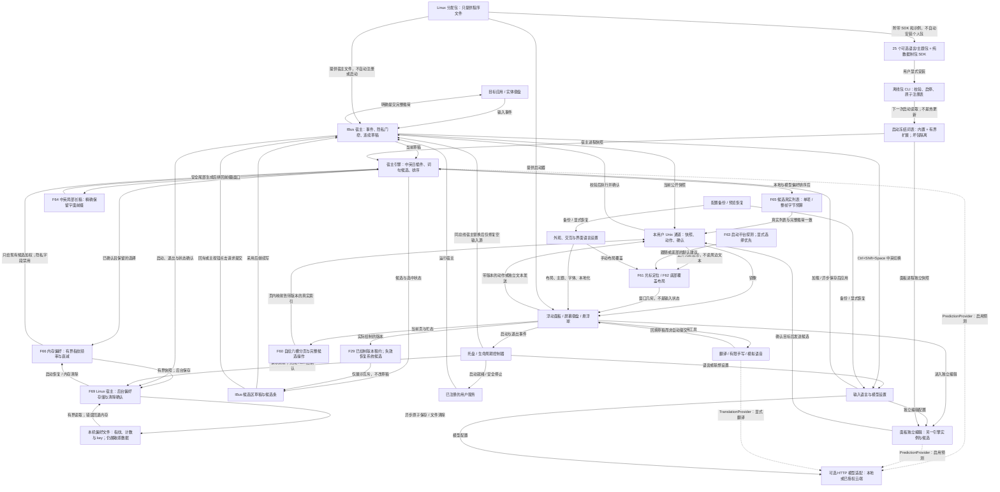

# Suzaku 功能网络与成熟度索引

这里用于定位功能的状态拥有者、实现路径和验证入口；完整评分与证据以
[functional-tensor.json](functional-tensor.json) 为准。模块依赖详见
[架构手册](development/architecture.md)，运行验证见[测试手册](development/testing.md)。

最新代表版本的交付记录见 [0.10.0 发布说明](releases/0.10.0.md)。
逐批词库扩充、旧测试结果和早期网络快照已归入
[重整前完整记录](history/2026-10/pre-reorganization/functional-network.md)，不作为当前状态说明。
本轮只整理文档、归档证据路径与文档工具索引；张量快照摘要相应更新，功能关联与评分不变。
旧快照及全部原始证据保存在[历史张量](history/2026-10/pre-reorganization/functional-tensor.json)。

## 当前能力索引

当前数据包含 **10 个架构域、69 个功能、49 个实现切片、79 条有效关联**，
每条关联有四个评分槽位，展开为 **316 条 COO 记录**，不是 316 个独立功能。
功能 F 编号保持稳定；同一功能可以由多个架构和实现共同承担。

### 四个轴如何读

`T[a, f, i, m] = 0..4 | null`：架构、功能、实现、成熟度维度。
JSON 按 `(a,f,i)` 分组，`m=[I,T,V,O]`；实现记录平台范围、源码和测试，关联记录限制与证据。

| 维度 | 评估对象 | 读取边界 |
| --- | --- | --- |
| I 实现闭环 | 接口、真实路径和失败处理是否接通 | 源码闭环不等于完整产品验收 |
| T 自动化回归 | 从静态/单元入口到专项执行记录 | 历史运行只覆盖其时间、代码与测试范围 |
| V 真实环境验收 | 平台、应用、设备及长期使用 | 当前各格为 `null`，不能从隔离测试推断真人验收 |
| O 交付准备度 | 构建、维护、产物及升级回退 | 精确版本回执另列，不自动覆盖所有实现切片 |

评分是人工序数评估，不是概率或完成百分比；不取平均，也不用 I/T 抵消 V/O 缺口。
缺失坐标表示未枚举或不适用，不能补 0；已有坐标的 `null` 表示未知，不是失败。
`parents` 表示功能拆分，不是调用次序。schema v1 尚不能验证精确快照验收，
因此禁止 I4、T4、V>0、O≥3；发布完成也不会自动提高评分。

### 架构切片

| 架构 | 责任 | 典型功能 |
| --- | --- | --- |
| A01 Linux 原生输入与宿主 | 事件、用途分流、草稿、提交与宿主确认 | F08–F15、F42、F69 |
| A02 引擎、状态与候选策略 | 组合、混排、预算、偏好、快捷键 | F20–F21、F65–F66、F68–F69 |
| A03 语言与离线词库 | EN/ZH/JA、有界长稿、词库与扩展包 | F15–F19、F57–F59、F64、F67 |
| A04 模型与异步任务 | 配置/授权、发现、取消、校验与回退 | F22–F28、F34 |
| A05 IPC 与伴随一致性 | 快照、动作、ACK、目标版本与显示租约 | F14、F29–F30、F65 |
| A06 面板交互与工具 | 独立编辑、手写、语音与回填 | F31–F35 |
| A07 呈现、窗口与本地化 | 窗口、外观、分页、定位与底部模式 | F05、F13、F36–F41、F60–F62 |
| A08 配置、数据与持久化 | 异步保存、路径、备份、恢复和锁 | F42–F49 |
| A09 生命周期、运维与交付 | 单实例、激活/释放、退出、诊断与分发 | F01–F04、F06–F07、F50–F53 |
| A10 跨平台适配 | IMK、TSF、Android 和自动布局策略 | F54–F56、F63 |

## 当前 Rust 模块与职责

当前是单个 Rust crate，不是独立插件进程或多库架构。入口是
[lib.rs](../src/lib.rs)；早期[概念地图](../src/00-Map.md)不与当前目录逐项对应。

| 模块 | 拥有的责任 | 主要边界 |
| --- | --- | --- |
| [ime](../src/ime.rs) | 组合状态、候选、采用/提交、预测 worker 与偏好接线 | 不以候选生成代替系统提交 |
| [languages](../src/languages/mod.rs) | 三语解码、词句补全与局部长稿 | 使用冻结词库，不拥有 HTTP 模型实现 |
| [lexicon](../src/lexicon.rs) / [packs](../src/lexicon/packs.rs) | 有序数据契约、包管理与启动快照 | 不执行包代码，不在按键路径读包文件 |
| [prediction](../src/prediction/mod.rs) | 版本化输入预测、取消与预算协议 | 返回完整草稿替换，不是提交命令 |
| [model](../src/model.rs) | 本地/云部署、发现、HTTP 提供器 | 直接使用预测协议，prompt/policy 仍含语言策略 |
| [languages/translation](../src/languages/translation.rs) | 显式翻译协议、worker 与结果校验 | 与输入预测协议分开 |
| [ime_host](../src/ime_host.rs) | 宿主会话、FFI、装配和 Linux 偏好生命周期 | 其他宿主不自动继承 Linux 验收 |
| [platform](../src/platform/mod.rs) / [IBus 桥](../src/linux/ibus_engine_bridge.c) | 系统事件、隐私、IPC、输出及平台适配 | 平台实现不是完全可互换的纯接口 |
| [panel](../src/bin/panel.rs) / [GPU](../src/ime/gpu/mod.rs) | 原生镜像、独立编辑、工具和呈现 | 面板与宿主分别持有引擎状态 |
| [preferences](../src/preferences.rs) / [data](../src/data.rs) | 频率、文件 worker、配置备份和安全文件操作 | 偏好、个人词包和配置备份是不同数据集合 |

模型规范入口为 `suzaku_map::model`；旧 `languages::model` 仅公开转导出，
私有 [model/legacy.rs](../src/model/legacy.rs) 承担旧联想接口与英文工厂兼容。
`model/translation.rs` 是 `TranslationProvider` 的 HTTP 实现；
共享部署不表示预测和翻译共用一种任务协议。

离线包入口仍为 `lexicon::packs`：私有 `format` 校验数据，`catalog` 合并目录，
`store` 管注册表事务，`runtime` 冻结进程快照。
当前可选目录为 **25 包（EN 8 / ZH 8 / JA 9）**；最多安装 **16 包**，禁用仍占名额。
浏览不等于安装；宿主和面板分别正常重启后读取变更，不支持热加载。
包契约与制包步骤见[离线包说明](../data/offline-packs/README.md)和 [SDK](../sdk/offline-packs/README.md)。

[Cargo features](../Cargo.toml) 目前是 `default = []`、`linux-ibus → gpu`，
[build.rs](../build.rs) 还编译平台桥。空默认 feature 不表示可独立 headless 构建；
开发验收继续使用 `--all-features`，独立 crate 和进一步 feature 拆分不属于现有能力。

## 运行时路由

核心闭环是输入事件 → 连续草稿 → 本地候选 → 可选模型补充 → 采用后继续写或明确提交。
本地候选同步生成，不等网络失败才加载；模型结果须通过请求关联、取消、保护文本和预算检查。
原生草稿归宿主，独立草稿归面板；显示租约只协调候选呈现，不转移草稿所有权。

实线表示实现中的逻辑路径，虚线表示可选模型请求，不是完整调用图。
[独立图源](functional-network.mmd)与下图保持一致。



数字选词和 Space 用于采用/继续编辑，Enter 或候选主按钮请求提交；完整文本由宿主发送，
不能从截断标签重建。动作入队、ACK 或模型返回均不等于目标应用已经保存正文。
Linux 偏好由宿主和后台 worker 协调；含 key 的指纹文件仍敏感，清除须等完成确认。

## 功能分组与实现入口

下表完整覆盖 F01–F69。分组用于导航，不是架构轴的一对一划分；
具体实现范围、各格评分和证据用 `--slice F编号` 查询。

| 分组 | 功能 | 实现入口与边界 |
| --- | --- | --- |
| 启动与生命周期 | F01 单实例启动 | [instance](../src/bin/panel/instance.rs)；重复启动唤出现有实例 |
| | F02 宿主服务联动 | [service](../src/bin/panel/input_method_service.rs)；仅管理已注册服务 |
| | F03 激活并记录原输入法 | [input_method](../src/bin/panel/input_method.rs)；就绪后切换并确认 |
| | F04 释放并恢复原输入法 | 同上；尊重用户已手动切走的输入法 |
| | F05 显隐、收球与关闭到托盘 | [windowing](../src/bin/panel/windowing.rs)；隐藏不自动提交 |
| | F06 安全退出与停止宿主 | [service](../src/bin/panel/input_method_service.rs)；恢复/停止失败须报告 |
| | F07 分层状态诊断 | [suzaku_tool](../src/bin/suzaku_tool.rs)；注册文件不等于运行就绪 |
| 原生输入与草稿 | F08 输入事件和用途分流 | [IBus 桥](../src/linux/ibus_engine_bridge.c)；密码等用途绕过组合 |
| | F09 Compose与死键 | [Compose](../src/linux/ibus_compose.inc.c)；未完成序列不进模型 |
| | F10 连续原文草稿 | [宿主](../src/ime_host.rs)；空格/标点不隐式提交 |
| | F11 导航、选择与采用 | [引擎](../src/ime/core_engine.rs)；页内数字选择，字面数字另有入口 |
| | F12 单步补全撤回与清稿 | [IBus 桥](../src/linux/ibus_engine_bridge.c)；不撤销应用已接收正文 |
| | F13 完整候选精确提交 | [宿主](../src/ime_host.rs)；装饰与省略标签不进入正文 |
| | F14 目标、焦点与隐私隔离 | [原生同步](../src/bin/panel/native_sync.rs)；旧动作不跨目标 |
| 语言与候选 | F15 输入语言注册与切换 | [语言注册](../src/languages/mod.rs)；输入/UI/翻译语言独立 |
| | F16 英文词前缀补全 | [english](../src/languages/english.rs)；有限词库，保护原文 |
| | F17 英文下一词与句子续写 | 同上；固定语境不是通用语法分析 |
| | F18 中文拼音与已转换前缀续写 | [chinese](../src/languages/chinese.rs)；有限拼音词表与续写 |
| | F19 日文罗马音与假名转换 | [japanese](../src/languages/japanese.rs)；无完整形态分析器 |
| | F20 词句混排、权重与来源 | [candidate_mix](../src/ime/candidate_mix.rs)；IBus 最多 12 项，每页 6 项 |
| | F21 信号降级与确认门控 | [core_engine](../src/ime/core_engine.rs)；不表示已接入 XR 设备 |
| 模型与异步任务 | F22 模型配置和显式云授权 | [model](../src/model.rs)；不暗中切到云端 |
| | F23 本机模型自动发现 | [runtime](../src/model/runtime.rs)；发现不等于可按期生成 |
| | F24 模型状态与显式探针 | [模型 CLI](../src/bin/suzaku_tool/model.rs)；区分状态和实际请求 |
| | F25 显式本地模型预热 | 同上；用户显式触发 |
| | F26 异步防抖与过期任务取消 | [prediction](../src/ime/prediction.rs)；过期结果不覆盖新稿 |
| | F27 模型结果验证与候选合并 | [协议](../src/prediction/mod.rs)；结构通过不是语义质量保证 |
| | F28 模型失败、关闭与隐私回退 | [transport](../src/model/transport.rs)；本地输入继续 |
| 面板与工具 | F29 原生镜像与系统候选回退 | [显示租约](../src/bin/panel/native_presentation.rs)；失效恢复系统显示 |
| | F30 屏幕键盘续写与ACK屏障 | [native_typing](../src/bin/panel/native_typing.rs)；等完整宿主结果再续写 |
| | F31 独立编辑与确认发送 | [controller](../src/bin/panel/controller.rs)；失败保留草稿 |
| | F32 有限手写与结果回填 | [handwriting](../src/bin/panel/handwriting.rs)；非通用 OCR |
| | F33 语音工具与转写回填 | [Linux 桥](../src/linux/speech_bridge.c)；Linux 仍为模拟链路 |
| | F34 八语模型翻译 | [翻译](../src/languages/translation.rs)；需模型，无离线词库翻译 |
| | F35 工具采用、取消与失效 | [工具控制](../src/bin/panel/translation.rs)；回填不是提交 |
| 呈现与设置 | F36 内容缩放与窗口适配 | [windowing](../src/bin/panel/windowing.rs)；尺寸与命中同步 |
| | F37 非功能区拖动与吸边 | [controller](../src/bin/panel/controller.rs)；功能区不做拖拽背景 |
| | F38 朱雀与其他主题 | [brand](../src/ime/gpu/brand.rs)；不改变输入语言 |
| | F39 清晰文本与字体回退 | [font_raster](../src/bin/panel/font_raster.rs)；依赖系统字体 |
| | F40 设置布局与窗口装饰 | [settings_scene](../src/ime/gpu/settings_scene.rs)；保留应用关闭入口 |
| | F41 八语界面本地化 | [ui](../src/ui.rs)；静态资源，不翻译用户草稿 |
| | F42 多入口设置同步与确认 | [prediction_settings](../src/bin/panel/prediction_settings.rs)；刷新不是保存 ACK |
| 数据与恢复 | F43 XDG路径与数据状态 | [paths](../src/data/paths.rs)；不扫描输入数据或模型目录 |
| | F44 设置保存和模型重载 | [control](../src/ime_host/control.rs)；异步 I/O 后再校验应用 |
| | F45 白名单配置备份 | [backup](../src/data/backup.rs)；不含正文、权重或密钥值 |
| | F46 备份验证与恢复预览 | 同上；裸 restore 只预览 |
| | F47 配置恢复与失败回退 | 同上；双文件不是断电原子事务 |
| | F48 打开数据目录 | [data](../src/data.rs)；失败返回路径，不重启文件管理器 |
| | F49 运行锁与维护锁 | [files](../src/data/files.rs)；不夺锁或杀个人进程 |
| 交付与其他平台 | F50 Linux分发包构建 | [package-linux](../scripts/package-linux.sh)；不带模型或个人数据 |
| | F51 包内容与文档链接验收 | [包检查](../scripts/test-linux-package.sh)；SHA256 不是来源签名 |
| | F52 安装、注册、升级与移除 | [注册命令](../src/platform/linux_ime_command.rs)；安装不自动激活 |
| | F53 分层CI与发行门禁 | [CI](../.github/workflows/ci.yml)；精确提交、分层验收 |
| | F54 macOS原生IMK实验 | [macOS](../src/platform/macos_ime.rs)；原生运行须单独验收 |
| | F55 Windows TSF预留 | [Windows](../src/platform/windows_ime.rs)；尚无原生提交闭环 |
| | F56 Android原生IME实验 | [Android](../android/README.md)；独立策略，不继承 Linux 验收 |
| 离线包 | F57 离线包契约与小型SDK | [SDK](../sdk/offline-packs/suzaku_pack.py)；仅纯数据 |
| | F58 离线包安装和注册表事务 | [pack CLI](../src/bin/suzaku_tool/pack.rs)；显式启停与原子持久化 |
| | F59 启动冻结扩展词库 | [packs/runtime](../src/lexicon/packs/runtime.rs)；需各进程重启 |
| 交叉能力 | F60 原生候选分页与六槽操作 | [候选场景](../src/ime/gpu/panel_scene_native_candidates_block.rs)；页内真实索引 |
| | F61 光标跟随与屏幕避让 | [native_position](../src/bin/panel/native_position.rs)；按 monitor 非工作区 |
| | F62 底部屏幕布局 | [bottom_layout](../src/bin/panel/bottom_layout.rs)；覆盖窗口，不保留系统区域 |
| | F63 平台探测与自动布局 | [panel_layout](../src/platform/panel_layout.rs)；手动覆盖优先 |
| | F64 中英长草稿局部续写 | [draft](../src/languages/draft.rs)；保留完整前缀，不含日文长稿 |
| | F65 候选字节预算与索引一致 | [companion](../src/ime/companion.rs)；裁真实列表，不只裁标签 |
| | F66 偏好频率学习、衰减与清除 | [preferences](../src/preferences.rs)；只给已有候选加权 |
| | F67 词库数据与算法解耦 | [lexicon](../src/lexicon.rs)；有限 fallback，不是模型质量证明 |
| | F68 人机工程学快捷键方案与组合配置 | [shortcuts](shortcuts.md)；聚焦上下文，不是全局监听 |
| | F69 输入偏好文件存储与恢复 | [persistence](../src/ime_host/persistence.rs)；Linux 默认持久化，其他宿主仍内存 |

## 交汇风险与验证边界

| 交汇点 | 必须同时检查 |
| --- | --- |
| 焦点、隐私与异步任务 | 旧模型结果、工具手势和排队按键不能流入新字段；PRIVATE 不公开镜像/预测 |
| 草稿、候选与正文 | 采用、提交、ACK 和目标应用保存是不同阶段；字面前缀与完整载荷保持一致 |
| 镜像、分页与显示租约 | 页内索引对应当前版本；未绘制或失效租约不能压掉系统候选 |
| 设置、托盘与恢复 | 持久化确认后应用；旧状态不能覆盖新选择；失败保留可恢复状态 |
| 窗口与输入命中 | 缩放、DPI、收球、拖动及候选变化后，几何与点击区一起更新 |
| 偏好与文件锁 | 指纹仍敏感；进程所有权、fork、清除和关闭路径单独验证 |
| 安装与运行状态 | 包文件、用户注册、自启偏好及运行锁分开检查；不把安装视作激活 |

支持范围和未完成能力见[已知限制](known-limitations.md)。
Linux/IBus 的 X11、GNOME/XWayland 路径不等于原生 Wayland、Fcitx 或任意桌面兼容。
八语 UI/翻译不代表八套输入法；有限词库、手写和模拟语音也不代表通用语言或识别能力。
Android 另有显式剪贴板抽屉，不能把桌面“不读取选区/剪贴板”的边界推广到整个仓库。

## 验证入口索引

详细命令、依赖和隔离范围见[测试手册](development/testing.md)。
功能索引只提供入口，实际通过结果应读取对应版本或审计记录，不从测试文件存在推断成功。

| 层次 | 入口 | 检查什么 |
| --- | --- | --- |
| 引擎、语言与协议 | [tests](../tests)、模块单测 | 候选、前缀、采用/撤回、预算与取消 |
| 原生 IBus 与面板 | [test-linux-ci.sh](../scripts/test-linux-ci.sh) | 私有 D-Bus/Xvfb 的事件、镜像、租约和 UI |
| 实际应用与恢复 | [test-linux-apps.sh](../scripts/test-linux-apps.sh) | GTK、浏览器、Qt、编辑器、焦点和重启 |
| 用户服务 | [test-linux-service.sh](../scripts/test-linux-service.sh) | 容器内真实用户管理器、重试与停止 |
| 离线包与 SDK | [offline_packs](../tests/offline_packs.rs)、[发包清单](../scripts/test-offline-pack-shipping.py) | 数据契约、注册表、冻结快照与装包内容 |
| 配置与偏好 | [data CLI](../tests/data_management_cli.rs)、[fork 锁回归](../tests/preference_lock_fork.rs) | 隔离文件、恢复、锁及错误回退 |
| Linux 分发 | [包检查](../scripts/test-linux-package.sh)、[安装检查](../scripts/test-linux-install.sh) | 归档、manifest、干净容器安装/升级/移除 |
| 模型质量 | [显式实模测试](../scripts/test-linux-model-live.py) | 真实请求与采用；合成服务和离线兜底不替代质量验收 |

## 查询与维护

在仓库根目录运行：

```bash
python3 scripts/functional-tensor.py --check
python3 scripts/functional-tensor.py --slice F60
python3 scripts/functional-tensor.py --slice A05
python3 scripts/functional-tensor.py --slice chinese
python3 scripts/functional-tensor.py --coo
python3 scripts/test-functional-tensor.py
```

`--check` 校验引用、坐标、分数、路径和源码摘要，不运行产品测试，也不判断人工评分是否合理。
修改源码后先复核受影响的实现、限制和证据，再用 `--digest` 更新 `snapshot.source_sha256`，
不要盲刷摘要。摘要仅覆盖已登记实现/测试路径，不是整个仓库或 Git 干净状态的证明。

维护时保留已有 F 编号与历史失败记录；新能力优先复用现有编号，必要时在尾部追加。
图只记录逻辑路由，运行历史进入[历史归档](history/2026-10/pre-reorganization/functional-network.md)，
版本交付进入[发布说明](releases/0.10.0.md)，不再把逐批日志追加到本页。
